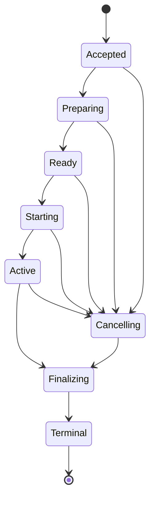

# belt 仕様

仕様版 1.4 / 2026-11-20（1.3: 2026-11-10、1.2: 2026-11-10、1.1: 2026-11-09、1.0: 2026-11-06）/ 実装に向けた提案仕様

この文書は、`belt` を日常の開発で使える状態まで一度に実装するための仕様である。未コミット変更、複数Macへの配置、導入・起動、ログ・成果物、キャンセル、切断・再起動からの復旧を、初回リリースの必須条件とする。実装工程は分けるが、これらが揃う前を実用版の完成とは扱わない。

会話で確定した要求と、この文書で具体化する設計を区別する。以下のコマンド、API、設定名、既定値は新設する仕様案であり、現行リポジトリに存在する機能を示すものではない。

1.1 での変更: 第22章（環境の整合）と第23章（設計判断と基準実装の更新）を追加し、受入条件 A42〜A44 を足した。

1.2 での変更: workerのattempt workspaceをfast-worktreeで作る・消す方針を22.5として加え、依存の準備の担当を第6章・第8章で整理した（`.fast-worktree.toml` を優先し、`[prepare]` は代替）。fast-worktreeを22.4の周辺toolに加えた。artifactの範囲を「同一run内の同じworkflow内」に改めた（第7章・第13章）。lib化後の基準版を task-traffic-controller 0.5.0、local-ci 0.9.0 に更新した（第16・17・21・23章）。基準プラットフォームにLinux（x86_64・arm64）を加え、Google Colab等の常駐しない一時workerと `workers forget` を定めた（第1・4・12・15章）。`.worktreeinclude` に一致するignoredファイルをsecret_filesと同じ経路で自動送付する（第6章・22.3）。受入条件 A45〜A49 を足した。worker の priority（配置の好み）を設定に加え、配置の比較値に補正量として入れた（第5章・A49）。

1.3 での変更: 仕事の呼び名を旧名から `task` に改めた（ID prefix は `task`、旧名の別名は置かない）。local-ciの Task は混同を避けるため `ExecutionTask` と書き分けた。

1.4 での変更: 親をclusterに1つ置く構成をやめ、マシンを対等なメンバーからなる1つのグループとして扱う構成に改めた。どのメンバーも投入でき、runの正本は投げたメンバーだけが持つ。第24章を追加し、第1〜5章、第9〜12章、第15・16章、第18〜20章、第22章の該当箇所を合わせた。グループ鍵による認証とメンバーの追加・削除・鍵の更新（`group`）、投げたメンバーをまたぐ調停と容量による断り、退役の通知、遅いpeerが他を止めない要求（R96）、メンバーの更新（R68）を定め、受入条件 A51〜A54 と A56〜A58 を足した（A50 は `belt exec`、A55 は fast-worktree・portool の組み込みのために空けてある）。

# 1. 製品の目的と確定事項

`belt` は、手元のMacとLAN内の複数Macを使ってCIと開発用コマンドを実行する、単一コマンドの実行基盤とする。利用者は仕事を投入し、配置・待機・実行・回収をツールに任せる。

| 項目 | 契約 |
| - | - |
| 公開コマンド | `belt` に統合する |
| 仕事の呼び名 | `task`（beltが配置する仕事単位。local-ciのJob DAGの `ExecutionTask`（配置可能な実行セッション）とは別概念で、`ci` はCI runを作りその中のJob／ExecutionTask／Shardを `task` にする） |
| 構成 | マシンは対等なメンバーからなる1つのグループを作る。どのメンバーも同じ `belt` で、投入もでき、他のメンバーが投げた仕事も受ける。以下の「親」は、そのrunを投げたメンバー（のcoordinator）を指す（第24章） |
| runの正本 | runごとに1つ。投げたメンバーのSQLiteに置く。合意の仕組みや分散DBは使わない |
| 親の計算資源 | 親自身もworkerとして参加する |
| 実行場所 | 通常、発注側は指定しない。能力・待ち時間・準備時間から親が選ぶ |
| 対象 | `local-ci` によるCIと、一般の非対話コマンド |
| 最初の実用版 | 未コミット入力、動的配置、導入・起動、回収、停止、復旧を含む |

基準プラットフォームはmacOS 14以降のarm64とx86_64、およびLinuxのx86_64とarm64とする（Linuxの追加は2026-11-10の決定）。親のcoordinatorもworkerも両OSで動く。Google Colabのような常駐しない環境は、Linux上の「一時worker」として扱う（第15章）。これは新しい製品の対応方針であり、現時点の動作確認済み範囲ではない。リリース時に対応OS・CPUで検証する。

分散するのは独立して実行できる仕事である。1つの通常プロセスが使うメモリを複数Macのメモリにまたがって確保する仕組みではない。1つの巨大な処理は、実行に必要な資源を持つMacへ配置するか、明示した分割契約によって複数のtaskにする。

# 2. 初回リリースの完成範囲

次をすべて必須とする。

1. `belt ci` と `belt exec -- <command>` が、親と子を同じ候補として扱う。
2. 変更中のソースを固定し、未コミット・未追跡・未pushの内容をリモートでも正しく実行できる。
3. CPU・メモリ・ローカルキュー・実行履歴・転送・setupを考慮して配置する。
4. 未配置の仕事を親に保持し、空いたworkerや途中参加したworkerへ動的に割り当てる。
5. 親からSSHでworkerを登録、導入、起動、停止、更新できる。
6. CLIを閉じても受理済みの仕事とログが失われず、再接続で追跡できる。
7. 切断・ACK消失・親やworker agentの再起動で二重実行を起こさない。
8. 未開始・実行中の仕事を取り消せる。停止確認前に停止済みと表示しない。
9. 必須成果物と終了結果を検証して回収でき、回収だけを再開できる。
10. 既存の `local-ci` と `task-traffic-controller` のCLI互換を維持し、同一ホストの資源予算を二重に作らない。共有scopeでの保証には、後述するtask-traffic-controller runtime更新を必要とする。
11. `needs` を保持したJob DAGと独立Shardを複数workerへ配置できる。長時間テストの自動shardingも初回実用版の対象とする。
12. 実際の2台以上のMacと障害注入で、後述の受入条件を満たす。
13. worker間のツール版・入力ファイルの差を検出し、自動で揃えられるものは揃え、揃えられないものは理由と手順を示す（第22章）。
14. Linux（x86_64・arm64）のworkerを、macOSと同じ契約で常駐・導入・更新できる。常駐しない一時worker（Google Colab等）を、親からSSH経由で使い、消滅を利用者が宣言できる（第15章）。
15. workerのattempt workspaceを、プロジェクトの `.fast-worktree.toml` と `.worktreeinclude` をそのまま使ってfast-worktreeで作り、消す（22.5）。
16. `init` 済みのどのメンバーからでも投入でき、投げたメンバーがそのrunの正本を持つ。1つのworkerがグループの全員の仕事を受け、取り合いを受ける側で調停する。投げたメンバーが1つ落ちても、他のメンバーのrunは残りのworkerの上で続く（第24章）。
17. メンバーであることをグループ鍵で確かめ、メンバーの追加・削除と鍵の更新を2〜5台で無理なく行える（24.2）。
18. 遅い・応答しないメンバーが1台あっても、CLIの応答と他のメンバーとのやり取りを止めない（24.7）。
19. メンバーが自分のresidentを更新でき、失敗したら二重実行を起こさずに元の版へ戻せる（24.8）。

対象外は、投げたメンバーが落ちたrunを別のメンバーが引き継ぐ自動フェイルオーバー、メンバーの自動発見、任意プロセスの途中状態の移送、電源OFFのMacの確実な遠隔起動、任意のGitHub Actions actionへの完全互換、共有メモリ型の分散処理とする。これらは今回の開発目的を定義する境界であり、上記の実用機能を後回しにする理由にはしない。

# 3. 責務と内部構成

| 層 | 担当 | 担当しないこと |
| - | - | - |
| belt CLI | 投入、観察、キャンセル、worker管理 | workerの選択を利用者へ要求しない |
| belt coordinator | durableなキュー、配置、attempt管理、集約、GitHub status | リモートプロセスの資源を親の測定値で代用しない |
| belt worker agent | 受理、入力準備、ローカル実行管理、spool、再接続 | 分散先を独自に選び直さない |
| attempt supervisor | 1つのattemptの寿命、lease、step・サービスの管理 | SSHセッションの寿命に従属しない |
| command supervisor | 1つの重いcommandのadmission、起動、計測、停止 | worker全体のsignal handlerを共有しない |
| local-ci-core | workflow解析、Job DAG、実行可能ExecutionTask／Shardへの分割、CI実行・結果 | ネットワーク配置を所有しない |
| task-traffic-controller-core | 1ホスト内の資源計画、キュー、開始判定、見積もり、計測 | ネットワークや分散リーダーを管理しない |

coordinatorとworker agentは、1つのメンバーの1つのresidentの中で両方動く（第24章）。coordinatorは自分が投げたrunだけを所有し、worker agentはグループのすべてのメンバー（自分のcoordinatorを含む）から仕事を受ける。表の「親」は、そのrunを投げたメンバーのcoordinatorを指す。

`task-traffic-controller` に分散システム全体を入れない。ホスト内の資源制御を再利用可能にし、その情報を `belt` が配置判断に使う。

配布物は原則として1つの `belt` バイナリとする。通常利用で `local-ci` や `task-traffic-controller` の別インストールを要求しない。既存リポジトリから `local-ci-core` と `task-traffic-controller-core` を抽出し、既存CLIもそのcoreを使う薄いadapterとして維持する。依存version・protocol・cache schemaは固定し、配布物に元のライセンス表記を含める。

workerには待受プロセスを置く。ただしLANへ独自の未認証TCPポートを開ける構成を既定にはしない。親がSSH接続を張り、`belt worker --stdio` をUnix socketへのbridgeとして起動する。agentとsupervisorはSSHから独立して動く。親のlocal workerも同じ実行経路を使い、通信部分だけUnix socket直結とする。他のメンバーがSSH越しに使うworkerと、そのマシンのlocal workerは同じ1つのworker agentである（24.1）。

attempt supervisorは、attemptごとに同じ `belt` バイナリを別プロセスとして起動したものとする（第23章）。

# 4. 利用者が使うコマンド

## 初回セットアップ

```sh
belt init
belt workers add mini-a --ssh ci@mini-a.local --install
belt workers add mini-b --ssh ci@mini-b.local --install
belt doctor
```

`init` はそのマシンを、coordinatorと自分のlocal workerを持つメンバーとして構成する（macOSはLaunchAgent、Linuxはsystemdのuser service）。グループにまだ属していなければ、そのマシンだけのグループ（IDと鍵）を作る。1台だけならこれで使える。`workers add --install` はSSH接続、互換バイナリ転送、service登録、起動、能力検査を実施する。親が送るのは、workerのOSとarchが親と同じときは親自身のバイナリ、違うときは `--binary <path>` で指定した、そのworker向けのbuildである（指定が無ければ、必要なtarget tripleを示して断る。第15章）。`workers add` は相手を自分のグループのメンバーにし、グループのIDと鍵を渡す（24.2）。相手が別のグループに属するときは断り、`--move` を明示したときだけ移す。相手が既にbeltを持つマシンなら、2つ目のworkerを導入しない（`--install` を付けても同じ。版が合わないときは `workers upgrade` を案内して止まる。第15章）。再実行は冪等とし、途中失敗を再開できる。SSHのRemote Loginと認証が利用可能であることは前提とする。OSの権限やライセンス同意が必要な環境導入は、必要な操作と検出した不足を明示する。

## 日常の利用

```sh
belt ci
belt ci plan
belt ci --snapshot commit --ref HEAD

belt exec -- pnpm test
belt submit -- cargo test

belt ls
belt show <run-or-task-id>
belt logs <id> --follow
belt wait <id>
belt cancel <id>
belt retry <id>
belt outputs <id> --dir ./belt-results
```

どのメンバーからでも投入できる。ふだん使わない方のPCで `belt ci` を実行すれば、そのPCがそのrunを投げたメンバーになり、自分と、設定に書いた他のメンバー（ふだんのmain PCを含む）へjobを配る（24.1）。これらのcommandが扱うのは、自分が投げたrunだけである。

`ci` はCI runを作り、その中のJob／ExecutionTask／Shardをtaskにする。`exec` は原則1つのtaskを作り、結果まで待つ。`submit` は非同期投入で、親が入力snapshotと実行仕様を永続受理した後にIDを返す。workerでの受理や実行開始までを保証する応答ではない。

通常のCLI終了・ターミナル切断はキャンセルを意味しない。foregroundの `exec`／`ci` に対するCtrl-Cは明示的なキャンセル要求として扱い、停止確認を待つ。接続できなければ `cancel_requested / unknown` と表示してIDを残す。`retry` は停止または終了を確認したterminal attemptに対して、新しいattemptを作る。同じrunのretryは元のsource snapshotを使う。現在のファイルで試すときは新しいrunを投入する。

機械向けには各操作へ `--json` を用意し、`schema_version`、ID、状態、error codeを返す。進捗はstderr、構造化結果はstdoutとする。`exec`／`wait` は正常終了なら0、コマンド失敗なら可能な範囲で元のexit codeを返す。signal、入力不備、通信未確定、成果物回収失敗はJSON上で区別する。CLIプロセスの終了コードだけをjobの確定状態と見なさない。

## workerの管理

```sh
belt workers
belt workers start mini-a
belt workers drain mini-a
belt workers resume mini-a
belt workers stop mini-a
belt workers upgrade mini-a
belt workers diff mini-a
belt workers sync mini-a
belt workers forget colab-1
belt estimate --json -- pnpm test
```

相手のマシンは他のメンバーの仕事も受け、自分でも投入する（第24章）。`drain`・`resume` はそのworker全体に働く。`stop` はそのマシンのresident（両方の役割）を止める操作なので、相手が他のメンバーの仕事か、自分で投げた非terminalのrunを持つときは、理由を示して断る。`stop --all-submitters` を明示したときだけ、drainの後に止める（そのマシンが投げたrunは、process停止と同じ扱いになる。24.6）。`stop --cancel-running` も同じ条件で `--all-submitters` を要する。`start` はresidentを起動し、両方の役割が戻る。`forget` は、一時workerのほか、鍵の更新で外したメンバーにも使える（24.2）。

`drain` は新規配置を止め、受理済みの仕事は完了させる。通常の `stop` はdrainして終了を待ってから停止する。即時停止は `stop --cancel-running` で明示し、停止確認まで追跡する。到達不能なら停止済みにはしない。`upgrade` は `workers upgrade <worker> --binary <path>` で、親とOS・archの違うworker向けのbuildを指定できる。`diff`／`sync` は第22章で定める。`forget` は、到達できなくなった一時workerの消滅を利用者が宣言する操作で、第15章で定める。一時workerは `workers add <worker> --ssh <dest> --ephemeral` で登録する。

## グループの管理

```sh
belt group
belt group rotate-key [--remove <member>] [--skip <member>]
belt group send-key <member>
belt upgrade
```

- `group` は、グループのID、鍵の世代、自分の名前と、メンバーごとの状態（接続、鍵が合っているか、自分が置いている仕事と受けている仕事の件数）を示す。
- メンバーの追加は `workers add` で行う。削除は `group rotate-key --remove <member>` で、一覧から消して鍵を更新する。メンバーごとの信頼の登録・取消の操作は無い。鍵の更新はSSHのアクセスを取り消さないので、外したマシンのSSH鍵を消す手順を表示する（24.2）。
- `group rotate-key` は、既に次の鍵を持っていれば、同じ指紋の鍵で途中から更新を再開する。相手が別の指紋の次の鍵を持つ場合は断る（24.2）。
- `group send-key` は、鍵の更新に取り残されたメンバーへ今の鍵を送り直す。
- `upgrade` は自分のマシンを更新する（24.8）。

表示は最低限、worker、能力、接続状態、running／waiting、資源予算、予測の品質を含む。taskには担当worker、実行段階、ローカル待ち時間、見込み完了時間、source ID、attempt IDを表示する。未知の時間を0秒と表示しない。

# 5. 設定と能力の照合

マシン・SSH・serviceの情報はユーザー設定へ置き、プロジェクトには必要能力と実行契約を置く。

ユーザー設定例：`~/.config/belt/config.toml`

```toml
schema_version = 1

[coordinator]
local_worker = true
local_worker_priority = -1   # 手元のMacは後回し（既定0、-100〜100、大きいほど優先）
heartbeat_seconds = 5
lease_seconds = 60

[scheduler]
strategy = "earliest_finish"
forecast_ttl_ms = 2000
prefetch_per_worker = 1
priority_step_seconds = 60   # priority 1段 = 60秒分の補正（既定60、0〜3600）

[defaults]               # プロジェクトが上書きできる既定値（最も低い設定層）
timeout_seconds = 3600
toolchain_match = "exact"

# メンバーの一覧。このマシンが仕事を配る相手を書く。自動発見はしない（第24章）
[[workers]]
id = "mini-a"
ssh = "ci@mini-a.local"
service_mode = "user"
binary = "/srv/ci/.config/belt/bin/current/belt"  # `workers add --install` が書く、worker上の絶対パス
priority = 10            # 最優先のworker
labels = ["macos", "arm64", "node"]

[[workers]]
id = "mini-b"
ssh = "ci@mini-b.local"
service_mode = "system-user"
labels = ["macos", "x86_64", "node", "docker"]

[[workers]]
id = "colab-1"
ssh = "colab-1"          # 利用者が用意したトンネルを指すssh設定の別名
ephemeral = true         # 常駐しない一時worker（第15章）
priority = 0
labels = ["linux", "x86_64", "node"]
```

プロジェクト設定例：`.belt.toml`

```toml
schema_version = 1

[source]
mode = "worktree"
include = []
exclude = ["belt-results/**"]
secret_files = [".env.test", "packages/*/.env.test"]

[execution]
profile = "web-dev"
requires = ["macos", "node"]
pass_env = ["CI"]
timeout_seconds = 3600

[toolchain]
match = "exact"

[ci]
workflows_dirs = [".github/workflows"]
no_cache = ["ci.yml", "e2e.yml:browser"]   # 結果を再利用しないworkflow、またはjob
status_context = "local-ci"
unsupported = "error"

[[outputs]]
name = "test-results"
paths = ["test-results/**", "coverage/**"]
required = false
when = "always"
```

`[[workers]]` がメンバーの一覧である。beltはここに書かれたマシンだけへ仕事を配り、LAN内のマシンを自動で探さない。`id` は相手のメンバーの名前と一致させる。一覧はメンバーごとのもので、他のメンバーの一覧と一致している必要は無い。グループのIDと鍵は設定fileには書かず、`init`・`workers add` が置くstateに持つ。`[coordinator] max_active_task` と `[scheduler] prefetch_per_worker` は、自分が配るときの上限であると同時に、このマシンのworkerが他のメンバーへ答える受付窓でもある（24.4）。

設定の優先順位は、明示CLI引数、プロジェクト設定、ユーザー設定、既定値とする。旧 `.local-ci.toml` は対応する項目のfallbackとして読む。両方で矛盾する設定は出所を表示し、黙って片方を無視しない。未知の設定名はerrorにする（`secret_files = [{ glob = ".env", requird = true }]` のように表の内側の綴り誤りも、キー名と位置を示してerrorにする）。

ユーザー設定の `[defaults]`（`timeout_seconds`、`toolchain_match`）は、プロジェクトが書かなかったときの値で、優先順位は「明示CLI引数、プロジェクト設定 `[execution] timeout_seconds` と `[toolchain] match`、`[defaults]`、既定値」とする。ユーザー設定が決めてよいのはこの2項目だけで、`requires`・`secret_files`・`outputs` 等のプロジェクト固有の契約は置けない。

`.local-ci.toml`（local-ci 0.9）の項目は次のとおり扱う。list項目は、順序と重複を無視した集合として比べて矛盾を判定する。

| `.local-ci.toml` | 扱い |
|---|---|
| `workflows-dirs` | `[ci] workflows_dirs` のfallbackとして読む |
| `[source] include` / `exclude` / `secret_files` | 同名の `[source]` 項目のfallbackとして読む |
| `no-cache` | `[ci] no_cache` のfallbackとして読む。対象は `ci.yml`（workflow）または `ci.yml:e2e`（job）。実際の効果は第8章 |
| `link-node-modules` | 対応しない。値があるときだけ `ci plan` と `doctor` がnoticeとして表示する（依存の準備はfast-worktreeの `[[clone]]` が担う） |
| `[setup] ignore-env` | 同上 |

liveness設定は、heartbeat < lease、stale ≥ heartbeat × 2、lease > stale（stale < lease）を検査し、破れる組み合わせはerrorにする。値は0を許さない。一時worker（`ephemeral = true`）はserviceを持たないため、`service_mode` を書くとerrorにする。

workerが申告する能力には、OS・arch・実行user・有効なprofile、tool version、Docker実行可否、利用可能disk、資源予算、protocol、feature flagsを含める。profileは実行PATH、shell、必要tool、許可するenv・secret参照、cache条件を定義し、内容のdigestで識別する。ラベルだけで実際のtool検査を代用しない。

配置前に能力を絞る。候補がないときは `blocked: no_compatible_worker` とし、不足能力を表示する。同じリポジトリであってもarm64用の依存cacheをx86_64で使わない。Rosetta等の別実行環境は別profileとする。自動導入で解消できる不足は、第22章の手順で導入してから候補に含める。

## 5.1 worker-local profile と generic requirements の実行契約

worker は private な `<worker_state>/profiles.toml`（schema_version=1、`active`、`[profiles.<name>]`）から resident ごとに 1 つの active profile を選ぶ。ファイルは symlink を追わず同じ FD から読み、所有 UID・private permission・通常ファイル・64KiB 上限を検証する。active が定義されていない場合は起動を拒否する。ファイルが無い場合は既に保存された worker env の PATH・SHELL（省略時 `/bin/bash`）から default を合成して通常どおり hash する。project の `[execution] profile` と CLI の `--profile` は worker の active 名を照合する selector であり、worker identity を指定したり環境へコピーしたりしない。profile 変更は drain/restart を伴う operator 操作とする。

profile は絶対 `path` 配列、絶対 `shell`（bash/sh/zsh）、`env` の非 secret 定数、`allowed_env`、`required_tools`、`cache_namespace` を定義する。`secret_refs` が空でなければ安全な provider が未接続である旨を起動時に返す。任意の source/script probe と install adapter はこの schema では受け付けない。自動導入抑止の env は [Corepack](https://github.com/nodejs/corepack/blob/main/README.md)、[rustup](https://rust-lang.github.io/rustup/environment-variables.html)、[mise](https://mise.jdx.dev/configuration/settings.html) の設定に従う。明示 profile では command/setup env は operator の allowlist に従う。合成 default は既存の通常 command env を許す。いずれも PATH・SHELL・HOME・TMPDIR の異なる上書きを拒否し、同じ値の指定は許す。暗黙の版導入は許可せず、Corepack の network/auto-pin/latest/download-prompt、rustup の auto-install、mise の auto-install を無効化する env を固定し、task から異なる値で上書きできない。probe、Machine、setup、consumer は同じ active PATH/env を使用し、shell を省略した setup は profile の絶対 shell を login/rc 読み込みなしで実行する。

`requires`（CLI は繰返し/カンマ区切り `--requires`）は AND 条件とし、重複を除く。bare の `macos/linux/windows`、`arm64/aarch64/x86_64/amd64`、`node/npm/pnpm/yarn/rustc/cargo/flutter/dart/xcode/git/portool/fast-worktree/docker`、同じ登録済み値の `os:/arch:/tool:`、登録済み protocol feature の `feature:worker_capabilities_v1/blob_resume/log_resume` を受け付ける。arch は aarch64/x86_64 に正規化する。unknown bare/prefix/tool/feature は invalid input とする。ラベルは tool 検査の代わりにならない。この generic requires は version constraint ではなく、版の宣言・照合・導入は §22.1 に従う。

tool は profile PATH で実行可能な実体を解決し、固定 argv・env_clear・private probe cwd・各 300ms・stdout/stderr 各 8KiB の上限で版を検査する。所有する子 process group だけを終了し reap する。resident の起動時（profile 読み込み時の required tool の検査と、baseline を公開する最初の report）だけは、各 tool の結果が確定（available / unavailable / 失敗による unknown）するまで測る。1 回の呼び出しは 2 秒まで待ち、時間切れになった呼び出しだけを tool ごとに最大 3 回、全 tool で共有する 5 秒の範囲で繰り返す。共有時間を使い切った後も各呼び出しは 300ms は待つので、待ちの上限は読み込み・起動 report それぞれ 5 秒 + 固定 14 呼び出し × 300ms = 9.2 秒である。失敗や解析不能は確定した結果であり繰り返さない。それでも時間切れの tool は unknown のまま公開し、baseline の公開後に観測できた場合は profile の drift として扱う（再起動まで worker を block する）。Docker は `info`、Xcode は選択済み SDK path の確認も必要で、binary の存在だけでは available としない。public report へは検証済み版と identity digest を出し、環境の値や private path は出さない。未観測の disk/budget は unknown とし、available/0 を捏造しない。Flutter launcher と Dart の bootstrap wrapper は版の問い合わせでも SDK 導入が発生し得るため、S20 の noninstalling adapter が接続されるまでは Unknown として扱う。native Dart binary は通常の固定 probe を使う。

`worker_capabilities_v1` を hello で交渉し、hello/inspect に optional report を含める。制約がある task は有効な report がない旧 peer へ配置しない。制約は TaskSpec と AttemptPayload に保存し、plan/payload digest に含め、retry は元の条件を保つ。空の条件は JSON から省き、旧 payload の canonical JSON/hash を保つ。durable requirements を知らない旧 binary の再開を防ぐため、coordinator/worker DB の schema version に semantic compatibility fence を設ける。readonly 旧 schema は migrate せず、配置診断用 index が無ければ placement を返さない。性能だけのための index（placement の未 ACK、attempt の生存）は feature marker を持たない。version の増加で旧 binary が拒否され、readonly の旧 schema は index が無いだけで同じ結果を返す。constrained submit は private resident IPC v3 を要求し、requirements を知らない旧 owner に条件を落とされないよう受理前に拒否させる。制約なし IPC は v2 のまま保つ。Coordinator は forecast 前に同じ pure predicate で候補を絞り、除外された worker ごとの不足と `no_compatible_worker` を配置記録へ残す。公開 Task metadata に最新の placement を含め、最大 4 worker × 各 4 不足（各 128 文字）へ明示 truncate する。受理済み/取消済み task へ古い待機理由は表示しない。worker も新規受理時と workspace 準備直前、長い setup 後に再検査する。受理済みの同じ attempt/hash の replay は元の応答を保つ。

実測 profile fingerprint は worker-local identity であり、別 host に同じ絶対 path/digest を要求しない。profile 名と実 requirements で照合する。受理時 fingerprint は worker の private durable metadata、setup/template、artifact、TTC history に固定する。tool/report drift は新規 report を無効にし、古い template や異なる実環境で実行を続けない。 startup report で Available だった tool の一時的な Unknown は、shell・PATH 上の実行ファイル identity が不変なら startup fingerprint を保持する。ただし現在の report は Unknown のままで、requires・profile の required_tools・固定 native baseline を満たさない。既知の版/identity の変化、実行ファイルの変化、startup Unknown から Available への変化は新 identity として扱い、同じ owner の既存 fingerprint では受理しない。再起動後も旧 attempt の実 identity を書き換えない。版管理 shim が project の版ファイルを読む場合の具体版 activation と baseline は §22.1 の必須残件であり、この generic probe だけで version matching の完了とはしない。


# 6. 入力snapshotと作業ディレクトリ

## 既定は現在の作業内容

`belt ci` と `belt exec` は、既定で呼び出し時のworktreeを固定する。commit済みの内容だけを実行するときは `--snapshot commit --ref <ref>` を明示する。既存の単独 `local-ci run` の既定動作は変更しない。

worktree snapshotには、追跡済みファイルのstaged／unstaged変更、削除、実行bit、binary、symlink、gitignore対象外の未追跡ファイルを含める。tracked fileはignoreに一致しても収集し、ignoredな未追跡ファイルは明示したincludeだけを追加する。`secret_files` と `.worktreeinclude` に一致するignoredファイルはsnapshotに含めず、第22章の別経路で扱う。コピー対象の拡張は `ci plan`／dry-runで確認できる。原本のworktree、index、branch、refsを書き換えない。

収集と検証の手順は次とする。

1. HEAD、index tree、論理branch、base・merge-base、収集対象一覧を記録する。
2. 内容をprivateなobject storeへ取り込み、path・mode・size・hashのmanifestを作る。
3. 内容とGit metadataを再検証し、収集中の変更を検出したら最大3回まで再試行する。
4. 安定した内容が得られた場合だけ、manifestをatomicに公開して `source_id` を確定する。
5. 確定できなければ `SOURCE_BUSY` とし、workerへdispatchしない。

これは検証付きのcopyによる固定であり、編集が並行するファイルシステム全体の厳密な同時点snapshotを保証するものではない。1つのrunでcaptureするのは1回とし、途中参加worker、再配置、再接続、retryも同じ `source_id` を使う。

## Gitの実行文脈

`SourceManifest` は少なくとも次を保持する。

| フィールド | 意味 |
| - | - |
| source_id / manifest_digest | 入力内容を固定するidentity |
| repository_id | ホストの絶対pathに依存しないrepo identity |
| source_kind | worktree、commit、directory |
| original_head / index_tree / worktree_tree | 元のGit状態と固定した内容 |
| execution_commit | CI用に作るsynthetic commit、または指定commit |
| base / merge_base / branch | 差分・条件式のための論理文脈 |
| cwd_relative | repo rootからの相対作業path |
| object_manifest | 未pushのcommitを含む必要Git objects |
| submodules / lfs | 固定したrevisionと必要payload |
| secret_files | 第22章のsecret bundleのHMAC digestとpath一覧（`.worktreeinclude` 由来を含む。内容は含めない） |

generic execでは可能な範囲でHEAD・index・worktreeの区別を再現し、`git diff` と `git diff --cached` が元の変更を表せるようにする。CIでは同じcaptureからsynthetic commit viewを作り、その内容でworkflow・config・changed filesを解釈する。元HEADやbranchの論理文脈は別フィールドで渡す。

必要なGit objectsとbase履歴をbundle等で転送する。workerが移動中のorigin branchをfetchして入力を決め直す方式は使わない。workerのcanonical cloneはoriginを持たず、最初のbundleを受け取るときに作る。bundleはsourceごとに1つで、親は、workerが `blob_verify` で答えた「cloneが履歴ごと持っているcommit」（`have`）より下を除いて作る。`have` が空なら、execution commitの全履歴を入れる（第11章）。`have` はworkerが決める値なので、親は形式の合わないものを捨て、256個までしか見ない。親のstoreに置くbundleのファイルは `have` の集合ごとに1つで、1つのsourceにつき4つまでとし、超えた分は古いものから消す。workerがそのsourceを持った（`blob_verify` の `ready`）とき、または転送をあきらめたときに、そのsourceのbundleのファイルを全部消す。親は1つのworkerと1つのsourceについて、bundleを最初の1回と `bundle_base_missing` を受けての作り直し2回までしか作らず、それでも合わなければその転送を失敗にする。（このうち、sourceごと4つの上限はstoreが守る。`ready`・あきらめたときの削除と作り直しの回数の上限は、親の送信側が守る規則で、送信側はまだ実装していない。）未pushのHEADも実行できる。submoduleとGit LFSは、固定revisionと実体をmanifestに含める。dirty submoduleは再帰capture、LFS payload不足は実行前errorとする。

worktreeのraw bytesとGitのcanonical blobを区別する。LFS、clean／smudge filter、改行変換を経た実際のmaterialized fileがmanifestのhashと一致することを検証し、capture済み内容へfilterを重複適用しない。pathはlosslessに扱い、shell文字列連結やlossyな文字コード変換で収集対象を変えない。

symlinkはlink値を保持し、取り込み時にrepo外を自動追跡しない。repo外入力が必要なら入力として宣言して相対mountへ配置する。FIFO・socket・device等の非通常ファイルは明示errorにする。source／artifactの展開では絶対path、`..`、symlink traversalによる管理領域外への書込みを拒否する。

## workerでの準備

workerはrepoごとのcanonicalなlocal cloneと、attemptごとの隔離workspaceを持つ。親の絶対cwd、`.git` のworktree参照、準備済み `node_modules`、venv、絶対symlinkをそのまま移送しない。依存はworker自身のprofileで準備する。

Git外のgeneric execにはdirectory snapshotを提供する。sourceが不要な管理コマンドも明示できるが、通常実行から黙って入力を省略しない。元の手元ディレクトリを直接更新する用途には `exec --in-place` を用意し、親local workerだけを適合候補とする。通常の分散実行で、生成物を元worktreeへ自動で上書きしない。

`in-place` は明示的な別workspace modeである。記録するsnapshotは比較用baselineで、実行入力の不変性は保証しない。remote配置、結果cache、既定の自動retryを無効にし、表示・結果でもsnapshot実行と区別する。

`exec --in-place` はGit worktreeとGit外directoryの双方を対象とする。Gitでは元worktreeのrootを保持し、元cwdからの相対pathでcommandを実行する。親local workerのidentityとrun/source/manifest digest、canonical rootのdevice/inodeを親state内の0600 bindingに保持し、rootの差替えや別workerへの配置を拒否する。原本pathは転送payloadや公開queryへ含めず、task/completionの `in_place: true` でmodeを示す。setup templateの適用・builder起動を行わず、prepare commandsは原本で通常commandとして実行する。workspace cleanupで原本を削除しない。

明示 `retry` は通常と同じterminal・停止確定・回収・control revisionの条件を満たした場合だけ、同runの新attemptとして同じ原本を再実行する。baselineは作り直さない。元のsecret globs契約はprivate bindingに保持し、現在のproject configを再loadしない。原本secretはbounded/no-followのread-only処理で実行時の値をmaskし、bundleの配置・chmod・消去を原本へ行わない。元globsと現在の `.worktreeinclude` が選ぶpath集合がbaselineのsecret inventoryと違えば実行・retryを拒否し、新しい `exec` によるbaseline作成を求める。値の変更だけなら現物をmaskして実行でき、元Vault bundleの消去は妨げにならない。例外は1つで、CIのsplit Jobのfail-fastが一度も配置しないままcancelしたShardは、停止を証明するattemptが無くてもretryできる（何も実行されていないため）。attemptを持たないそれ以外のtaskを含むretryは断る。

private bindingはowner再起動と明示retryのため親stateとともに保持する。binding自体はbaseline sourceや結果のGC pinではなく、元sourceが消去されたrunはretryできない。現段階ではbindingの個別GCは行わず、親stateの削除まで保持する。bindingやrunの取消・workspace cleanupは原本の削除を意味しない。

依存の準備は、プロジェクトの `.fast-worktree.toml` の `[[clone]]`（と `post_add`）が担う。attempt workspaceをfast-worktreeで作る方針と、`.worktreeinclude` の扱いは22.5で定める。第8章のSetupRecipeとtemplateは、workflowのsetup stepの再利用に限る。`.fast-worktree.toml` を持たないプロジェクトでは、第8章の `[prepare]` が代わりを務める。両方がある場合は `.fast-worktree.toml` を優先し、`ci plan` が準備の出所（`fast-worktree` / `[prepare]` / workflowのsetup step）を表示する。

# 7. CI計画と分散単位

## FrozenPlan

親は入力snapshotに対して一度だけ計画を作り、`FrozenPlan` として固定する。workflow選択、無効化の判断、config、差分、branch、base、job filter、Job DAG、ExecutionTask／Shard、依存、実行条件を含める。workerはこの計画を実行し、同じ引数で `local-ci run` を再度解釈し直さない。

実行中のneeds outputによるdynamic matrixや条件式は、依存出力が得られた段階で評価する。提出時点に全variantの値が分かっているとは扱わない。展開結果を永続eventとして固定し、再接続で別の展開を行わない。

## Job DAG・ExecutionTask／Shardと配置の境界

現行local-ciのUnitは、needs関係や実行環境を共有するJobをまとめている。新しいplannerはUnitを唯一の配置単位とはせず、Workflow → Job DAG → ExecutionTask／Shard の階層を作る。`needs` は同一ホストへの固定ではなく、先行Jobの結果・output・artifact確定を要求する依存辺とする。Job間のworkspace共有はGitHub Actionsの通常の独立Job意味論に従い、暗黙のファイル共有を仮定しない。必要なデータは明示artifactまたは契約化したimmutable inputとして渡す。中間artifactの範囲は、同一run内の同じworkflow内に限る（第13章）。worker側で `-j` を再解釈して先行Jobを重複起動しない。

**未配置のJob／Shardは動的に配置できる。配置された実行セッション（workspace・service・step状態を持つ単位）は開始後、同じhostに固定する。** `needs` の先行Jobが別hostで完了しても、結果と必要artifactが親で確定した時点で後続Jobを別workerへ配置できる。同一Jobの任意の連続stepを、workspaceの状態転送なしで別hostへ移動しない。受理済みだが未開始のattemptを再配置する場合も、元workerのretireと停止確認を要する。

run開始時に全Unitをworkerへ押し込まない。親に未配置backlogを残し、workerごとの先行受理枠を制限する。既定の `prefetch_per_worker = 1` は、実行セッション開始前の先行taskを1件に制限する値であり、実行中step数やCPU budgetとは別である。実際のstep並列数はtask-traffic-controllerのadmissionとCIのconcurrency規則に従う。

### 分割モデルと決定規則

`FrozenPlan` は `JobGraph`（workflowのJobとneeds辺）と `ExecutionTask`（配置可能な実行セッション）、`ShardGroup`（分割元Jobと集約契約）を持つ。各ExecutionTaskのID、実行条件、必要input／artifact、workspace policy、サービス、資源見積、retry policy、出力検証を固定する。Jobの内部stepは原則同一ExecutionTaskに置く。runner adapterが入出力の独立性を証明できるテスト部分だけ、元Jobを複数ExecutionTaskへ展開できる。

分割可能性の判断は「runnerがテスト集合を列挙できる」「各Shardで正しく対象testを指定できる」「Shard間で共有状態を競合更新しない」「必要fixture／DB／serviceを独立提供できる」「集約結果が元のJob判定と一致する」の全条件とする。単にscript名に `test` が含まれるだけでは分割しない。splitできない理由は `belt ci plan` に出す。

### 自動shardingの実装契約

初回版はJest・Vitest・Playwright・Cypress・`cargo test` のうち、対象プロジェクトで実際に使うrunnerをadapterで認識する。adapterは `discover`、`partition`、`invoke`、`collect`、`merge` を備え、runnerのversion・設定・filter／tag／skip条件を保持する。サポート不能な機能を推測で分割せず、安全な単一ExecutionTask実行へfallbackする。選択されなかったtestや失敗したtest discoveryも明示する。

partitionは各テストファイル（またはrunnerの安全な分割単位）の履歴時間を使い、予測完了時間の長いものを優先して、worker性能補正後の各Shardの推定負荷が均等になるよう割り当てる。初回実行や履歴不足時は安定した名称順と決定的hashによるfallbackを使う。同じsnapshot、runner version、shard plan、履歴snapshotなら同じ分割になる。極端に小さいtaskはsetup・転送の固定費を考慮してまとめる。shard数はworkerの実効容量、CI全体の残りDAG、並列上限に応じて決定する。

同一テストが異なるShardに重複しないこと、対象全件を一度だけカバーすることをmanifestの集合検証で保証する。テストの動的生成などで事前列挙が不完全なrunnerではrunner固有の安全なshard機能だけを使う。DBを共有するE2Eはdatabase／schema／port／containerをShardごとに隔離できないなら分割禁止とする。

### 結果集約・失敗・再試行

Shardの結果は `job_id / shard_id / test_identity` で集約し、assertion数、failed／skipped test、coverage、JUnit等のartifactを重複・欠落検証する。coverage mergeはrunner対応方式だけで行い、単純な数値加算で代替しない。元Jobの `needs` outputと後続の開始判定は、ShardGroup全体が終了し集約が確定した後に公開する。fail-fastは親が残りShardへのcancel要求を発行し、停止確認と中途結果を残す。retryは失敗Shardを同じsnapshotで新attemptとして実行し、通過済みShardの検証済み結果を保持できる。ただしrunner固有の非冪等テストでは明示的なretry許可が必要。

beltの親の実装（S18）: split済みのShardGroupを持つFrozenPlanのShardを、依存を持たないtaskとして並べて配置する。全Shardが終わると `local_ci::complete::aggregate_shard_group` とoutputの一致でJobのoutcomeを1つ作り、後続taskのinputsにはそれだけを渡す（Shardの順で作り、到着順は使わない）。receiptはtaskとJobの名前が合うものだけを数える。全Shardが成功でも、欠落・重複・不一致が有ればJobはfailureになる。`fail_fast` のShardGroupでは、失敗したShardを見つけた進行のpassが、終わっていないShardのcancelを1回だけ要求する（未配置は理由付きのcancel、配置済みは対象attemptと理由を `ci_fail_fast_requested` に記録し、coordinatorがcancelを届ける）。retryは既存の `retry` で、成功したShardのattemptと結果を残し、それ以外だけを新attemptにする。retry対象の後続taskは再び保留し、親Jobの新しい集約結果をneedsに渡してから配置する。run単位のretryでは成功済みの後続taskも保持する。fail-fastで一度も配置されないままcancelされたShardはattemptを持たないが、retryの対象とし、cancelを外してqueueへ戻す。Jobのoutcomeは集約した時点でShardの行に残し、runの結果はこれを読む。集約前のrunは確定せず、集約がfailureならattemptが全部成功でもrunは失敗（exit code 1）になる。`ci`・`wait`・`show`・statusは同じ結果を読む。task単位の結果（`wait <task>` など）はShard自身のattemptの結果で、Jobの集約を待たず、集約のfailureも反映しない。runの失敗の原因は、fail-fastで止められただけのShardではなく実際に失敗したtaskとする。単独でcancelされた別Jobのtaskも原因にせず、止められたShardやそのtaskのIDが先に並んでも、runは失敗したShardのexit codeを返す。run全体をユーザーがcancelし、そのcancelがまだ終わっていないShardを止めた場合は、Shardのreceiptに失敗したtestが有っても（attemptが失敗でも成功でも）、Jobの集約がfailureになっても、taskのIDの並びに関わらずrunはcancelled（exit code 130）で終わる。fail-fastが残りを止めてrunが失敗で確定した後に届いたcancelは、結果を変えない（cancelの要求時刻をrunのcancelの時刻と比べる。同じミリ秒ならrunのcancelが止めたものとして扱う）。completionの `cancel_requested`、最初の失敗、exit codeは同じ結果を示す。retryは、attemptが成功でも単独で通過と言えないShard（receipt無し、testの失敗、渡されたtestの報告の過不足）をやり直す。この印はretryがrunの全taskを読み終えてからJobのoutcomeと一緒に外すので、taskの数が走査の1ページを超えても同じShardを選ぶ。`ci` はShardごとの行とJobの行を出す。複数の実行枠がある場合、本番の `ci` は候補Jobの通常taskを保留し、`ci_discovery_v1` を交渉したworkerでsetup・runner version確認・列挙を行う。`needs` を持つJobの探索には、上流Jobの集約後に得たoutputを渡す。親は列挙結果と元planの対応を検証し、同じsnapshotを参照する確定済みの分割を永続化する。列挙不能、または応答した候補workerがすべて探索機能に非対応なら元のJobを実行する。matrixを含むrunでは、SDKの再生可能なjournalを開始する前に、独立したJobの列挙結果を確定する。確定したShardの実行workerは、setup後の実行ディレクトリでrunner versionを再照合する。不一致・取得失敗時はテストを開始せず、stepログに理由を残して失敗させる。`ci plan --run <run-id>` は保存済みplanの分割と件数を示す。

履歴はプロジェクト、workflow、Job、作業ディレクトリ、runner versionと実行設定で区別する。成功かつ全テストを確認できたShardのreceiptから、実行workerと各テストの実測ミリ秒を保存する。同一テストを複数workerで実行した観測があれば実行時間の比の中央値を使い、基準workerでの時間に正規化してから分割する。分割時に想定したworkerは配置比較の最終同点で優先する。転送時間と繰り返すsetupの実測下限を固定費に使う。ブラウザーrunnerでは、対象Jobの隔離宣言と明示的なretry許可をcaptured configから読む。coverageを安全に統合できないJobは単一taskになる。coverage・JUnit・assertion数の集約は未実装。

単一Jobのステップ間で生成された書込み可能workspace、常駐service、プロセス内状態を自動移送することはしない。複数ExecutionTaskへ切り離す境界は、immutable artifactと明示依存だけで再現できる位置に限定する。

### workerでのCI taskの実行

CIのExecutionTaskは、通常のattemptのpayloadの一種（`ci_task`: FrozenPlanのdigest、task ID、needsの結果であるinputs）として配置する。commandのattemptと同じplacement・admission・lease・retry・結果回収の経路を使い、`hello` のfeature `ci_task_v1` を交渉したworkerにだけ送る（提供するが要求しない）。workerがこのfeatureを提供するのは、FrozenPlanの本体を受け取れるbuildからである。受け取れないbuildは提供せず、交渉していない接続からのCI taskは `PROTOCOL_INCOMPATIBLE` で断る。FrozenPlanの本体はcontent-addressedなblobとして届ける。`blob_put` の種類 `plan` で、sourceの転送と同じ接続・同じ64 KiBのchunkで送り、runのsourceがworkerで使えるようになったあと、そのrunのtaskを配置する前に届ける（sourceとは別に保持し、sourceが揃っているかどうかに依らず受け取る）。この種類は `ci_task_v1` を交渉した接続にだけ送る。workerは全bytesが届いてdigestが一致したときだけ `<state_dir>/ci-plans/` に置き、digestが一致したbytesだけを使う。既に持っているplanをもう一度送られたworkerは、完了と答えて、そのplanを今届いたものとして扱う。workerが保持するplanは件数と合計bytesに上限を持ち、未完了のattemptが参照しなくなったplanは、保持期間を過ぎたらattemptのGCと一緒に消す。

workerではsupervisorがlocal-ci-coreのtask実行を呼び、coreが求める各stepを、commandと同じ経路（task-traffic-controllerの登録とadmission、launchの記録、mask済みのログ、timeout、停止と停止確認）でnodeとして実行する。coreはstepのprocessを起動せず、signalも送らない（service containerのdockerやgitなど、step以外の補助processはcoreが起動する）。taskの結果（Jobごとの結果とoutput）はattemptのartifact `belt-ci-task-result.json` として親へ返し、親が後続taskのinputsに入れる。この名前とその配下は予約で、CI taskのpayloadが同じ名前のartifactやoutputを宣言すると `INVALID_INPUT` で断る。後続taskのinputsの上限（4 MiB）を超えるoutputを持つtaskは、実行したworkerで失敗にする。

supervisorは、coreがstepの外で作業している間（workspaceの照合、stepとstepの間）も、commandの実行中と同じ間隔で取消要求・lease・attemptのdeadlineを見る。leaseの更新はstepの外でも反映し、止める理由が出たらcoreのcancel handleでcoreを止める（次のstepの要求を待たない）。attemptを終わらせるのは、cancel・lease失効・attemptのdeadline・資源待ちのtimeout・spoolの失敗・停止を確認できなかった場合だけで、その後は `if: always()` のstepも起動しない。stepやJobの `timeout-minutes` が切れた場合は、そのstepを止めて停止を確認したうえで、stepの結果（timeout）としてcoreへ返し、続けるかどうか（`continue-on-error`、`if: failure()`、`if: always()`）はcoreが決める。stepの実行時間の上限は、planの値とattemptの `command_timeout_ms` の小さい方である。stepがadmissionを待った時間は実行時間に含めず、待ち時間として別にcoreへ返す。

### 親でのCI runの進行

`ci` は入力を1回captureし、FrozenPlanを1回だけ作り、planのExecutionTaskをすべて1つのrunのtaskとして提出する。taskのIDは提出のときに決まり、あとから作り直さない。他のJobを必要としないtaskはそのままqueueに入る。他のJobを必要とするtaskは、同じrunのtaskとして受理されるが、inputsが決まるまで配置しない（待機）。待機中のtaskもrunの完了・cancel・表示の対象である。

親は、taskが必要とするtaskがすべて終わり、その結果の回収が閉じたときに、結果のartifactから下流のinputs（直接必要とするJobの結果とoutput）を作り、待機中のtaskに書き込んでqueueに入れる。この書き込みとcancelの確認は1つのtransactionで行い、先に来たcancelが勝つ。上流がどう終わったかに依らず下流は配置する。Jobを実行するかどうか（既定の `success()`、`failure()`、`always()`、その他の `if:`）は親では決めず、workerのcoreがinputsから評価する。実行しないJobは、stepを1つも起動せずに `skipped` として結果に残る。

上流が使える結果を残さなかった場合（cancelされて配置されなかった、attemptが結果なしで終わった、結果が読めない）は、親がそのtaskのJobを `failure`（cancelによる場合は `cancelled`）として下流のinputsに入れる。inputsは1 MiBまでとし（payloadは接続の1 frameに収める）、超えるtaskは実行できないものとして理由をeventに残してcancelする。

親が進められないrunは、黙って待たせない。次の2つを区別する。

- 進められないことが親の持つ状態から決まる場合（FrozenPlanのfileが無い、digestが一致しない、planとして読めない、runのtaskがplanのtaskと対応しない、進行の規則が入力を拒む）は、何度見直しても同じなので、そのrunのまだ配置されていないCI task（待機中のものと、queueにあるもの）をすべてcancelする。理由はtaskのspecの `ci.unrunnable` に書き、taskごとにevent `ci_task_unrunnable`（`task`、`reason`）を残す。理由の書き込み・cancel・eventは1つのtransactionで行う。すでにattemptを持つtaskには触れず、そのまま終わらせる。runは成功にならずに完了する。inputsが上限を超えたtaskも同じ手順でcancelする。親がplanを読めないことは、workerへplanを届けるとき（待機中のtaskを持たないrunを含む）にも同じ扱いにする。
- その時だけ読めなかった場合（親のDBが使用中、planのfileの読み取りがその他の理由で失敗）は、runを変えずに次のheartbeatでやり直す。理由はrunのevent `ci_run_stalled`（`reason`）に、障害が始まったときと理由が変わったときに1回だけ残す（親のprocessの中で数えるので、再起動すると同じ理由をもう一度残すことがある）。

cancelした理由は、`show`・`ls` のtaskの `unrunnable`、`logs` のそのtaskのstatus（`reason`。followの途中でcancelされた場合も、理由が付いたstatusをもう一度出す）、`ci` のJobごとの結果（`reason`、textでは `no_result (理由)`）に出す。

workerがFrozenPlanを受け取らなかった場合（保持できるplanの件数・合計bytesの上限、途中のfileの上限に達していて `blob_put` を断った。workerがerrorを答えた場合に限り、接続の失敗は含めない）は、そのworkerではrunの入力がreadyにならない。親はそのworkerを、runのtaskの配置から理由付きで外す（`input_refused`、理由は `unmet`）。ほかのworkerがplanを受け取っていれば、そこへ配置する。外したことは配置の判断に残り、どのworkerにも配置できない間は `task_waiting` に残るので、`show` のtaskの `placement` と、`logs` のそのtaskのstatus（`placement`。followの途中で変わったらもう一度出す）に出る。runにはevent `ci_plan_refused`（`worker`、`reason`）を、接続ごと・理由ごとに1回残す。配送は同じworkerへ繰り返し試し、workerが受け取った時点（GCで空きができた後など）で除外は終わる。workerが別のboot・agent epochになったときも終わる。この除外は一時的なもので、`worker_cannot_run` の記録は作らず、`blocked_reason` も付けない。

進行の状態は親のprocessに持たない。runのtaskの行、FrozenPlanのfile、回収済みの結果のartifactから毎回組み立て直すので、親が再起動しても同じところから続き、同じtaskを二度作ることも二度配置することもない。進行の規則は、local-ci-coreの共有driverと同じ形（入力を渡し、保留中のactionを実行して確認する）のtraitの後ろに置く。matrixの展開・permit・max-parallel・fail-fast・集約は共有driverに置き換えてから扱い、それまで、matrixのvariant・式のmatrix・shard・service containerを持つplanと、secret_filesを持つsourceのCI runは、提出の時点で理由を付けて断る。

`ci_task_v1` を交渉していないworkerにはCI taskを配置しない。除外したworkerと理由（`protocol feature ci_task_v1`）は配置の判断に記録する。配置のときのforecastには、planがそのtaskについて挙げるcommandの数だけのnode（`step-N`、実行の順）を渡す。最初のstepだけをtask全体として尋ねない。

CI taskの結果のartifactは、payloadが宣言できない名前だが、親は必須（required）として回収する。無い場合と、そのtaskの結果として読めない場合は、回収を `required_missing` で閉じ、commandが成功していてもtaskを成功にしない。CI taskが宣言できるartifactとoutputは、結果の1件を除いた数までである。

service containerを持つtaskは受理しない（supervisorが失われたとき、coreが起動したcontainerを回復で止める仕組みがまだ無いため。理由を付けて `INVALID_INPUT` で断る）。

coreはworkspaceがcaptured sourceとbyte単位で一致するときだけ実行を束縛する。そのため、secret_filesを配置するsource、prepared setupを伴うattempt、in-placeのworkspaceではCI taskを受理しない（local-ci-core側に、宣言済みの上書きを除いて照合する束縛を足して解く。決定と制約は docs/plan.md のS16節）。

## matrix・自動テストsharding・明示shard

独立workspaceと明示input／outputで実行できるmatrix variantやtest shardは、初回実用版から複数workerへ分散できるようにする。共有workspaceの任意のfile依存を自動的に推論して切断する仕様にはしない。

分割を許可する条件は、plannerが独立性を扱える構造であること、またはプロジェクト設定で独立workspace・入力・出力・集約方法を宣言していることとする。前段の生成物が必要な場合はimmutable artifactとして確定してからvariantへ配る。後段は必要なvariantのterminal結果とartifactが揃うまで開始しない。

親が全workerを通した `max-parallel`、`fail-fast`、variant ID、結果集約を管理する。どのvariantのoutputを後段へ渡すか曖昧なら、明示した集約規則を必須とする。既存の共有workspace前提のUnitは維持する。

`belt ci plan` は、分散可能なtask数、依存関係、並列幅、分割できない理由を表示する。実利用するCIが1つの不可分Unitに閉じている場合、そのまま「複数Mac対応完了」と判断せず、独立shardの契約を設計する。

# 8. setupとcache

各配置可能ExecutionTask／Shardは、他hostのsetup成功に暗黙依存せず、自分の準備を完結できる計画を持つ。同一Jobの分割Shard間で必要な入力はimmutableなprepare receipt・artifactとして渡し、共有の書込み可能workspaceを仮定しない。

現行の全体hoist後の `execute=false` や、別jobがsetup所有者であるという参照を、そのまま分散用DTOへ保存しない。元stepを保持したUnitから `SetupRecipe` を導出し、実際に準備されたstepの対応だけを `PreparedTemplate` receiptに記録する。workerはそのreceiptにあるstepだけをskipする。

template keyには、source digest、順序付きsetup recipe、working directory、解決済みshell、workflow／job／stepを合成した実効env、toolchain・OS・arch・profile、cache schema、reuse scope、freshness policyを含める。scopeは `run / persistent` を区別し、run scopeではrun IDもkeyへ含める。コマンド文字列だけが同じでも準備の同一性を認めない。

同じtemplateの生成はworker内でsingleflightにし、複数Unitで待てる。builderは独立した `builder_id` とconsumer参照集合を持つ（workerでは参照集合をagentのプロセス内に持つ。下記）。1つのUnitのcancelや再配置で、他Unitが必要とするbuilderを止めない。最後の有効参照がなくなった場合にだけbuilder停止を判断する。setupも重いcommandとしてtask-traffic-controllerに登録し、builder IDに対するbudget chargeとforecast上の需要は1つだけ保持する。

完成templateはimmutableとし、Unitごとにcopyまたはwrite-isolatedなcloneを作る。書込み可能なhardlinkの共有は禁止する。新しいrequirementsを既存templateへ追加実行して上書きせず、別keyで構築する。forecastでは共有builderの負荷を1回だけ数え、各Unitの依存として参照する。

workerでのtemplateとbuilderの実装は次のとおりとする。
- **templateの中身**: builderは、stepの実行前と実行後にworkspace全体を読む（全ファイルの内容をdigestで比べ、更新時刻やサイズだけで「変わっていない」と判断しない）。その差分、つまり追加（深さを問わず、新しく現れた最上位のentry）、変更（元からあるファイルとlinkで内容が変わったもの。変更前のdigestと変更後のdigest）、削除（変更前のdigest。ディレクトリは空の場合だけ消す）をreceiptに記録し、追加と変更の中身をtemplateに保存する。stepがどこへ書いても結果は変わらない。consumerのworkspaceはsourceから普通に作ったうえで、この差分を適用する。先にすべてを照合し、追加先に別のものがある、変更・削除の対象がbuilderの開始時点と違う、途中のpathがlinkである、のいずれかなら何も書かずにそのattemptが自分でstepを実行する。copyはworkspaceの外（templateの置き場のscratch）で作ってreceiptと照合し、renameで適用する。適用の途中で失敗したら適用済みの分を元に戻す。元に戻せなかった場合だけ、そのattemptをエラーにする。差分が空のtemplateも有効で、stepが成功しworkspaceを変えなかったことの証明として扱う。
- **templateにしないもの**: 次の場合はstepが成功してもtemplateを公開せず、consumerに理由を返して各自でstepを実行させる。同じkeyで作り直しても結果は同じなので、workerは理由をプロセス内に覚えておき、次のconsumerにはbuilderを起動せずに返す（再起動で忘れる）。(1) `.git` という名前のentry、またはその下への追加・変更・削除、および追加されたディレクトリの中の `.git` ファイル。`git submodule update --init` が該当する。runnerが作るworkspaceの `.git` は別の場所のrepositoryを指すファイルで、repository本体はworkspaceの外にあり、templateに入れられない。追加されたディレクトリの中の `.git` ディレクトリ（その中で完結したclone）は通常のentryとして保存する。workspaceのrootに `.git` ディレクトリが新しくできた場合（`git init`）も公開しない。元からあるrootの `.git` ディレクトリ（in-placeのworkspaceだけが持つ）の中は読まない。(2) workspaceの外を指すlink（絶対pathで外を指すもの、相対pathで外へ出るもの）。builderのworkspace内を指す絶対pathのlinkは、公開前に相対pathへ書き換える。workspace内にとどまる相対link（workspace installの `node_modules/a -> ../packages/a`）はそのまま保存する。(3) ディレクトリがファイルに、またはファイルがディレクトリに変わった場合。(4) 追加が256件、変更と削除の合計が4096件を超える場合、深さが128を超える場合、ファイル・ディレクトリ・link以外のentryがある場合。stepがworkspaceの外に書いたもの（`$HOME` のcacheなど）と、ファイルの中に書かれたbuilderの絶対path（`pip install -e` の `.pth`、venvのshebang）はtemplateでは扱えない。in-placeのworkspaceにはtemplateを適用せず、builderも起動しない。
- **keyの算出**: keyはworkerが算出し、wireのkeyは信用しない。os・arch・profileはworker自身の値を使い、実行するstepのid・dir・script・shell、stepが実際に受け取る実効env（workerがstepに与えるenvにstepのenvを重ねたもの）、toolchainの宣言、宣言されたtoolの実体（stepの `PATH` で解決した実体の絶対path・サイズ・更新時刻。無ければ「無い」）、cache schema、scope（run scopeではrun ID）、freshness、secret versionを含める。`--no-cache` と `[ci] no_cache` はscopeをrun scopeにする（他runのtemplateは使われず、同じrun内のsingleflightは残る）。toolの実測version（S20）はまだkeyに入らない。version managerのshim経由のtoolと、宣言されていないtoolの更新はkeyに現れないので、それまではpersistentなtemplateがtoolの更新より長く残りうる。避けるにはfreshnessを指定する。
- **先に準備するstep**: 先頭から数えて、実行時にだけ値が決まるenvを持つstepと、workerが実行しないshell（bashとsh以外）のstepより前までとする。それ以降のstepはconsumerに残す。secretを宣言したsetupは1つも先に準備しない（builderにはsecretを渡さないため、consumerと同じ条件で実行できない）。
- **builder**: builderは、template keyごとに1つ、worker内部のattemptとして `<state>/setup/builders/<builder_id>/` の専用DBに記録し、通常のattemptと同じ `supervise` プロセスで動かす。stepはtask-traffic-controllerのadmissionを通り、leaseは専用で、consumer参照が1つ以上ある間だけworkerが更新する。最後の参照が外れると更新をやめてcancelする。停止はsupervisorが行う。builderが失敗・timeout・cancel・消失したときは、待っていた全consumerに理由を返し、consumerは自分でstepを実行する（失敗は記憶せず、次のattemptが作り直す）。consumer参照はagentのプロセス内だけで持ち、永続化しない。builderはagentの再起動をまたいで生き残らない。再起動時に前回のbuilderは参照の有無にかかわらず止めて片付け、templateを必要とする次のattemptが作り直す（作り直しは常に安全である）。supervisorが消えたbuilderをagentのプロセス内で片付けるときは、先にcancelを記録する。起動を1つも記録していないbuilderのstepをagentの中で実行しないためである。
- **検証と破棄**: consumerへのcopyを、適用する前にreceiptのtree digestと照合する。一致しないtemplateは使わずに破棄し、次のconsumerが作り直す。破棄は、照合したreceiptのdigestが今もそこにあるtemplateのものと同じ場合に限る（その間に別のbuilderが公開し直したtemplateは消さない）。templateは完成後に書込み不可にし、hardlinkは使わない。公開のrenameの前に、ファイルとディレクトリをdiskへ書き出す（fsync）。templateを置き場から外すときは、先に別名へrenameしてから消す。copy中に外されたconsumerは読み取りに失敗し、自分でstepを実行する。
- **templateの削除**: templateごとに最後に使った時刻とサイズを記録する。合計が上限（既定20 GiB）を超えたら、最後に使った時刻が古い順に消す。上限の日数（既定14日）使われなかったtemplateを消す。run scopeのtemplateは、そのrunのattemptがworkerに無くなってから一定時間（既定1時間）使われなければ消す。copy中のtemplateは消さない。削除はbuilderの終了時、templateの適用後、agentの起動時に行う。
- **全commandが準備済みのattempt**: templateがattemptの全commandを満たした場合（installだけのtask）、commandを1つも起動せずにsucceededで確定する。resultのexitは無し、logは空、宣言されたartifactはworkspaceから通常どおり集める。eventに、起動しなかった理由と省いたstepを記録する。cancelが記録されていればcancelledになる。
- **受理時の検査**: SetupSpecの上限と形式は受理の時点で検査し、違反はINVALID_INPUTで返す。
- **起動時の掃除**: 途中のtemplate（scratchディレクトリ、receiptの無いディレクトリ）と、前回のbuilderを片付ける。supervisorが生きているbuilderには停止を依頼し、そのworkspaceとディレクトリは残して、止まったことを確かめてから消す（確かめられるまで繰り返し見に行く）。コマンドが起動済みのbuilderはsupervisorのrecoveryで止めてから消す。
- **`[prepare]`**: `.fast-worktree.toml` が無いときだけ、`commands` の各argvを1つのsetup stepに変換し、同じbuilderの経路で実行する。

cacheはworker内を基本とし、別hostの準備済み依存を無条件には流用しない。source、plan、profile、OS・arch、tool version、env参照version等が一致することを確認する。secretが結果へ影響する場合、値をcache keyに保存せずsecret version等で識別し、それができなければcache対象から除外する。

`--no-cache` は他runのprepared templateと計算結果のreuseを止める。プロジェクト設定 `[ci] no_cache`（`.local-ci.toml` の `no-cache` と同じ書式）に挙げたworkflowまたはjobには、`--no-cache` を付けた場合と同じ扱いを常に適用する。同じrunで必要な同一recipeのsingleflight共有は維持する。検証済みのimmutable source objectsは転送最適化として再利用できる。worker追加直後のcold setupも配置コストに含め、cache hitを前提にETAを表示しない。

runtimeのneeds、matrix、service、step outputに依存する準備は、その実行位置に残す。`GITHUB_ENV` 等の副作用をcapture・replayできないstepもhoistしない。venv等の絶対pathに依存する環境を別pathへ単純copyせず、安全な共有ができなければUnit専用に準備する。再利用可能性を確認できないsetupはrun内の再利用に限定する。最適化できないことを理由に必要なstepを省略しない。

本章のSetupRecipeとtemplateが扱うのは、workflowのsetup stepの再利用である。依存そのもの（`node_modules`、`.dart_tool` 等）の準備は、22.5のとおりfast-worktreeの `[[clone]]`（と `post_add`）が担い、worker用の準備設定を別に持たない。

generic execの依存準備もプロジェクトに宣言できる。`.fast-worktree.toml` を持たないプロジェクトでは、例えば `[prepare]` の `commands = [["corepack", "pnpm", "install", "--frozen-lockfile"]]` を、同じsetup・admission・cacheの経路で実行する。`.fast-worktree.toml` があるプロジェクトでは `[prepare]` より `.fast-worktree.toml` を優先し、`ci plan` に出所を表示する。`init` は検出したlockfileに応じた設定案を生成できる。`exec pnpm test` が別Macの偶然の `node_modules` に依存する構成にはしない。

# 9. 配置と待ち時間の見積もり

## 配置の手順

coordinator内の1つのscheduler actorが、配置のcommitを直列化する。複数利用者からの投入やworkerへの見積照会は並行してよい。

1. 親のready queueから対象taskを選ぶ。通常優先度では投入順と待機時間を考慮し、依存未解決の仕事で独立した後続を塞がない。
2. OS・arch・profile・tool・必要disk・明示resource要件で候補を絞る。
3. 各workerへ、現在のキューと候補workloadを含むforecastを照会する。
4. source差分転送、setup（第22章のtoolchain導入を含む）、実行、成果物回収を含む予測完了時間で比較する。
5. workerとattemptを選び、親DBに配置と未ACKの需要を同じtransactionで記録する。
6. transactionを閉じてからworkerへ送信する。次の配置はこの未ACK需要も考慮する。
7. workerの受理・登録・終了に応じて仮需要を実状態へ置き換える。

最短の予測完了時間を基本とし、同程度なら待機の少なさ、cache状態、転送量、既存affinity、stable worker IDで決める。これは推定に基づく配置であり、全体の最適解や完了時刻の保証ではない。

比較と同点の規則は次のとおりとする。

- 予測完了時間は、workerのforecastの答え（転送とsetupは「readyになるまでの遅れ」としてworkerへ渡すので、既存のキューと重なる）に、回収の見積を足した値とする。
- 「同程度」は、比較値が最小の比較値から1秒以内（1秒ちょうどを含む）であることをいう。同程度のworkerの中では、priorityが高い方、forecastの待ち時間が短い方（不明は最後）、親がそのworkerに置いているtaskが少ない方、cacheが温まっている方（温・不明・冷の順）、転送量が少ない方（不明は最後）、affinityがある方、worker IDが小さい方の順で決める。同程度の中では、比較値の大小そのものは順位に使わない。
- forecastが時刻を返さず `fallback` のranking（`target.ranking.finish_in_ms`）だけを返したworkerは、その値で比べる。`measured` の時刻と `fallback` のrankingは同じ尺度で比べ、配置理由にはどちらであるかを残す。rankingを時刻として表示しない。
- 数値をまったく得られなかったworker（forecastの時刻もrankingも `null`、errorの答え、期限切れ、boot／agent epochの変化、聞いたものと違うworker／planへの答え）は `unknown` とする。`unknown` を空きとは扱わない。数値のあるworkerが1台でもあれば、`unknown` のworkerは選ばない。全員が `unknown` のときに限り、上の同点規則だけで選ぶ（配置は止めない）。task-traffic-controllerは、登録済みのnodeを持つworkerについて数値を返せないことがあり、そのworkerはこの `unknown` になる。
- 親の側の見積（転送・setup・回収）がworkerによって不明のときは、その部分について候補の中で最も大きい既知の値を仮に入れて比べ、仮の値であることを配置理由に残す。全員が不明の部分は比較に入れない。
- forecastを制限時間（1秒。設定fileのkeyではなく実装の定数で、`forecast_ttl_ms` より短くなければならない。短くない組み合わせではschedulerを起動しない）までに答えなかったworkerは、そのtickの残りの配置から外す。他のworkerの配置はそれを待たない。
- tickの途中でattachされたworkerは、次の1件の決定の前にほかのworkerと同じ確認（`inspect` と、そのworker上のattemptの確認）を受け、その決定から候補に入る。
- 決定ごとの配置理由（比べたworker、それぞれの予測と内訳・出所・補正量、勝った理由、外したworkerとその理由）は、配置と同じtransactionで親DBに記録する。どのworkerも選べなかったときの理由は、runのevent `task_waiting` に記録する。同じtaskについて書き直すのは、結論か、tickをまたいで続く除外（そのtaskを断ったworker、drain中のworker、能力が合わないworker、runの入力を受け取らなかったworker）が変わったときだけとする。そのtickだけの事情（満杯、forecastやsubmitに答えなかった、確認できなかった）が入れ替わっても書き直さない。決定に付ける番号 `decision_seq` は親processの中での順番で、再起動すると1から数え直す（DB上の識別子ではない）。
- 配置は古いtaskから順に、1回のtickで決まった件数まで見る。attach中のworker全員から外されたtask（下の `worker_cannot_run`）は、その順番の最後に回す。そのようなtaskが何件待っていても、配置できるtaskが後回しにならない。外していないworkerがattachされると、元の順番に戻る。

利用者は設定でworkerに好みを付けられる（`[[workers]]` の `priority`、親のlocal workerは `[coordinator] local_worker_priority`。整数、既定0、大きいほど優先、範囲は -100〜100。範囲の外の値は近い方の端として扱う）。比較値は次のとおりとする。

```
比較値 = 予測完了時間 + (候補中の最大priority − そのworkerのpriority) × priority_step_seconds
```

`priority_step_seconds` は `[scheduler]` の設定（整数秒、既定60、0〜3600）。比較値が最小のworkerを選び、同程度の判定と同点規則の先頭にpriorityを置く（priorityが高い方、次に上の既存の規則）。手順2の能力条件（requires・labels）による候補の絞り込みは従来どおり強制で、priorityは候補の中での好みに限る。全workerのpriorityが同じなら補正量は0になり、従来と同じ配置になる。ephemeral workerもpriorityを持てる。

例：`local_worker_priority = -1`、他のworkerが0なら、手元は60秒遅いものとして比べられ、他のworkerが60秒以上遅れない限りそちらへ配置される。手元を実質使わないなら大きな差（例：-50）を付ける。配置理由の表示には、priorityによる補正量（worker別の秒数）を含める。

workerはactive task数と未開始prefetch数の両方を制限する。既定は `max_active_task = 2`、`prefetch_per_worker = 1` とし、設定で調整できる。resource待ちのactive taskもactive枠を使う。親は、あるworkerに置いたtask（開始済み・未開始・未ACK・unknown・retire確認待ちを含む）の合計が `max_active_task + prefetch_per_worker` に達したら、そのworkerへ新しく配置しない。上限は親の設定とworkerが `inspect` で答えた値の、項目ごとに小さい方を使う。件数は配置を記録するtransactionの中で数え直す。セッションだけを大量に開始して親のbacklogを消費する実装を避ける。step単位のCPU・メモリ制御は別途task-traffic-controllerが行う。

この受付窓は、そのworkerへ仕事を投げるすべてのメンバーに共通の1つの予算で、値は受ける側のマシン自身の設定が決める（`inspect` で答える）。投げた側が数えられるのは自分が置いたtaskだけなので、上限を守る責任はworkerにあり、workerは窓を超える新規submitを断る。断られた側は、retireを確認してから別のworkerへ置き直す（24.4）。投げた側の件数の確認は、断られるsubmitを減らすために残す。

## 読み取り専用の見積（`estimate`）

`estimate -- <command>` は未投入のcommandを、`estimate --task <ID>` は保存済みtaskの入力（commands・env・requirements・toolchains・出力計画・source）を使って見積もる（queueで配置を待っているtaskならその配置、それ以外なら仮の追加実行）。どちらも、既に起動している認証済みownerにだけ照会する。ownerを起動せず、停止中は `online: false` とし、実行・待ち・転送・setup・回収をすべてunknownと答える。

見積は読み取り専用である。親のqueue・task・attempt・配置・未ACK需要・待機理由（`task_waiting`）・coordinator epochを変えず、workerへは `inspect`、frozen toolchainの照合、forecastの読み取り照会だけを送る。workerのledger entry・lease・job・受理予約も増えない。実測の転送でcoldなworkerを選んでも、配置のときのprefetchは起こさない。何回実行しても同じである（A06）。

保存済みtaskの見積は、配置と同じ判断を同じ材料で行う。

- 親の見積（転送・setup・回収）は、親が実測した部分を先に使い、実測の無い部分だけcost modelの値で埋める。この合成は配置と同じ関数で行う。
- workerによって不明の部分には、候補の中で最も大きい既知の値を仮に入れる。これをforecastの照会より前に行い、workerへ渡す「readyになるまでの遅れ」を配置と同じ値にする。
- forecastの答えの年齢は、照会を送る直前から全員の答えが揃った時点までを測る。errorで答えたworkerは、配置がreadyなworkerをそう扱うのと同じく、数値の無い候補（`unknown`）として比べる。
- そのtaskを断ったworker（`worker_cannot_run`）、CI taskを受け取れないworker、drain中・満杯・能力が合わないworkerは、配置と同じ理由で外す。
- 比較・同点規則・priorityの補正は配置と同じ `decide` を使う。

queueで配置を待っているtask（配置が今拾える状態のtask）の見積は、続けて行う配置が実際に決めることを答える。そのため、runの入力についても配置と同じ条件を写す。

- sourceがreadyなworkerと、readyではないが親がそこへの転送を実測済みのworkerだけにforecastを照会する。どちらでもないworkerは照会せず、配置理由にも載らない。見積は前提の欄に「照会しなかった」と理由を示す。
- runの入力を受け取らなかったworkerは、配置と同じく理由付き（`input_refused`）で外す。
- attach中のworkerがあり、そのどれもsourceを持たず入力も断っていない間、配置はそのtaskについて決定をしない（待機理由も記録しない）。見積も決定を返さず（`decision` は `null`）、まだ決定が無いこととその理由を前提の欄に示す。
- sourceを持たないworkerは、使えて期限内のforecastの答えがあるときだけ比べる。errorの答えや期限切れなら、forecast無しとして外す。sourceを持つworkerは、errorの答えでも数値の無い候補として比べる。
- sourceを持たないworkerが選ばれたときは、配置がまずsourceをそこへ送り、readyになってから決め直すことを前提の欄に示す。見積はその転送を始めない。
- 外す理由を調べる順序は配置に合わせ、到達不能・drain中、満杯、入力の拒否、sourceの有無、能力、そのtaskの拒否の順とする。

したがって、同じ状態（同じworker・同じ負荷・同じ入力の状態・同じcost model・同じforecastの答え）なら、queueにあるtaskの見積が示すworker・勝った理由・比べた順序・内訳・外したworkerは、続けて行う配置の配置理由と一致し、配置が決定をしない状態では見積も決定を返さない。

queueに無い保存済みtask（実行中・終了済み・取消済み、依存するjobを待って保留されているCI task）の見積は、その入力を使う仮の追加実行を答える。配置はこれらのtaskを拾わないので、比べる相手の配置は無い。この場合はsourceがworkerでreadyかどうかで候補を絞らず、errorで答えたworkerを数値の無い候補として比べ、readyを確認できた転送だけを標本数0の「確認済みready」として0にする。

次の点は、queueにあるtaskでも配置と異なる。

- 古いcoordinator epochを理由にforecastを断られたとき、配置は自分を止める（fence）が、見積は止めず、答えの無いworkerとして外す。
- 能力が合わないworkerの `unmet` の文言は、見積の方が詳しいことがある（frozen toolchainの照合結果など）。外す結論は同じである。
- 未投入のcommandにはsourceも出力計画も無いので、上の入力の条件は使わず、転送・setup・回収はunknownのままである。

setupの見積は、実測の観測を数値へ変換するモデルが無いため、保存済みtaskでもunknownとする（cost modelが値を持つ場合を除く）。確認できた準備identityは前提として表示するだけで、setupの時間・readyの遅れ・admissionを変えない。

人向けの表示は次を含む。`--json` は同じ内容を `result` の `decision`（配置理由と同じ形）、`forecasts`、`components`（workerごとの転送・setup・回収の根拠）、`assumptions`、`online`、`conditional` で返す。

- 選んだworkerと、勝った理由（唯一の候補、最短、同程度の中で決めた規則）。選べないときはその旨。
- 比較に使った規則の数値（priority 1段の秒数、同程度の幅、forecastの有効時間）。
- 比べたworkerごとに、予測の種別（`measured` は時間、`fallback` は順位、数値が無ければ `unknown`）、使わなかったforecastの理由、priorityと補正量、親が置いているtask数、待ち時間、実行時間、条件付きかどうか。
- 転送・setup・回収のそれぞれについて、実測（標本数と残りの有効時間）、確認済みready、cost modelの値、仮の値（順位付け専用）、unknownとその理由のどれであるか。仮の値と `fallback` の順位は、時間として表示しない。
- 外したworkerと理由、満たしていない条件。
- workerごとに、他のメンバーの需要を含むかどうかとその件数（24.5）。
- この見積が前提にしていること（仮の追加実行であること、in-placeの内容は固定されないこと、など）。

## 必要なのは仕事ごとの予測

「このMacは平均何秒待つか」という値だけでは配置できない。対象の資源要求、先行キュー、準備が終わる時刻、後続step、並列上限によって変わるため、**このworkloadをこのworkerへ追加した場合の予測**を求める。

単一commandの概念式は次とする。

```text
開始まで = 準備完了まで + 準備完了時点からの資源待ち
完了まで = 開始まで + 実行時間 + 必須出力の回収時間
```

例えば、転送に10秒、現在のキューが30秒で解消し、実行に20秒かかるなら、回収を除いた完了予測は50秒である。10 + 30 + 20の60秒にはしない。転送中にも既存のキューが進む。

setupがCPUを使うcommandなら、単なる準備遅延へ隠さず資源を消費するnodeとして扱う。CI全体はDAGをsimulateし、並列stepの時間を単純合計しない。Unitの実測wall timeには内部の資源待ちが含まれるため、それを実行時間として使ってさらに待ち時間を足さない（local-ci v0.7.0以降は待ち時間を別に記録するので、待ちを除いた実行時間を使う。第23章）。

## WorkloadPlan

task-traffic-controller-coreへ渡す計画はCI非依存の構造とする。

| 要素 | 内容 |
| - | - |
| command node | command identity、予測weight／RSS／runtime、優先度 |
| dependency | 他node完了が開始条件となる関係 |
| external delay | 転送等、admission外の準備 |
| ready time | 現在から登録可能になるまでの相対時間 |
| concurrency | 実executorと同じ登録中・待機中・実行中の制約 |
| correlation | attempt、node、実ledger entryの対応 |
| shared dependency | 複数Unitが待つsetup builder等 |

未来のnodeはreadyになった時点で仮想キューへ入れる。全stepを最初からwaitingとして予約しない。ready順、FIFO、優先度、backfill、資源規則は実行時と一致させる。runtime条件やdynamic matrixで未確定の部分はunknownとして返す。

## 需要の二重計上と取りこぼしを防ぐ

forecastには、実ledger、workerが受理した未登録workload、親が送信中の未ACK workを含める。`attempt_id / node_id` を使い、実ledgerへ登録されたnodeは仮需要を置き換える。受理から登録への隙間で消えたり、実・仮の両方に数えたりしてはいけない。

workerはcoverageとsnapshot digestを返す。coverageは `attempt_id / plan_digest / expansion_seq / node_id` で範囲を特定し、dynamic matrixの追加nodeを、古いattempt単位の応答だけで考慮済みとしない。親は合成済みforecastに含まれるnodeをoverlayへ再追加しない。shared setup builderも1回だけ数える。

登録ACKだけで仮需要を消さず、今回のforecastに使う実ledger snapshotに同じnodeが存在するときだけ実需要へ置き換える。terminal確認済みnodeは除去する。別storeの読取り順序によって、実ledgerにもoverlayにも需要がないsnapshotを作らない。

workerは複数のメンバーから仕事を受ける。forecastは、他のメンバーが投げた仕事も、実ledgerにあるものとworkerが受理済みのものを需要に含める。coverageは聞いたメンバーの分だけを返し、他の分は件数だけを返す。他のメンバーが送信中でまだ届いていない仕事は見えないので、その分はsubmitの時点の断りで吸収する（24.5）。

forecastは読み取り専用とし、全workerへ100回照会してもqueue entry・lease・jobが増えない。snapshotは予約券ではなく、実行時は最新状態をlock下で再確認する。

## 不確実な予測

履歴なし、RSS不明、実行時間超過、live memory guard、古いsample、toolchain変更は予測品質へ反映する。未知を0秒・0byte・確実に空きと解釈しない。

APIは `measured / fallback / unknown` の出所、履歴件数、条件付き予測か、現在の待機理由を返す。運用開始直後も配置を止めないよう、設定されたfallbackと現在のqueue chargeによる順位付けを提供する。その内部用ranking値を、測定済みETAとして表示しない。ranking値は応答の `target.ranking`（`start_in_ms`・`finish_in_ms`）に入れる。runtimeが測定済みでないことだけが理由で時刻を返せないときに付け、それ以外では省く。

`runtime_source` は、対象planのnodeに加えて、対象より前に積んだ需要（登録前に受理したnodeなど、履歴runtimeを持たずfallbackで見積もるもの）のうち最も悪い出所を返す。`unknown` は、runtimeが確定していないnode（dynamic matrixなど）をworkerが受け取ったときの出所である。現在のwire（第11章）のnodeにはその印が無いので、workerは `unknown` を自分では作らない。履歴の無いnodeは `fallback`、実行時間を超えたentryは `overrun` と `null_reasons` で示す。受理済みattemptの内部依存は無視し、未完了のnodeをすべて前の需要に数える（実際より遅く見積もる側に倒す）。未来の外部CPU・メモリ負荷の解消時刻は保証しない。

見積のTTLは既定2秒（`scheduler.forecast_ttl_ms`）。workerは応答の `ttl_ms` にこの設定値を入れ、有効性（`validity`）の判定にも同じ値を使う。経過時間は呼び出し側が単調時計で測って渡す（壁時計しかないときは、時計が戻っても0に丸める）。親（scheduler）は、照会を送る直前から決定の時点までを単調時計で測り、workerの `ttl_ms` と親自身の `forecast_ttl_ms` の短い方で判定する。boot IDとagent epochは、同じtickの `inspect` の答えと比べる。使えない答えのworkerは `unknown` として扱う。期限切れ、worker boot／agent epoch／policy変更で見積を更新する。長い準備の終了後にも実際のadmissionを再確認する。

# 10. 永続状態と実行単位

## 主なidentity

| ID | 用途 |
| - | - |
| cluster_id / coordinator_id | `cluster_id` はグループのIDで、グループ鍵と組で信頼の境界を決める。`coordinator_id` はメンバーのcoordinatorの導入で、グループの中でrunを投げたメンバーを区別する。1つのメンバーは1つのグループに属する（第24章） |
| coordinator_epoch | 親の再起動後に古い制御を拒否する世代。投げたメンバー（`coordinator_id`）ごとに数え、workerはメンバーごとに最大値を持つ |
| worker_id / worker_boot_id | workerのidentityとOS bootの区別。`worker_id` はメンバーの名前で、グループの中で1つ |
| agent_epoch | agent再起動を区別し、古いforecastを失効 |
| run_id | 1回のCIまたはcommand投入。投げたメンバーのDBだけが正本 |
| task_id | 配置可能な論理的な仕事 |
| attempt_id / generation | 1回の実行試行と世代。workerは `(coordinator_id, attempt_id)` で持ち、投げたメンバーが違えば別のものとして扱う |
| node_id | setup・step等の実行node |
| request_id / payload_hash | 冪等な要求と同一内容の確認 |

親と各workerは、それぞれローカルdiskのSQLiteを正本とする。WALを使用し、受理・配置・terminal確定等の重要transactionは永続commit後に応答する。LAN共有directory上のSQLiteや、task-traffic-controller ledgerを分散DBとして使用しない。メンバーは親DB（自分が投げたrun）とworker DB（グループのメンバーから受けたattempt）の両方を持ち、runの記録を他のメンバーへ複製しない。

同じtaskに非terminalの実行attemptを複数持たない。新attemptは旧attemptのterminal／retiredが確認されてから作る。coordinator epochで古い制御要求を拒否するが、世代を増やしただけで古いプロセスが停止したとは扱わない。結果はattempt ID、generation、payload hashで採否を決める。再起動後にadoptした同じattemptの永続結果は、生成時のcoordinator epochが古くても回収する。

## 状態



terminal outcomeは `succeeded / failed / cancelled / timed_out / interrupted` を区別する。各段階の準備失敗・起動失敗等もfinalizingを通して確定する。stepの `waiting_resources / running` はattemptの内側に置く。CIではactiveの途中にも資源待ちが起こる。

通信の観測状態 `known / reconciling / unknown` は実行状態と別に保持する。切断は失敗でも未実行でもない。workerで計算が終了しても、親が必須出力を取得中ならrunは `collecting` と表示する。

## 受理の段階

| receipt | 保証 |
| - | - |
| coordinator accepted | 親に入力snapshotと実行仕様が永続保存された |
| worker accepted | workerが同じattempt・同じ内容を永続保存した |
| command registered | supervisorがlocal leaseを保持し、実ledgerへの登録が確認できた |
| running | 対象commandの実行開始が確認できた |
| terminal | 終了内容と停止・cleanupの結果が永続確定した |
| collected | 必須結果・成果物が親で検証、永続保存された |

1秒以内に完了する仕事でも、registeredの観測を待ち損ねたことを理由にlost扱いしない。永続eventとterminalを照会できるようにする。

workerは `command registered` と `running` に初めて到達したとき、receiptの記録と同じtransactionでevent journalへ `attempt_receipt`（payload `receipt`）を1件書く。`watch_events` はこれを `receipt_reached` として返すので、receiptは到達順に、それぞれ1回だけ見える。leaseの失効も同じで、DBのleaseを失効にした最初の書き手（supervisorか、supervisorの起動前ならagent）が同じtransactionで `lease_expired` を1件書き、`watch_events` は `lease_expired` として返す。2回目以降の失効は何も書かない。supervisorが診断用に書く `supervisor_stop` の文言は、通信上のeventの判定に使わない。

# 11. 通信プロトコルと二重実行の防止

SSH上でversion付きの長さprefix JSON frameを使う。stdoutはprotocol専用、診断はstderrへ出す。大きなsource・artifactはchunk転送し、digestとoffsetで中断再開する。ログ転送がcontrol・heartbeatを塞がないよう、別streamまたは優先制御を実装する。

必要な操作は `hello`、`inspect`、`forecast`、`submit_attempt`、`get_attempt`、`list_attempts`、`renew_lease`、`cancel_attempt`、`retire_attempt`、`watch_events`、`read_log`、`get_result`、`ack_collected`、blobの転送・検証、secret bundleの転送（第22章）、環境差分の取得と導入（`env_report`・`env_sync`）、グループ鍵の確認（`group_proof`。24.2）、退役の通知（`identity_retired`。24.3）とする。

`env_sync` は、親が名指しした tool と厳密な版だけを worker 自身の registry（`toolchains.toml`）の inventory に照らして導入する。導入は待たずに `pending` を返し、親は同じ `sync_id`（導入1回ごとに親が決め、要求ごとの `request_id` とは別）で聞き直す。worker は `sync_id` ごとに導入への参照を1つ持ち、決着した結果は聞き直しに同じ答えで返す。同じ `sync_id` で別の tool を要求したら `CONFLICT`。1要求の tool は32個まで、同時に覚える `sync_id` は16個まで（超える要求は `OVERLOADED`）。古い epoch は `STALE_EPOCH`。停止中の worker は新しい `sync_id` を `CONFLICT`（停止中であることを述べる）で断り、既に覚えている `sync_id` には答え続ける。

worker 側の確認（registry・receipt・setup の照会）は、`sync_id` ごとに同時に1本だけ、要求とは別のスレッドで行う。確認を始めた要求は最長1.5秒だけそれを待ち、終わらなければ `pending` を返す。確認中に同じ `sync_id` で来た要求は、分かっている結果（未決着は `pending`）をその場で返し、確認を重ねない。遅い確認の結果は捨てず、次の要求に答える。60秒（`warmup_idle_ms`。設定 `coordinator.warmup_idle_seconds`、既定60、0は不可）聞かれない `sync_id` は参照を手放し、最後の参照なら導入を止める（確認中のものは手放さない）。tool を1つも含まない `env_sync` は、その `sync_id` の warm-up を今すぐ手放す要求である（親が待つのをやめたとき。確認中なら、その確認が戻ったときに手放す。知らない `sync_id` には何もせず空の結果を返す）。この要求を知らない古い worker は `CONFLICT` を返すので、親は答えを見ずに終わり、idle の時間に任せる。手放した後に同じ `sync_id` で聞かれたら、同じ内容の新しい導入として扱う。

親は `COMMUNICATION_UNKNOWN` を答えなしとして、`OVERLOADED` を「worker は居るが混んでいる」という答えとして、どちらも同じ `sync_id` で聞き直す。worker の答え（`pending`・`OVERLOADED`）の無い状態が2分続いたら打ち切る。一度 `pending` を見た後は、resident に繋がらないこと、resident が停止中と答えること、resident が worker をまだ掴んでいないこと（`NOT_FOUND`）も答えなしとして同じ2分の中で聞き直す（resident の再起動をまたぐ）。`pending` を見る前のそれらは、その場で止める。`pending` が続く間は最長1時間待つ（worker は準備の timeout 15分で `failed` にする）。`pending` を見た後に打ち切る・止めるときは、worker で導入が続いている可能性と、`workers diff` で確かめられることを伝える。

`hello` でprotocol versionとfeatureを決め、続く `group_proof` で、グループ（`cluster_id`）とグループ鍵を双方が確かめ合う。worker identity、profile、epoch、能力は、proofが合った後に `group_proof` の答えで返す（proofの前には返さない）。互換性のないworkerにはdispatchしない。proofが合うまで、workerは他の操作を受けず、接続した側は仕事もsecretも送らない。グループが違う接続、鍵が合わない接続、名前と `coordinator_id` の組が記録と違う接続、退役を告げられたidentityのままの接続は、理由を付けて断る（24.2・24.3・24.10）。鍵が更新されたら、workerは古い鍵で確かめた接続を閉じ、以後は新しい鍵のproofだけを受ける。断る理由は `PROTOCOL_INCOMPATIBLE` に付ける項目で、新しいerror codeは足さない。断られた側は、送り直しを繰り返さず、設定の不一致として `workers`・`group`・`doctor` に表示する。1つのworkerは複数のメンバーと同時に接続を持ち、attemptへの操作は、そのattemptをsubmitしたメンバーの分だけを対象にする（24.4）。

optional な feature `env_sync_v1` は、`env_sync` に答えられることを表す。双方が提供し、どちらも必須にしない（接続・通常の配置は片方が古くても動く）。合意していない接続へは親は `env_sync` を送らず `PROTOCOL_INCOMPATIBLE`（`workers upgrade` を案内）とし、worker も合意していない接続からの `env_sync` を断る。`env_sync` の `sync_id` と `pending` は、この feature を合意した peer にだけ送るので、schema version は上げない。

workerは受け取る量に上限を持ち、超える要求は一部だけ処理せずerrorで断る。以下の上限は、どれもそのworkerへ仕事を投げるすべてのメンバーの合計に対するものである（24.4）。

- `submit_attempt`: terminalでないattemptはworkerあたり32個まで（worker agentの設定 `max_live_attempts`）。超える新規submitは何も保存せず `OVERLOADED` で断り、親は後で同じattemptを送り直す。受理済みattemptの再送は上限に数えず、既存状態を返す。これとは別に、受付窓（worker自身の設定の `max_active_task + prefetch_per_worker`。第9章）を超える新規submitも、tombstoneを含めて何も保存せずに断り、`overloaded_reason.reason = "capacity"` を付ける（24.4）。`lease_ms` は24時間以下でworkerの監視間隔より長いこと、`deadline_ms`・各timeoutは7日以下であること。argv・env・cwdのNUL、空またはenv名に `=` を含むものは `INVALID_INPUT` とする。artifactの宣言（`artifacts`）は1024件まで、nameは255 byteまで、pathは1024 byteまでとし、超えるものと第13章の規則に反する宣言は `INVALID_INPUT` として何も保存しない。
- workspaceの準備は同時に4個まで（`max_concurrent_prepares`）。1つの準備は15分（fast-worktreeの既定timeoutと同じ）を超えたらattemptをfailedにする。
- `list_attempts`: `states` の絞り込みはDB側で行う。該当が500件を超えるときは先頭だけを返さず `INVALID_INPUT` とし、呼び出し側が `states` を絞る。
- `blob_put`（sourceの受け取り）: sourceは、manifest（そのsource自身のものが最初、続いてそれが名指しするsubmodule captureのもの）、content（manifestが名指しするファイル）、Git bundle（Git sourceに1つ）の3種類のblobで届く。必要なものが全部そろうまで、workerのobject storeにもcloneにも何も入れない。そろったあとも、sourceを断り得る検査（storeに既にあるファイルのサイズ、submodule captureの有無、bundleが展開できてmanifestの名指すcommitを運ぶこと）を全部先に済ませ、bundleはcloneの隣の作業用repository（cloneのrefを持ち、objectsは借りるだけ）で試す。断ったsource・途中で捨てたsourceは、storeにもcloneにも何も残さない。上限は次のとおりで、どれも書き込む前に、相手が申告したサイズで判定する。
  - 1つのmanifestは、workerの `max_manifest_bytes`（既定64 MiB）まで。送る側も同じ既定値（`BlobLimits::default()`）を守り、超えるmanifestはsourceの何も送る前に断る。
  - 1つのsourceが使う量は、manifestの申告サイズ、bundleの申告サイズ、manifestが名指しするファイルのサイズ（同じhashは1回）の合計で、32 GiBまで。超えるものは `INVALID_INPUT`。
  - 受け取り途中のsource全体では64 GiBまで。ディスクは、受け取り途中の全source（要求したsource自身を含む）が予約してまだ書いていない分と、今回増える分を引いたあとの空きが1 GiB以上。1つのsourceがディスクに予約する量は、置く分（上の合計）に、公開のときに一時的に重なる分（manifestをもう1回、bundleをもう1回、最大のファイルを2回）を足したもの。空きは、受け取り用ディレクトリ・store・clonesの3か所のうち最小の値を使う。超える要求は `OVERLOADED`（後で送り直せる）。受け取り途中のsourceは16個まで。この数と量の判定は、全source共通の1つのlockの下で行う。
  - 1つのsourceが持つbundleは1つ（別のbundleを送り始めたら前のものを捨てる）。そのsource自身のmanifestが置かれる前は、途中のmanifestも1つ。
  - 同じhashのファイルに、manifestによって違うサイズを付けることはできない（後から来たmanifestを `INVALID_INPUT` で断る）。storeに既にあるファイルに別のサイズを付けたmanifestも `INVALID_INPUT`（manifestが届いた時点で断る。その後にstoreへ入った場合は公開の直前に断り、そのsourceの受け取り済みのものを全部捨てる）。
  - storeに既にあるsubmodule captureは書き直さない。同じidで中身の違うmanifestは `INVALID_INPUT`。
  - bundleが前提にするcommitをworkerのcloneが持っていないときは、`CONFLICT`（`conflict_reason.reason = "bundle_base_missing"`、`have` 付き）で答える。そのbundleは保存せず、cloneも作らない。親は `have` を基にbundleを作り直して送る。bundleでないもの（headerが読めないもの）や、manifestが名指しするcommitを運ばないbundleは `INVALID_INPUT`（そのbundleを捨て、cloneには何も書かず、cloneが無ければ作らない）。`conflict_reason.reason` が知らない値のときは、理由なしの `CONFLICT` として扱う（`unknown` と読む）。`submit_attempt` が受理済みのattemptと異なるpayloadで届いたときの `CONFLICT` には `conflict_reason.reason = "payload_mismatch"` を付ける（送り直しても通らないことを示す）。
  - bundleは、dirty submoduleの中のdirty submoduleのcommitも、どの深さのものも運ぶ。workerは、そのsource自身のmanifestと、その下のdirty submoduleのmanifest全部（届いたもの、または以前に公開済みのもの。256個まで）をbundleと突き合わせる。各snapshot refがmanifestの名指すcommitであること、そのtreeがmanifestのtreeであること、どの階層のgitlinkも下の階層のcommitであることを確かめ、1つでも合わなければ `INVALID_INPUT` で断る。cloneに同じ名前のrefが別の値で既にあるときも `INVALID_INPUT` で、そのrefは書き換えない。refは全部入るか1つも入らないかのどちらかである（`git fetch --atomic`）。
  - `INVALID_INPUT` で断るのは、届いたもの（manifestとbundle）の検査が合わなかったときだけである。それ以外の失敗（Gitを起動できない、ディスクがいっぱい、refがlockされている、storeに書けない）は `INTERNAL` で答え、届いたbundleもほかの受け取り済みのものも残す。同じsourceの何かを送り直せば、続きから公開される。Gitは壊れたpackとディスク不足を同じ終了コードで返すので、headerは正しくpackだけが壊れたbundleも `INTERNAL` になる（エラーの文面では区別しない）。そのbundleは、別のbundleを送り始めるか、sourceを捨てるまで残る。作業用repositoryで展開できたbundleについて、cloneへの展開でGitが失敗しても、bundleのせいにはしない。
  - bundleをcloneへ展開したあとで断ることになったsource（cloneでcommitがsnapshot refの下に見つからない、公開の直前の検査が合わない）は、その展開が新しく作ったrefを消す（`git update-ref -d <ref> <commit>`。展開の前からあったrefと、公開済みになったsubmodule captureのsnapshot refは残す）。そのbundleのために作ったcloneは、refが1つも残らなければ消す。repositoryごとのlockは、公開するか断るまで持ち続ける。
  - workerは起動時に `git --version` を確かめ、Gitを起動できないとき、2.31より古いとき（`git fetch --atomic` が無い）は起動しない（`BLOCKED`、`environment_mismatch`）。
  - 1つのcloneへbundleを展開するのは同時に1つだけで、repositoryごとのlockで順番に行う（sourceのlockを取ったあとに取る）。待ち時間の上限を超えたら `OVERLOADED` で答え、届いたbundleは残す（送り直せば続きから公開される）。
- `blob_verify`: 問い合わせたblobごとの present / missing（受信済みoffsetつき）/ corrupt のほかに、sourceが公開済みか（`ready`）、bundleが要るか（`bundle_needed`）、sourceのrepositoryのcloneが持つcommit（`have`、64個まで。そのsourceのcommitで既にあるものが先、続いて、新しいcommitの上で作られたsnapshotの先端が先）を返す。何も変更しない。
- `blob_get`: attemptの保存済みresultに載っているartifactだけを返す。artifactのファイルは、途中のディレクトリを1つずつsymlinkをたどらずに開いて読む。
- `secret_bundle_put`: workspaceがまだ無いときは `NOT_FOUND`（送り直す）、commandが始まり得る状態以降は `CONFLICT`（確定）、cancel・retire済みは `RETIRED`。
- `OVERLOADED` は「今は受けられない。何も行っていないので後で同じ要求を送り直せる」を表す（live attemptの上限、DBのbusy、bulk streamの満杯）。CLIの終了コードは69（70〜79は他のcodeが使用済み）。

## 冪等性

同じ `attempt_id + payload_hash` のsubmit再送は、既存状態を返す。異なるpayloadならconflictとする。workerはacceptedをcommitする前にuser commandを起動しない。ACKを返す前後のcrashを想定し、親は同じattemptを同じworkerへ照会・再送する。

各command nodeには唯一のsupervisorによる実行claimと排他lockを持たせ、spawn前にlaunch intentを永続化する。setup builderにも同じ規則を適用する。starting状態からの復旧はprocess identityと照合し、起動の有無が不明なら再spawnしない。

**ACKが失われたことを理由に、別workerで同じ仕事を始めない。** 一時的な `not_found` だけでも再配置の証拠として不足する。遅れたsubmitが後から到着する可能性があるため、元workerにretire tombstoneを永続化し、未開始または停止済みを確認してから新attemptを作る。

元workerがofflineで確認できなければunknownのまま保持する。leaseが切れたはずだという時間推測だけで、別workerへ自動再投入しない。これにより、障害時に可用性より重複防止を優先する箇所を明確にする。

親（coordinator）は、attemptごとに「親DBに記録済みの事実」と「workerの今の答え」だけから次の1手を決める。親がどの時点で落ちても、次の起動が同じ規則で続きを行う。

- 答えが無い（切断・timeout）ときはunknownにして保持する。再送も再配置も失敗の確定もしない。
- retireの依頼があれば最初に送り、次にcancel、その後に未ACKのsubmitの再送を行う。再送は記録済みのpayloadを同じworkerへ送る場合に限り、payloadのhashが記録と違えば送らない。
- workerのACKを記録済みのattemptに `not_found` が返っても、再送せずunknownのまま保持する。
- retireの答えは、返ってきた語（`not_started`・`stopped`・`already_terminal`）ではなく、attemptがどう終わったかで分ける。`unconfirmed` は待つ。それ以外の答えのときは続けて `get_attempt` で終わり方を確かめる。`cancelled`・`interrupted`（完了せずに止まった）なら確認済みとし、taskを次のgenerationで配置できるようにする。`succeeded`・`failed`・`timed_out`（自分で終わった）ならその結果を採用して再配置しない。workerがtombstoneだけを持つ（attemptが届いていない）ときは、答えが `not_started` の場合に限り確認済みとする。終わり方の答えが無い、または答えが食い違うときは、unknownのまま保持して再配置しない。commandはworkerが状態を読んでから止めるまでの間に自分で終わることがあり（答えは `stopped`）、retireの最初の答えが失われて再送すると `already_terminal` が返る。どの場合も同じ結論になるようにこの区別を置く。
- retireが確認済みになったときの扱いは、確認を記録するtransactionの中で、その時点の記録から決める。taskにcancelが記録されていれば、taskを空けずに親がそのattemptを `cancelled` に確定する。workerがsubmitを確定的に断ったことによるretireなら `failed` に確定する。どちらでもなければattemptをretire済みにしてtaskを空ける。terminalのattemptをretire済みにはしない（結果が確定したtaskを再び配置しないため）。
- 届く前にcancelしたattemptは、workerにtombstoneが書かれたことを確かめてから、親が `cancelled` を確定する。
- workerがsubmitをerrorで断ったとき、確定的な拒否として扱うのは、attempt自体についての答えだけとする。`INVALID_INPUT` と、同じattemptを別のpayloadで受理済みであることを示す `CONFLICT`（`conflict_reason.reason = "payload_mismatch"`）である。このときは、そのworkerへretireを送ってtombstoneを残し、確認できたら親がそのattemptを `failed` に確定する。別workerへは自動で配置しない。
- 容量による断り（`OVERLOADED` で `overloaded_reason.reason = "capacity"`）は、そのworkerが他のメンバーの仕事を含めて満杯で、何も保存しなかったことを表す。そのattemptを1回だけ送ってこの答えを得たときは、retireを送らずにattemptを閉じ（理由 `capacity_refused` は親DBにだけ記録する）、同じtransactionでattemptのevent `submit_refused_capacity` を残して、次のgenerationで別のworkerへ配置する。2回以上送っていた、または答えの無い送信があったときは、遅れて届くcopyが残り得るので、retireを依頼し、workerが未開始を確認してからtaskを空ける。どちらの場合もtaskは失敗にしない。除外は一時的で、そのworkerが `inspect` で空きを答えれば候補に戻る（24.4）。
- `attempt_id` が使用中という断り（`OVERLOADED` で `overloaded_reason.reason = "attempt_id_in_use"`）は、そのworkerが同じ `attempt_id` を別のメンバーのattemptとして持っていて、何も保存しなかったことを表す（24.4）。taskについての答えではないので、taskを失敗にしない。容量による断りと同じ規則で、1回だけ送ってこの答えを得たときはretireを送らずにattemptを閉じ、送信の結果が不確かなときはretireを依頼してworkerの未開始の確認を待つ。どちらの場合も、同じattemptを送り直さず、新しい `attempt_id`（次のgeneration）で配置し直す。そのworkerを候補から外さない。親はattemptのevent `submit_refused_attempt_id` を残す。`in-place` のtaskは自動で配置し直さない（第6章）ので、この断りと容量による断りを理由の無い `OVERLOADED` と同じに扱い、同じattemptを同じworkerへ後で送り直す。
- それ以外のerror（理由の無い `OVERLOADED`、`INTERNAL`、`COMMUNICATION_UNKNOWN`、`NOT_IMPLEMENTED`、`NOT_FOUND`、理由が `payload_mismatch` でない `CONFLICT`、`blocked_reason` が `secret_unavailable` か無い `BLOCKED`、親の知らないcode）は、workerの一時的な不調か、そのattemptについての答えではないものとして扱う。taskを失敗にせず、同じattemptを同じworkerへ後で送り直す（何回でも）。断られた理由は、attemptのevent `submit_deferred` に、答え（error codeと、`BLOCKED` ではその `blocked_reason` の組）ごとに1回記録する（待っている理由を表示できるようにするため）。
- workerが自分の側の理由だと明示した答え、つまり `PROTOCOL_INCOMPATIBLE` と、`blocked_reason` が `environment_mismatch` か `no_compatible_worker` の `BLOCKED` は、そのworkerでは解消しない理由として扱う。同じattemptに同じ答え（codeと `blocked_reason` の組）が2回返ったら（1回目は `submit_deferred` に記録済み）、schedulerがそのattemptのretireを依頼し（理由 `worker_cannot_run`）、同じtransactionでattemptのevent `worker_excluded` にworker・code・`blocked_reason` を残す。別の理由の `BLOCKED` が先に返っていても、それは2回目に数えない。workerが未開始を確認した時点でtaskが空き、次のgenerationで配置される。そのtaskは、理由 `worker_cannot_run` のretireが確認済みのattemptのworkerへは配置しない（retireの理由だけで判断する。親DBの記録から判断するので、親の再起動後も同じ）。taskは失敗にしない。全workerが外れたtaskは未配置のまま待ち、理由は `task_waiting` に残る。`secret_unavailable` はどのworkerでも同じなので、移さずに同じworkerへ送り直す。
- 答えが届いたが読めなかったとき（schema versionが違う、別の操作への答えだった）は、workerのerrorではなく「答えが無い」として扱う。workerは依頼を実行したかもしれないので、拒否には数えず、unknownのまま保持する。
- 配置を記録した直後でも、そのattemptにcancelかretireの依頼が記録されていれば、submitを送らない（次の確認でcancel・retireを先に届ける）。
- 親は1回のtickで全workerを並行して確認する。1つのworkerに使う時間には上限（`worker_budget_ms`、既定15秒）を置き、上限までに答えの無かったattemptはunknownにして次のtickで確認し直す。そのworkerにはそのtickで新しい配置を送らない。応答の遅いworkerが1台あっても、他のworkerのleaseの更新は遅れない。tickの終わりに行う配置のsubmitにも同じ長さの上限を置くので、1回のtickは上限の約2倍以内に終わる。この2倍が `lease_ms` より十分短くなるように設定する。配置の決定（transaction）は並行させず、1つずつ行う。workerとの通信を待つ間、coordinatorのactorを占有しない。応答しないworkerが何台あっても、CLIの要求と他のworkerとのやり取りは待たされない（24.7）。
- payloadを組み立てられないtaskは、受付（enqueue）の時点で断る。受付を通らずに親DBにある組み立てられないtaskは、配置のたびに飛ばして他のtaskの配置を続け、理由をrunのevent `task_unplaceable` に記録する（1回の親processにつき1回）。
- `STALE_EPOCH` を受け取った親は、新しい親に交代したものとして、以後は配置も制御も行わない。
- 配置を記録した未ACKの需要は、workerの受理を記録したときのほか、attemptがterminalになったとき、retireが確認されたときにも解消する。

retire・重複排除の最小記録はclusterの寿命中保持する（attemptが届かなかったtombstoneだけは、24.4の規則で消してよい）。大量のログ・成果物をGCしても、古いsubmitを新規実行する状態に戻さない。完全消去・再登録は新しいworker identityとして扱い、旧identityのunknown attemptを自動的に再投入しない。

# 12. lease、停止、再接続、再起動

## 生存確認と実行lease

既定値はheartbeat 5秒、接続stale判定15秒、実行lease 60秒、TERM後の停止猶予10秒とする。これらは設定可能とし、相互の矛盾を検査する。

親がworkerの状態を受け取り、workerは親から制御・lease更新を受ける。短い切断では有効leaseの範囲で実行を継続する。期限が切れた場合は新しいuser commandを開始せず、実行中commandと所有serviceをTERM、猶予後KILLで停止する。agentが落ちてもattempt supervisorがleaseを独立して監視する。

leaseとdeadlineは受理の時点から数える。workspaceの準備中にleaseが切れたattemptはuser commandを開始せずinterruptedにし、deadlineが尽きていればtimed_outにする。supervisorには残りのdeadlineと、leaseの残り（lease seed）を渡す。

lease seedは、agentがsupervisorを起動する直前に測った「受理または最後のrenewから数えたleaseが切れる時刻」（workerの単調時計の値）と、そのとき適用済みだったlease key（`coordinator_epoch`・`lease_seq`）の組である。supervisorは自分のlease clockをこの時刻から始めるので、起動前に与えられたleaseを、起動時点から数え直して延ばすことはない。agentとsupervisorは同じhost・同じbootの同じ時計を読む。規則は次のとおりである。

- seedの残りは、leaseの1期間（`lease_ms`）を上限にする。別のbootの時計の値や誤った値が渡っても、1期間より長いleaseにはならない。pollの遅れ（`poll_ms`）は、通常のgrantと同じく差し引く。
- supervisorの起動時にDBで適用済みのlease keyがseedのkeyと違えば、seedを測った後にrenewが届いている。このときseedは無効とし、そのrenewを起動時点から1期間として数える（短く数えて、有効なleaseを切らない）。
- seedはsupervisorを起動するたびに書き直す。seedの無いspecでは、supervisorは起動時点から1期間を数える。
- 起動後のrenewは従来どおり、supervisorが気付いた時点から1期間として数える。

renewはsequenceとrequest IDで冪等にし、同じrenewの再送で期限を再延長しない。失効・cancel・retireが確定したattemptは、遅延renewで実行許可を復活させない。共有setup builderには独立leaseを設け、少なくとも1つの有効なconsumer参照がある間だけ更新する。全参照の失効時はbuilder自身のsupervisorが停止する。

lease期限・timeout・queue ageはmonotonicな経過時間で管理し、OSのsuspend時間を含める単調時計（macOSとLinuxで別の実装を持つ。第15章）を使う。異なるホストの絶対時刻を直接比較しない。UTCは表示・診断用とする。通常のsleepはworkerのcapacityを止めるため、実行中のidle sleep抑止を既定で有効にする。lid closeや停電からの復帰は別途reconcileする。

lease期限切れはworker側の停止方針である。親に停止証拠が届くまではunknownであり、別hostで実行してよい証明にはならない。

## キャンセルとtimeout

取消要求を先に永続化し、新しいspawnを禁止する。実行中のcommand専用process groupと追跡した子孫・serviceを止め、停止とcleanupを確認してからterminalを確定する。PIDだけではなくboot IDとプロセス開始identityを確認する。

signalを送る前の確認は次の規則に従う（recovery・timeout・lease切れによる停止も同じ）。

- pidが今どのprocessのものかの読み取り結果は、**identity**（生きたprocessがあり開始identityが読めた）、**zombie**（終了したがまだ回収されていないprocessがそのpidを持ち、開始identityが読めた。pidはまだ空いていない）、**processなし**（OSが「そのprocessは無い」と確答した場合だけ）、**不明**（権限・資源不足・解釈できない内容など、それ以外のすべての失敗）に分ける。不明を「processなし」にも「同じprocess」にも寄せない。zombieも開始identityで誰のものかを判定する（Linuxは `/proc/<pid>/stat`、macOSは `sysctl(KERN_PROC_PID)`。macOSの `proc_pidinfo` はzombieを「processなし」と答えるので使わない）。
- 記録したidentityと一致する生きたprocessのgroupだけに、番号を根拠にsignalを送る。identityが違えば（zombieでも）pidの再利用であり、送らない。leaderを回収済みなのにそのpidをzombieが持っている場合も他人のものであり、送らない。
- leaderが「processなし」と確答された場合、または記録したidentityのzombieである場合は、group番号だけでは誰のgroupか分からない（groupが一度空になれば、そのpidを得た別のprocessが自分のgroupを作り、子孫を残して消えることがある）。このときはgroupにmemberが残っているかを調べ、残っていれば、**memberの1つがそのcommandのものだと確認できたときに限り**signalを送る。確認の根拠は、task-traffic-controllerがcommandの環境に入れる印（managed idとscope）を持つprocess、またはcommandの実行中に記録された子孫（pidと開始時刻）が、今そのgroupに属し、groupを読んだ後も同じ開始時刻であること。根拠が無ければ不明として扱い、signalを送らない。自分がsignalを送った直後に限り、根拠の無いmember（終了途中のもの）が消えるのを停止の確認時間の範囲で待つ。
- supervisorが実行中のcommandのidentityを記録するのは、同じ読み取りで親pidがsupervisor自身だったときだけにする。commandの回収は別threadが行うので、読み取りの時点でそのpidが別のprocessのものになっていることがあり、そのidentityを記録すると後で「同じprocess」と誤認する。
- **不明のprocessにはsignalを送らず、groupの有無も調べない**。停止を確定せず、消えたとも扱わない。実行中のsupervisorは次のpollで読み直し、それでも確定できなければattemptを未解決（unresolved）のまま残して、次回のsupervise（recovery）が同じ確認をやり直す。理由はevent（`supervisor_stop_identity_unknown`、`supervisor_recover_node` の `verdict: Unknown`、`supervisor_unresolved` の `identity_unknown`）に残す。
- 未解決の理由がidentity不明だけのとき、supervisorは専用のexit code（5）で終わる。agentはこれをsupervisorの失敗に数えず、attemptを諦めない（`max_spawn_failures` の対象外）。`retry_ms` から始めて倍々に、最大32倍まで間隔を延ばしながらsuperviseを起動し直し、確定できるまで続ける。最初の1回と、間隔が上限に達したときに、event `agent_identity_unknown` を1件ずつ残す。待つ間もcancelとretireを見ており、新しく要求されたら待ちを打ち切ってすぐに見直す。identity不明以外の理由が1つでも混ざる未解決は、従来どおりexit code 3で、失敗として数える。
- 既知の制約: 根拠を得られないmember（環境を消して起動され、実行中にも記録されなかった子孫。macOSでは、環境をOSが見せないsystem binaryで記録もされなかったもの）がgroupに残ると、そのattemptは未解決のまま再確認を続ける。残ったprocessが終わる（または利用者が確かめて止める）まで解消しない。Linuxで `/proc` が別のPID namespaceのものだったり `hidepid` で他のprocessを隠していたりすると、存在するprocessが「processなし」に見える。この構成は対象外とし、workerは自分のPID namespaceの `/proc` を読める環境で動かす。判定の読み取りからsignalまでの間にpidが再利用される、ごく短い時間の競合は残る（OSにpidではなくprocessを指定してsignalを送る手段が両対応では無い）。
- identityは判定のときと、signalを送る直前のたびに読み直す。group番号がleaderのpidと異なる記録は、leaderからgroupを判定できないので不明として扱う。

自然終了とcancelが競合した場合は、条件付きtransactionで一度だけterminalを確定する。cancel受理とcancel完了は別の応答とする。queued／preparingの仕事も遅れてspawnしないことを確認する。

通常の実行契約はforeground commandと、beltが所有を追跡できるserviceである。独立daemonとして脱離する処理はservice宣言とcleanup契約を必要とする。任意コードの外部サービスへの副作用を取り消せるとは約束しない。

command実行timeout、task全体deadline、資源待ちtimeoutを区別する。実行timeoutにqueue待ちを黙って含めない。全体deadlineは準備・待機・実行・回収のどこで超過したかを記録する。

command実行timeoutは、attemptの既定値（`command_timeout_ms`）と、commandごとの値（`timeout_ms`）を持てる。commandごとの値があるcommandは、その実行中だけ既定値の代わりにそれを使う（既定値より長くても短くてもよく、既定値が無くてもよい）。値の無いcommandは既定値に従う。資源待ちtimeoutとdeadlineはattemptのもので、commandごとには変わらない。0と7日を超える値は受理の時点で拒否する。

1つのattemptのcommandは1つずつ順に実行する。順序は `depends_on` で決まり、commandは自分が `depends_on` に挙げたすべてのcommandの後に走る。挙げる相手は一覧の前後どちらにあってもよい（後ろのcommandを挙げてもよい）。次に走れるcommandが複数あるときは、一覧で先にあるものを先に走らせるので、同じ一覧からは常に同じ順序になり、依存の無い一覧は書かれた順に走る。commandが成功しなかった時点で残りは開始しないので、依存先が失敗したcommandは走らない。attemptに無い名前を挙げた `depends_on` と、循環（自分自身を挙げるものを含む）は、受理の時点で `INVALID_INPUT` として拒否し、何も保存しない。

## 復旧動作

| 障害 | 動作 |
| - | - |
| CLI終了 | durable jobは継続。IDで再接続 |
| SSH切断 | worker spoolへ出力。lease範囲で継続し、再接続で追跡 |
| 親process再起動 | process lock取得、epoch更新、非terminalをreconcileして同じattemptをadopt |
| 投げたメンバーの停止 | 止まるのはそのメンバーが投げたrunだけ。そのattemptはworkerでleaseの範囲だけ続き、切れたら止まる。他のメンバーのrunは同じworkerの上で続く。別のメンバーは引き継がない（24.6） |
| メンバーのマシンの停止（両方の役割） | そのメンバーが投げたrunは上の行、そのマシンをworkerとして使っていた他のメンバーのattemptは「worker OS再起動」等の行で扱う（24.6） |
| グループ鍵の更新 | メンバー間の接続を閉じ、新しい鍵でつなぎ直す。attemptはleaseの範囲で続く。次の鍵を持つメンバーは断られた時点で自分で切り替え、持たないメンバーは `group send-key` で戻る（24.2） |
| メンバーの削除 | 外したメンバーが投げたattemptは、残るworkerがleaseの失効で止める。外したメンバーの上のattemptはunknownのまま保持し、leaseと停止猶予が過ぎた後の `workers forget` で確定する。未回収の結果は失われる。SSHのアクセスは鍵の更新では消えない（24.2） |
| 退役済みidentityのworkerが戻った | 親はattachせず、退役を通知する。workerはそのメンバーのattemptだけを止める（24.3） |
| workerが容量を理由にsubmitを断った | workerは何も保存しない。1回だけ送って断られたattemptはそのまま閉じ、送信の結果が不確かなattemptはretireを確認してから、別のworkerへ置き直す。taskは失敗にしない（24.4） |
| 更新（`belt upgrade`）の失敗 | 期限までにcommitされなければ、serviceの入口が親DBとworker DBを一緒に退避へ戻して元の版で続ける。試用中は配置も確定も行わず、他のメンバーの要求にも「後で送り直せ」とだけ答えているので、二重実行は起きない（24.8） |
| worker agent再起動 | 生存supervisorへ再接続。DBのactive表示だけでcommandを再起動しない |
| supervisor異常終了 | 子孫・serviceを調査、停止・確定。起動済み不明なら自動再実行しない。identityを読めないprocessと、leaderが消えたあと自分のものと確認できないgroupにはsignalを送らず、未解決のまま残して、確定できるまで間隔を延ばしながらrecoveryで再確認する |
| worker OS再起動 | boot ID変更を検出し、旧所有資源を確認・cleanupしてinterruptedへ |
| 結果転送の中断 | offset・digestから回収だけを再開 |
| 入力転送の中断 | 同じsource IDの不足blobだけ再送 |
| secret bundle消失 | 親がrun存続中に保持する同じbundleを再送（第22章） |
| 一時workerの到達不能 | attemptはunknownのまま保持し、時間の経過で再投入しない。利用者が `workers forget` で消滅を宣言したときだけinterruptedに確定（第15章） |

任意commandの命令途中から再開する機能ではない。OS rebootで失われた計算は、interrupted確定後に明示retryする。安全に再実行できる仕事はプロジェクトの明示設定によるretry policyを使えるが、実行状態unknownのattemptには適用しない。

分散matrix groupは、coordinatorがsubmit前にglobal permitを永続確保し、permit IDをattemptへ結び付ける。terminal、またはretireと停止確認が揃うまで解放せず、unknownも枠を保持する。parent不在時は新しいpermitを発行しない。permitはrunを投げたメンバーが管理し、他のメンバーのrunとは共有しない。発行済みpermitのattemptはlease規則に従う。global semaphore、fail-fast、joinをdurable coordinatorが管理し、再起動時に復元する。

# 13. ログ、結果、成果物

workerはstdout／stderrをdiskへspoolし、network速度でcommandの出力を直接停止させない。stream ID、byte offset、event sequenceで再開・重複排除する。任意bytesを扱い、UTF-8でない出力も元データを保存する。

local spoolの既定上限はtaskごと1 GiBとする。到達した場合もpipeをdrainし、保存しなかったbytes数と `log_truncated` を必ず記録する。必要なら上限を変更できる。disk不足や結果保存失敗を成功で隠さない。

上限はtaskのattemptで共有する。attemptは、spoolを開いた時点で他のattemptが保存済みのbytes数を上限から引いた残りを使う。回収が済みGCがlog参照を外したattemptのbytesは数えない。同じtaskの複数のattemptが同時に走る場合、互いに開いた時点の値しか見ないため、合計が上限を超えうる（超過は、同時に走るattempt 1つにつき最大で上限1つ分）。attemptは通常は順に走るので、これは既知の近似とする。

**既知の逸脱（stdoutとstderrの合流）**: 現在のsupervisorは、commandのstdoutとstderrを1本のpipeで受け、両方を `stdout` streamとして保存する。`stderr` streamは常に空である。task-traffic-controllerがstderrの出力先を別に受け取れるようになった時点（task-traffic-controller側の変更が先）でstreamを分ける。それまで、streamごとのoffsetと `log_truncated` は合流後の1本について成り立つ。

spoolに関してsupervisorがevent journalへ書くeventは次のとおりである。

| event | 意味 | payload |
|---|---|---|
| `spool_failed` | spoolへ出力を保存できなかった。attemptは成功にならない（`interrupted`、cancel済みなら `cancelled`） | `stage`（`open`・`pipe`・`write`・`finish`）、`error`。同じ `stage` は1回だけ書く |
| `workspace_warning` | workspaceの用意で出た警告。supervisorの開始時に書く | `index`（0始まりの位置、文字列）、`message`（maskしてから4096 bytesで切る）。最大64件で、超えた分は件数を伝える1行にまとめる |

`stage` が `open` または `finish` の `spool_failed` を持つattemptは、spoolを使わずに確定しており、resultを持たない。spoolのdirectoryはlogとして参照され、最後に公開された位置が保存されるので、GCが他のattemptと同じく回収する。それ以外でterminalなのにresultが無いattemptは、supervisorが確定の途中で落ちたものであり、次のsupervisorの起動または回復が、閉じたspoolの最終位置からresultを補う。`workspace_warning` は位置（`index`）で重複を除くので、mask後に同じ文面になる別の警告も1件ずつ残る。

artifactにはname、relative path、size、content digest、source ID、plan digest、attempt ID、profile fingerprintを記録する。親の受取後にhashを検証し、atomicに公開する。必須artifactが揃うまでrunをsuccessにしない。回収失敗で計算済みcommandをやり直さない。

workerでは、supervisorがattemptを確定する前にartifactを保存する。resultは一度保存したら変えず、workspaceはterminalになった時点で消えるためである。supervisorのspecはartifactの一覧（name、workspace内のsource path、欠落時の扱い）と、記録に使うsource ID・plan digest・profile fingerprint、1ファイルの上限（既定1 GiB）、workspaceに置いたsecret fileの識別子の一覧（`secret_files`。fileごとのdevice番号とinode番号で、agentがmaskする値を読んだのと同じopen済みのfileから取る。省略できず、secret fileが無いattemptでは空の一覧を書く）を持つ。手順は次のとおりである。

1. 開始したcommandがすべて終わり、停止を確認した後（未解決のまま残るattemptでは行わない）、一覧のファイルをworkspaceから `<attempt>/artifacts/<name>` へ写す。commandの成否は問わない（失敗したcommandのreportも残す）。commandを1つも開始しなかったattempt（開始前のcancelなど）では何も探さない。例外はCI taskで、後続taskが結果を待つため、stepを1つも開始しなくても（条件でskippedになったJobだけのtaskなど）結果のartifact `belt-ci-task-result.json` だけは残す。宣言済みのartifactとoutputの探索は、launchが1つも無ければ行わない。
2. 保存できたartifactの一覧を、event journalの `artifacts_stored`（attemptに1件）として確定する。
3. その後にterminationとresultを確定する。resultのartifactは、常に `artifacts_stored` の一覧である。同じentryは、宣言されたが保存できなかったartifactの一覧（`not_stored`）も持ち、resultの `artifacts_not_stored` はこの一覧である。確定の途中でsupervisorが落ちても、次に確定する者（workspaceが既に無くてもよい）が同じ一覧をresultに入れる。`artifacts_stored` が読めないときは「artifactなし」とは扱わず、確定を失敗させる。
4. `artifacts_stored` に載らなかったファイル（一覧の確定前に落ちたsupervisorが写したもの）は、どのresultにも参照にも入らないので、確定の時点で `<attempt>/artifacts` から消す。spoolを使わずに確定するattempt（resultを持たない）では、保存済みのartifactもすべて消す。

保存できなかったartifact（ファイルが無い、通常ファイルでない、symlinkを経由する、上限を超える、同名で内容が違う、attemptのsecret fileそのものである、secretの値を含む等）は一覧から外し、event `artifact_not_stored`（`name`、maskした理由 `why`。nameごとに1回）を書く。attemptのterminationは変えない。必須artifactの欠落でrunを失敗にするかどうかは、親が判定する。workerは判定の材料だけをresultに残す。保存できなかった宣言は、resultの `artifacts_not_stored` に `name`、宣言の `path`、`if_missing`（`required`／`optional`）、`reason` を持つ項目として載る。`reason` は、宣言のpathに何も無いとき（ファイル、または途中のdirectoryが無い）`missing`、それ以外（通常ファイルでない、symlinkを経由する、上限を超える、同名で内容が違う、secret fileそのものである、secretの値を含む、保存先に書けない）は `refused` である。`missing` は宣言のpath側に何も無いときだけで、保存先のdirectoryが無いといった保存側の失敗は `refused` である。全部保存できたattemptのresultは `artifacts_not_stored` を持たない（`get_result` の応答では空の一覧）。commandを1つも開始しなかったattemptは何も探さないので、`artifacts` も `artifacts_not_stored` も空である。`artifacts_not_stored` はresultの一部としてresult digestに含まれ、resultと同じく一度保存したら変えない。一覧は1024件までとし、nameが管理領域の相対pathとして使えないもの、nameどうしが衝突するもの、sourceがworkspaceの外を指すものは、commandを開始する前にspecごと拒否する。

**artifactの宣言の経路**: 親はattempt payloadの `artifacts` でartifactを宣言する。1件は `name`、`path`、`if_missing` を持つ。

| 欄 | 意味 |
|---|---|
| `name` | artifactの名前。worker上の保存先 `<attempt>/artifacts/<name>` の相対pathにもなる |
| `path` | commandがファイルを残す場所。workspace rootからの相対path（secret_filesのpathと同じ基準） |
| `if_missing` | ファイルが無かったときの扱い。`required` または `optional`。省略できない |

`artifacts` はpayloadの他の欄と同じく `payload_hash` に含まれる。宣言が1件も無いpayloadは `artifacts` を書かない（空の一覧も書かない）ので、そのcanonical JSONと `payload_hash` は、この欄が無かったときのものと同じである。同じattempt IDで宣言（name・path・`if_missing`・並び順のどれか）が違うsubmitは、別のpayloadとして `CONFLICT` になる。宣言が無いattemptでは、agentは一覧の無いspecを書く。

workerは受理の時点で宣言を検査し、次のものを `INVALID_INPUT` として何も保存しない。

- 件数が1024件を超える。
- `name` が空、255 byteを超える、または管理領域の相対pathとして使えない（絶対path、`.`・`..`・空の要素、制御文字、`\`、`.tmp` で始まる要素、17階層以上）。
- `path` が1024 byteを超える、絶対path、`..` の要素を含む、または空・`.`・空の要素・制御文字（NULを含む）を含む。
- `name` が重複する、または別のartifactの `name` の下にある（`a` と `a/b`）。
- `path` が重複する。
- `path` がそのattemptのsecret fileのどれかと同じである。secret fileは、attemptのsource manifestの `secret_files`（`[source] secret_files` の宣言と、`.worktreeinclude` に一致したignoredファイル。22.3）である。

`name` どうし、`path` どうし、`path` とsecret fileのpathは、NFCと小文字にそろえた形で比べる（大文字小文字を区別しないfile systemで同じファイルになるものは同じとみなす）。

secret fileとの照合には、attemptのsource manifestがworkerのstoreに要る。受理の時点でsourceがworkerに届いていれば受理の時点で照合する。届いていなければ、workspaceを作った後、supervisorのspecを書く前に同じ照合を行い、一致する宣言があればcommandを1つも開始せずattemptをfailedにする（event `agent_prepare_failed`、code `INVALID_INPUT`）。この時点でもsource manifestが読めないときは、照合できないまま開始せず、同じくfailedにする。このときのcodeは読めなかった理由による。sourceがworkerのstoreに無ければ `NOT_FOUND`、storeにあるmanifestがpayloadの `manifest_digest` と違えば `CONFLICT`、storeが読めなければ `INTERNAL` である。どの場合も、secret fileを指す宣言のcommandは開始しない。

受理を後の照合へ回すのは、sourceがまだworkerのstoreに無い場合だけである。受理の時点でsourceはあるがmanifestがpayloadの `manifest_digest` と違う（`CONFLICT`）、またはstoreが読めない（`INTERNAL`）ときは、submitをそのcodeで拒否し、何も保存しない。artifactを宣言しないpayloadでは、受理の時点でsource manifestを読まない。

**secretをartifactにしない保証の範囲**: workerが保証するのは次の3つで、これ以外は検出しない。

1. 宣言の `path` がsecret fileのpathと同じ（上の比べ方で）なら、受理または開始前に拒否する。早く分かりやすく断るための検査で、これだけでは足りない（NFCと小文字化は、file systemの大文字小文字の畳み込みと同じではない。`ſ` と `s`、`ß` と `ss` などは別の名前として通る）。
2. supervisorは、保存するために開いたfileそのもののdevice番号とinode番号を、specの `secret_files` と比べる。一致すれば保存しない（`refused`）。名前は問わないので、file systemが同じfileとして開く別の綴り、hard link、renameしたsecret fileはここで止まる。
3. supervisorは、写しながら内容を調べ、logでmaskする値（secret fileの `KEY=VALUE` の値のうち、maskできる長さがあり、ありふれた語でないもの）のどれかを含むartifactを保存しない（`refused`。一時fileも残さない）。値が読み取りの区切りをまたいでも見つける。

検出しないもの: maskする値を持たないsecret file（`KEY=VALUE` 形式でないもの、値が短いかありふれた語であるもの）の写し、変換した写し（encode、圧縮、分割、暗号化）、commandがsecret fileを同じ内容の別fileに置き換えた後の扱い（3の内容の検査だけが残る）。3の検査は、secretの値と同じbyte列をたまたま含むartifactも拒否する。event `artifact_not_stored` の `why` は、どの理由で保存しなかったかを言うが、値そのものは含まない。

artifactの記録（`get_result` の `artifacts` の1件）は、name、相対path、size、content digest、source ID、plan digest、attempt ID、profile fingerprintを持つ。相対pathは宣言の `path` ではなく、保存先（`<attempt>/artifacts` からの相対path）で、`name` と同じである。source IDとplan digestはpayloadのもの、profile fingerprintはworkerが `hello` で名乗るものと同じ値である。

親は検証と永続commit後に冪等な `ack_collected` を送る。workerはそのACKを受理してから回収待ちのGC保護を解除する。単なるdownload完了やSSH正常終了を保存確認には使わない。

**親の回収の手順**: 親は、terminalになったattemptごとに回収の記録を1件持ち、次の順に進める。どの段階で親が落ちても、接続が切れても、次の回収は親に永続保存済みの事実から続きを行い、commandは実行し直さない。

1. `get_result` でresultを読み、`<attempt>/result.json` へ書いて（一時ファイル → fsync → rename → directoryのfsync）から、`result_digest` とともに記録する。記録と、result・logのファイルへのGC参照は同じtransactionで確定する。resultのattempt・generation・terminationが親の記録と違うもの、artifactの名前が相対pathとして使えないもの、同じ名前を2回載せたもの、1024件を超えるもの、上限（既定1 GiB）を超えるartifactを載せたものは記録しない。
2. `read_log` でstdout・stderrを終端まで読む。終端は `read_log` の `eof`（spoolが閉じられ、その末尾まで読んだ）であり、`log_truncated` と保存されなかったbytes数はこの応答から取る。event journalの `log_truncated` はterminalの後に書かれるので、logの完了の判定に使わない。resultを持たないattempt（`result_digest` がterminationだけのresultのもの）はspoolが閉じられないことがあるので、読めた分を取り、不完全（`complete: false`）と記録する。
3. resultに載っていて親が宣言したartifactを `blob_get` で取得する。途中までのbytesは `<attempt>/tmp/<sha256>.part` に置き、chunkごとにfsyncする。再開はこのファイルの長さから行う。全bytesが揃ったらsizeとdigestを照合し、合えばfsyncしてから `<attempt>/artifacts/<sha256>` へrenameする（合わなければ捨てて最初から取り直す）。親の保存先はdigestであり、workerが決めた名前を親のpathに使わない（大文字小文字だけが違う名前、他の名前のdirectoryになる名前、長すぎる名前が、親のファイルシステムで衝突も失敗もしない）。どの名前がどのdigestかは、resultと受領の記録が持つ。公開済みで受領の記録がまだ無いファイル（renameの直後に親が落ちた場合）は、記録の前にdigestを確かめ直す。受領の記録とそのファイルへのGC参照は同じtransactionで確定する。親が宣言していないartifactは取得しない。親が送ったpayload（宣言の出所）を読めないattemptは、宣言なしとして扱わず、回収もACKもしない。
4. すべてが検証され永続保存された後に、記録した `result_digest` で `ack_collected` を送る。送る直前に、記録したものがdiskにあることを確かめ直す: `result.json` を記録から書き直し、各logと各artifactを読んで記録した長さとdigestに照合し、ファイルとその上の各directoryをfsyncする（新しく作ったdirectoryとファイルは、作った時点でも親directoryをfsyncする）。記録と合わないものは記録を取り消して回収し直し、それが済むまでACKを送らない。workerが別のresultを持っていれば（resultなしで確定したattemptに後からresultが保存された場合）`CONFLICT` で断るので、親はresultを読み直し、digestが違えば1から回収し直す。workerは、digestを照合した読み取りの後にresultが保存された場合も、ACKの記録と同じtransactionで断る。
5. workerがACKを受理した記録と、attemptの `collected` を、同じtransactionで確定する。応答を失ったACKは送り直す（workerは同じACKを何度でも受理する）。送り直したACKにworkerが `NOT_FOUND`・`RETIRED` で答えた場合（解放して削除した後）は、親にすべてが揃っているので回収を閉じる。resultを持たないattemptへのACKは、workerがそのattemptのsupervisorのlockを取れたときだけ記録する（supervisorが生きている間は後からresultが保存されうるので `OVERLOADED` で断り、親は待つ）。resultなしでACKされたattemptへのresultの保存は、workerが失敗として断る。

回収の失敗に数えるのは、問い合わせ直しても変わらないものだけである: 全bytesを受け取ったobjectのdigest・sizeの不一致、問い合わせと合わない・自己矛盾した応答（使えない名前を含む）、workerの `NOT_FOUND`・`RETIRED`（workerはACKを待つ期限 `ack_wait_ms` を過ぎたresultだけを削除する）。これが、間に検証済みの前進（artifactの公開）を挟まずに3回続いたら回収を打ち切り、`COLLECTION_FAILED` を確定する。それ以外（接続の切断、`OVERLOADED`、worker内部の失敗 `INTERNAL`、未知のerror code、親自身のdiskやDBの失敗）は数えず、間隔を延ばしながら（既定1秒から倍々、最大64秒。切断は待たない）何度でも待つ。前の親が残した `.part`（末尾が壊れているかもしれない）がdigestに合わないときは、失敗に数えずに捨てて最初から取り直す。1つのattemptの失敗は、同じworkerの他のattemptの回収を止めない。打ち切った回収ではACKを送らず、途中のファイル（`tmp/`）を消す。打ち切った回収は開き直せる（resultの読み直しから。親に残っているファイルは検証し直す）。workerが未ACKのresultを保持するのは `ack_wait_ms` の間なので、それを過ぎて開き直した回収は `NOT_FOUND` で再び打ち切られる。

**必須artifactと任意artifactの判定**: 親が `required` で宣言したartifactがresultの `artifacts` に無い場合（`artifacts_not_stored` の `missing`・`refused`、またはどちらの一覧にも無い）、そのattemptは `collected` にならず、taskは成功にならない（commandが成功していても「必須artifactの欠落」）。resultは変わらないので、`missing` も `refused` も取り直さない。存在するartifactとlogは回収し、ACKも送る（workerに残す理由が無い）。`optional` の欠落はtaskの結果を変えない。親がterminationを確定したattempt（workerが受理していない、またはretireを親が確定した）は、workerに問い合わせずに回収を閉じる。

attemptごとの保存領域を分け、古いattemptの結果は診断用に保持しても新attemptの結果を上書きしない。CIの全expected Unit、展開済みmatrix、必須stepがterminalか、明示されたskip理由を持つことを検査する。空の結果集合や欠落resultをsuccessと解釈しない。フィルタによって実行対象0件なら `no_work` とし、「テスト成功」と区別する。

runの判定は、taskごとの「現在のattempt（retireされていないもの）の終わり方」と「閉じた回収の結果」から決める。期待するtaskが0件なら `no_work`、期待より少なければ `missing`、終わっていないか回収が閉じていないtaskがあれば `collecting`、全taskが成功しかつ回収が完全なら `passed`、それ以外は `failed` である。`no_work`・`missing`・`collecting` は成功ではない。

matrixのoutputは既定で元のmatrix順に集約し、完了到着順によるlast-write-winsを禁止する。明示shardはby-shard namespaceまたは指定reducerを使用する。CIの判定には既存のcondition、continue-on-error、fail-fastの意味を保持する。

汎用の成果物宣言に加え、初回版は `actions/upload-artifact@v4` と `actions/download-artifact@v4` の同一run内の同じworkflow内の基本動作を実装する。name、path、複数file、missing-file policy、download先を対応表に明記する。cross-run、GitHub側artifact IDやAPI連携等の未対応optionは事前errorにする。現行のような単純skipを完全対応として表示しない。

| action / option | 分散 `ci` での動作 |
| --- | --- |
| upload の `name`・`path` | 名前の既定値は `artifact`。workspace 内の相対パス、ディレクトリ、複数行のパターンで複数ファイルを選択できる。 |
| upload の `if-no-files-found` | `error` は step 失敗。`warn`（既定）と `ignore` は成果物を公開せずに step を終える。 |
| upload の `overwrite` | 既定では同一 workflow の既存名を拒否する。`true` は新しい版を割り当てる。親は各ファイルのサイズと SHA-256 を検証・永続化してから応答する。 |
| download の `name`・`pattern`・`path` | 同一 run・workflow 内で公開された版を選び、指定先（既定は workspace）へ展開する。複数名は各名前の下へ展開し、`merge-multiple: true` では同じ先へ展開する。衝突する展開先は拒否する。 |
| 転送・保持 | 1 回の upload は最大 4,096 ファイル、合計 1 GiB。接続が切れた場合、親は永続化済みのオフセットから取得を再開する。 |
| 対象外の指定 | 外部 run・repository、GitHub の artifact ID・認証 token・API に依存する指定は、run を受理する前にエラーとする。 |

中間artifactはupload step時点でimmutableに固定し、親で検証・永続保存したreceiptを公開してからstepを完了する。download側はこのreceiptを待つ。最終run回収とは別の処理とし、後段がUnit terminalまでartifactを待つdeadlockを作らない。同名artifactのconflictもworkflow単位で判定し、別workflowが同名のartifactをuploadしてもconflictにならない（local-ci 0.8.0以降の実装と同じ）。別workflowのartifactはdownloadできない。同名artifactは同じworkflow内では既定でconflict、明示overwriteは新しいartifact versionとして記録する。matrixにはvariantを含む名前または明示reducerを必要とする。

`outputs` は明示directoryへ展開する。元worktreeへ戻す操作を用意する場合は、実行時sourceと現在内容の差分を確認し、競合を拒否する。入力、ログ、結果の既定保持はterminal後7日とし、実行中・回収待ち・参照中cacheはGCしない。削除前に未回収必須artifactを検査する。親が回収した結果（result・log・artifact）は、回収が閉じた（`collected`、または回収の打ち切り・必須artifactの欠落を確定した）attemptについて消す。保持期間は、terminalと回収を閉じた時点の遅い方から数える（workerが長く不在で、terminalから保持期間を過ぎて回収された結果を、回収の直後に消さない）。回収の判定の記録は消さない。

secret bundleの内容はartifact・outputs・ログspoolのいずれにも含めない（第22章）。

# 14. 実行環境と認証情報

workerは専用または指定された非root userで実行する。各hostのHOME、TMPDIR、PATH、shellとprofileを使い、親の環境変数を丸ごと転送しない。通常envは、profileのbase、投入時にcaptureしたpass-through、project、workflow、job、前stepのGITHUB_ENV、現在stepのenvの順に合成し、後の値を優先する。pass-throughの非secret値はretry時にも取り直さない。portool等の自動defaultsはworkflowより前に入れる。

GITHUB_WORKSPACE、attempt identity、TASK_TRAFFIC_CONTROLLER_LEASE、内部socket・state path等の予約値はruntimeが最後に設定し、設定による上書きをerrorにする。PATHはprofileのbaseに正当なGITHUB_PATH更新を適用する。HOME／TMPDIRはprofileとworkspace方針が決め、親の同名envを暗黙転送しない。

新しいworker／top-level supervisorへ、親の `TASK_TRAFFIC_CONTROLLER_LEASE` は持ち込まない。各command supervisorが自分のleaseを取得し、そのcommandの子だけに継承する。既にadmission済みstepの内部で呼ばれる正当なnested task-traffic-controllerは、同じscopeのleaseを検証して継承し、二重課金を避ける。

secretはprojectが名前で参照する、worker側profileのsecret providerまたは明示転送で解決する。永続spec、CLI引数、source manifestに平文secretを埋め込まない。転送する場合は認証済みSSH経由で実行時に渡し、再起動後はproviderから再解決する。値はlogからmaskするが、任意commandが加工した値まで完全に秘匿できる保証はしない。

providerのversion／revisionを実行契約へ結び付ける。同じ参照を再解決できない場合は `blocked: secret_unavailable` とし、空値や新しい値で黙って再開しない。明示転送だけのsecretは再供給元を登録するか、必要時に再供給を待つ。secret更新を伴う再実行はexecution fingerprintを変えた新attemptとして記録する。

必要なsecretやtoolが利用できなければ配置前errorまたはblockedにし、そのstepを成功扱いでskipしない。GitHub status用credentialは親に置き、通常workerへ渡さない。`github.token` と他のaction互換性は対応表に含める。

repo lock、port、container slotは実行host内の資源として扱う。parentのport割当をそのまま子へ渡さない。複数workerが同一のremote Docker engine等を使う場合は同じresource domainのlockを共有する。初回版でそのdomainを管理できない構成はdoctorで不適合とし、同一engineを独立資源として二重計上しない。

同一OS userの互換task-traffic-controller CLIとbeltは同じledger・lock・leaseの資源scopeを使う。共存保証の対象は、本仕様のreaper修正を含む更新後のtask-traffic-controller runtimeとする。未修正v0.4.2 binaryの同時使用まで無条件には保証しない。複数OS userでそれぞれ全CPU budgetを持つ構成にはしない。複数userを運用する場合は管理者が合計予算を分割するか、単一実行userへ集約する。

同じledgerに加え、scopeのeffective policyも一致させる。budgetやguardをworkerだけの別configで上書きしない。共通configを正本とし、必要なpolicy変更はdrainまたは協調更新で行う。ここでいう共通configは、そのhostのメンバー自身の設定である。他のメンバーは、仕事を投げるときに相手のhostのpolicyを上書きしない（メンバーごとに設定が違ってよく、違いは `inspect` とforecastの答えに現れる。24.4）。doctorは旧CLIとworkerのstate path・policy digestを確認する。nested task-traffic-controllerにも同じscopeを明示し、HOME／XDG系の偶然の違いで別budgetを作らない。

# 15. 親からの導入と常駐方式（macOS・Linux・一時worker）

1つのhostには1つのresidentを置き、そのresidentがcoordinatorとworker agentの両方の役割を持つ（第24章）。`init` が登録するserviceも、`workers add --install` が相手に登録するserviceも、この1つのresidentである。既にbeltを持つhostへ `workers add` したときは、serviceもbinaryも足さず、グループのIDと鍵を渡すだけにする（24.2）。`workers add --install` で導入されただけのhostは、仕事を受ける役割だけを持つ。そのhostで `belt init` を実行すると、同じresidentにcoordinatorの役割が加わり（グループは今のものを使い、自分の `coordinator_id` を発行する）、そのhostから投入できるようになる。このときも2つ目のworkerは作らない。未完了attemptまたは未回収の終端結果があれば件数を示して拒否し、各メンバーから `workers stop` でdrainするか待ってから `init` を再実行するよう案内する。workerの切替lockの下で既存serviceを停止してinit residentのserviceへ置き換え、グループID・鍵・メンバー名・pinsを引き継いで旧plistとjournalを退役させるが、停止後の失敗時は変更を戻してworker serviceを復旧する。1つのhostに、別のstate directoryを持つ2つ目のworkerを常駐させない（試験ハーネスを除く）。

SSHで到達できる、起動中のMacへworkerを導入・起動できる。Remote Loginの有効化、正しいSSH認証、known_hostsの確認を利用する。SSH agent forwardingや親のprivate key複製は既定にしない。これはworker processの起動であり、電源OFFのMacをSSHだけで起動する機能ではない。

既定はユーザーのLaunchAgentとする。ログインsessionが存在する開発用Mac向けで、logout中・login前の常駐を保証しない。無人の専用Macには、明示選択の `service_mode = "system-user"` を提供し、LaunchDaemonの `UserName` で非rootの実行userを指定する。service登録に管理権限が必要でも、CI自体をrootで実行しない。

launchd配下のagentはforegroundで動作する。attempt supervisorをagentの一時的なSSH process groupへ従属させず、agent再起動が所有commandへどのように伝わるかを検証する。supervisor自体の自動再起動によってuser commandを再実行してはならない。

system-user modeではlogin shell、GUI Keychain、Docker Desktop等が利用できるとは限らない。doctorが実際のservice user・service環境でprofileを検査し、必要能力を持つworkerだけを選ぶ。専用Macのreboot後の自動agent復帰はこのmodeで受入検証する。

## Linuxの常駐

LinuxのworkerもSSHで導入・起動する。既定はsystemdのuser serviceとする。ログアウト後も動かすにはlingerの有効化が要るため、doctorが確認する（`loginctl show-user <uid> --property=Linger`。offは警告とし、直すcommand `loginctl enable-linger <uid>` を示す。答えが得られないときは未確認とし、合格にしない）。親（coordinator）の `init` もLinuxではsystemdのuser serviceを使う。無人の専用機には、macOSのsystem-user modeに対応する明示選択の `service_mode = "system-user"` を提供し、systemdのsystem serviceを非rootの `User=` で動かす。service登録に管理権限が必要でも、CI自体をrootで実行しない。systemdを使わない環境（コンテナ内等）は常駐workerの対象にせず、必要なら一時workerとして扱う。

## OS依存部分

次のOS依存の部分は、macOSとLinuxの実装を別々に持つ（platform module）。attempt supervisorとworker agentは両OSで同じ契約を守る。

| 部分 | 契約 |
| - | - |
| suspendを含む単調時計 | 第12章のlease・timeout・queue ageに使う。両OSでsuspend中の経過を含める |
| boot ID | worker OSの再起動を検出する（第12章） |
| process identity | pidの再利用を区別するため、開始時刻等と組にして記録する。読み取り結果はidentity／zombie／processなし（OSの確答だけ）／不明で、不明をどれにも寄せない |
| sleep抑止 | 実行中のidle sleepを抑止する。Linuxでは系統のsuspendも対象とする |

## 一時worker（Google Colab等）

Google Colabのように、常駐できず、利用者が起動した間だけ存在する環境は「一時worker」とする（2026-11-10の決定）。

- **起動**: 利用者がノートブックから `belt worker --ephemeral` を起動する。LaunchAgentやsystemdへ登録せず、親からの導入・更新（`workers add --install`、`upgrade`）の対象にもしない。バイナリの配置は利用者が行う。
- **接続**: 親は、利用者が用意したトンネルを指すSSH接続（ユーザー設定の `ephemeral = true` のworker）でつなぐ。独自の未認証ポートを開けない原則（第3章）は一時workerでも変えない。
- **グループ**: 起動時にグループのIDと鍵を受け取るので、鍵を持つどのメンバーも使える。identityの退役と `workers forget` は、それを行ったメンバーの記録の中だけで働く（24.3）。鍵が更新されたら、新しい鍵で起動し直す。
- **identity**: 起動ごとに新しいworker identityを発行する。以前のidentityの再接続として扱わない。親は最後に見たidentityを記録する。同じ名前で別のidentityが接続を試みた場合、利用者が旧identityを `workers forget` するまで新しい接続を拒否する。以前の起動のattemptを新しい起動へ送らない。
- **到達不能**: 一時workerへ配置したattemptは、接続が切れてもunknownのまま保持する。時間の経過や推測で別workerへ再投入しない（第11章・第12章）。
- **`workers forget`**: 利用者が `belt workers forget <worker>` で消滅を宣言したときだけ、そのworkerのunknownのattemptをinterruptedに確定し、そのidentityを退役させる。退役したidentityはtombstoneを永続保持し、遅れて戻った同じidentityは接続させない（親はsubmitもrenewも送らず、退役を通知する。workerはそのメンバーのattemptをすぐに止める。通知が届かなければ、worker側のattemptはleaseが切れて止まる。24.3）。確定したattemptの回収は断念として閉じる（消えたworkerからは回収できない）。確定後の再実行は、プロジェクトの明示retry policyまたは利用者の明示retryによる。forgetは、接続中のworkerや通常のworkerには使えない（拒否する）。

親が送るバイナリは、workerのOSとarchが親と同じときだけ親自身のものとする。違うときは `--binary <path>` で指定されたbuildを送り、指定が無ければ必要なtarget triple（例: `x86_64-unknown-linux-gnu`）を示して何も送らずに断る。releaseの成果物を自動で取得することはしない。送ったバイナリは、導入・切替の前にworker上で `--version` を実行させ、親と同じversionであることを確かめる。違う場合は送ったcopyを消して断り、導入済みのversionには触れない。

バイナリはversion別directoryへ配置し、実行中supervisorのファイルを上書きしない。更新はdrain、配置、互換検査、service切替、health check、resumeの順に行う。失敗時は元versionへ戻せる。古いattemptの結果とspoolを読み取れるmigrationを含める。更新の単位はマシン（1つのbinary、両方の役割）で、drainはworker全体に対して行う。自分のマシンは `belt upgrade` で更新し、commitまでの制限と、親DB・worker DBを一緒に戻すrollbackは24.8に従う。

# 16. task-traffic-controllerに必要な仕様変更

調査時点の基準実装は `task-traffic-controller v0.4.2`、commit `8fdeb83ecd8b68efcd87ddd1d52ef9d643b79713` である（以下の「現状との差分」とsource linksはこの版を根拠とする）。lib化（第23章）後の基準は task-traffic-controller 0.5.0（crates.io公開済み、main `18b2d45`、タグ `v0.5.0`）とする。

## 現状との差分

| 現行の事実 | 実用版で必要な変更 | 0.5.0 / 0.9.0 での状態 |
| - | - | - |
| `status --json` は主にledgerのserialize | 既存出力を維持し、version付きのinspectとforecastを追加 | 満たし済み。`inspect`（`Inspection`、schema_version・digest付き）と `forecast` を提供。inspectに独立のhistory quality項目は無く、任意の残り |
| ETAは既にqueueにあるIDを対象とし、履歴なしに60秒を使い、live guardを予測しない | 未投入command／WorkloadPlanを予測し、fallback・unknown・条件付きETAを区別 | 満たし済み。`estimate::command_plan` と `forecast` が履歴なし・fallback・unknown・条件付きを区別する（`plan_command` に相当） |
| `submit` は5秒で登録確認できなくてもwarningとIDを返せる | durable accepted、registered、runningのreceiptを分離 | 満たし済み。`managed::register` の `RegisteredReceipt`（冪等）と `try_admit`・`run_command` で段階を分ける |
| liveな `TASK_TRAFFIC_CONTROLLER_LEASE` を継承するとnested実行のadmission・計測を省略 | Unitを外側の普通のleaseで包まず、step単位で取得 | ほぼ満たし済み。`managed::run_command` でstep単位に取得できる。ただし `exec::Opts` にenv mapとstdioが無く、T1で足す |
| runnerがprocess-globalなsignal処理を使う | workerの並列threadへ直結せず、専用supervisorへ分離 | 満たし済み。lib側にprocess-globalなsignal状態・`process::exit` は無い（`Context.supervisor` で注入） |
| jobはwaiter不在でorphan停止する経路を持つ | beltではdurable lifecycleとleaseを使い、SSH切断をwaiter消失にしない | 満たし済み。launch intentとdurable lifecycle（`OwnerGuard`）で、SSH切断をwaiter消失にしない |
| ledger entryの除去とjob終了記録が別処理 | durableなterminal記録を先に確定してから資源登録を解放 | 満たし済み。`managed::finish`・`resolve` が終了を確定してから解放する |
| owner lease消失でentryをreapでき、残存子孫を確認しない | managed commandは停止確認とruntime metadataを使ってreconcileしてから解放 | 満たし済み。`reap.rs` の `verdict` がmanaged規則（sidecar・boot ID・子孫確認、不明はKeep）を扱う |
| `lock::snapshot` はdead entryのreapとledger書込みを伴う | forecast用に書き込まない読み取り専用経路を分ける | 満たし済み。`lock::snapshot_read_only` が共有lockで判定し、reapも保存もしない |

0.5.0で残るのは次である（調査: X1）。**T1（必須）**: `exec::Opts` にenv map（`env_clear` 後に設定）とstdio（stdout・stderrの追記先log path、stdinはnull）を足す。既存CLIは `None` 既定で挙動を変えず、履歴keyにenvを混ぜない。**T1（任意）**: `legacy_clock`（旧entryのUTCから推定したageの明記）、inspectのhistory quality。左欄の記述と下のsource linksは調査時点（v0.4.2）の事実であり、調査根拠として残す。

根拠：現行の [status](https://github.com/t09tanaka/task-traffic-controller/blob/8fdeb83ecd8b68efcd87ddd1d52ef9d643b79713/src/cmd/status.rs)、[ETA](https://github.com/t09tanaka/task-traffic-controller/blob/8fdeb83ecd8b68efcd87ddd1d52ef9d643b79713/src/eta.rs)、[非同期job](https://github.com/t09tanaka/task-traffic-controller/blob/8fdeb83ecd8b68efcd87ddd1d52ef9d643b79713/src/cmd/job.rs)、[execとnested lease](https://github.com/t09tanaka/task-traffic-controller/blob/8fdeb83ecd8b68efcd87ddd1d52ef9d643b79713/src/cmd/exec.rs)、[runner](https://github.com/t09tanaka/task-traffic-controller/blob/8fdeb83ecd8b68efcd87ddd1d52ef9d643b79713/src/runner.rs)。

## 新しいcore API

| API | 入力・出力と保証 |
| - | - |
| `plan_command` | 明示PlanContextとCommandSpecからResourcePlanを作る |
| `inspect` | 設定、実ledger、live metrics、履歴quality、snapshot digestを返す |
| `forecast` | snapshot、WorkloadPlan、future demandからnodeと全体の予測を返す。副作用なし |
| `register` | stable command IDとspec digestを登録し、RegisteredReceiptとowner guardを返す |
| `try_admit` | lock下の最新状態で許可または構造化待機理由を返す |
| `run_command` | admission済みcommandを専用supervisorから実行し、構造化Outcomeを返す |
| `record_measurement` | measurement IDで重複を除いて履歴へ反映する |

coreにstate directory、config、history、Clock、計測provider、実行contextを明示的に渡す。並列処理のためにプロセス全体のcwdやenvを一時変更するAPIにはしない。libraryから `process::exit` せず、旧CLIのexit code・signal再送はadapterが再現する。

新しいCLI入口として `task-traffic-controller inspect --json`、`task-traffic-controller estimate --json -- <command>` を追加する。beltはCLIの表示を解析せずcore APIを利用する。

forecast responseの概念例：

```json
{
  "schema_version": 1,
  "worker_id": "mini-a",
  "snapshot_digest": "sha256:...",
  "policy_digest": "sha256:...",
  "ttl_ms": 2000,
  "coverage": [{
    "attempt_id": "attempt-previous",
    "plan_digest": "sha256:previous-plan",
    "expansion_seq": 1,
    "node_ids": ["setup", "test"]
  }],
  "target": {
    "plan_digest": "sha256:...",
    "ready_in_ms": 10000,
    "queue_wait_after_ready_ms": 20000,
    "execution_ms": 20000,
    "finish_in_ms": 50000,
    "confidence": "medium",
    "runtime_source": "measured",
    "conditional": true,
    "assumptions": ["no new external load"]
  }
}
```

この `finish_in_ms` はworker計算終了までの例で、親へのartifact転送はbeltが別に評価する。値が計算できない場合は `null` と理由を返す。既存running entryが履歴runtimeを超えた場合はremainingをunknown／overrunとし、0へ丸めて空き扱いしない。

## admissionとの一貫性

現在時点の判定は、実行とforecastで同じ `admit` 関数、ResourcePlan、Limits、実測charge、queue ageを使う。未来の実測負荷の投影は仮定として区別する。既存policyがlive guardを省略する条件も明示し、forecastだけに別の隠れたpolicyを作らない。

履歴identityは、論理repository、相対subdir、work key、実行profileを基礎にする。attempt IDや毎回のcommit IDだけをkeyにして学習を失わない。sourceの大きな変更、toolchain、cold／warm setupの区別はqualityまたはprofileへ反映する。性能の違う親と子のruntimeをそのまま同一視しない。

CPU weightやRSSはadmissionと予測のための値であり、OSの強制CPU上限・メモリ上限を実装したという意味にはしない。

## 登録と終了の順序

1. workerがattemptとstable command IDを永続化する。
2. 専用supervisorがlocal leaseを取得する。
3. ledger lock下で同じIDの登録を確認または作成する。
4. registered eventを永続化してからadmissionを進める。
5. launch intentを永続化し、子の起動identityと実行開始を追跡する。
6. 終了・停止・cleanupと必要なspool位置を記録し、terminalをcommitする。
7. その後でledger entryとleaseを解放し、計測を冪等に反映する。

OSのprocess spawnとDB commitを1つのatomic transactionにはできない。child実行前のhandshakeとlaunch intentを使い、crash後に起動の有無が不明なら再spawnせず調査・停止・interrupted確定へ進む。履歴書込み失敗だけで仕事を再実行しない。

supervisorがSIGKILLされた場合、flockの消失だけでbudgetを解放してはならない。managed entryのreaperはruntime metadata、boot ID、process identity、所有serviceを照合し、子孫の停止を確認するまでquarantine中の資源chargeを保持する。metadataが読めない場合も空き扱いしない。新coreを使うtask-traffic-controller CLIも同じreaper規則を使う。

## 既存stateとの互換

旧 `status --json` と既存CLIの契約を維持する。既存ledger v1へ、旧binaryの保存処理で消える重要な新fieldを混在させない。correlation、accepted、managed ownership、event、log offsetはbelt storeのsidecarとして管理し、更新後のreaperが参照する。

CLIの互換維持と、未修正binaryとの同時互換は分ける。v0.4.2のreaperはmanaged ownershipを理解しないため、共有scopeでは修正版への更新を必須とする。doctorとbootstrapは実行中process、解決されるtask-traffic-controller binary、scopeのruntime compatibilityを検査し、未対応ならdrain・更新の必要を表示してmanaged dispatchを開始しない。旧単独jobを動かしたままstateを破壊する移行は行わない。

snapshot digestはcanonical ledger・policy・参照履歴・overlayから計算し、後付けrevision fieldだけには依存しない。旧entryのUTCから推定したageは `legacy_clock` と明記する。旧task-traffic-controllerと同じuser・state scopeで同じlock／leaseを使い、別budgetによる過剰実行を避ける。

変更対象は `src/main.rs`、`cmd/exec.rs`、`cmd/status.rs`、`cmd/job.rs`、`admit.rs`、`eta.rs`、`runner.rs`、`ledger.rs`、`lock.rs`、`jobs.rs`、`key.rs`、`gitctx.rs`、history／paths周辺と、抽出した `lib.rs` である。

# 17. local-ciに必要な仕様変更

調査時点の基準実装は `local-ci v0.6.2`、commit `873b4a72cc1e4f30d1e538cbfabd6c821682d08f` である（以下の変更仕様とsource linksはこの版を根拠とする）。lib化（第23章）後の基準は local-ci 0.9.0（crates.io公開済み、main `8666da7`、タグ `v0.9.0`）とする。

| 現行構造 | 変更仕様 | 0.5.0 / 0.9.0 での状態 |
| - | - | - |
| CLI内でrevision・branch・filterを決めて実行 | plannerとexecutorをlibraryへ分離し、FrozenPlanをwire化 | 満たし済み。`run::build_frozen_plan`（`FrozenPlan` はschema_version 4・digest付き、canonical JSON） |
| needs等でUnitをまとめる | Job DAGとして依存辺を保持し、Job単位で独立配置。さらにrunner対応のテストExecutionTask／Shardを自動分割 | 一部。`frozen::derive_job_dag` と `ExecutionTask`・`ShardGroup` は有る。shardは常に元task 1件で、分割は **L2・L3** |
| 全体でsetupをhoistし、global判定で元stepをskip | 元stepsを保持し、ExecutionTask／ShardごとのSetupRecipeと成功receiptで置換 | 一部。`setup::derive_setup_recipe`・`PreparedReceipt` は有る。`SetupRecipe`・`PreparedReceipt` にschema_version・digestが無く、**L1** |
| shell stepをtask-traffic-controller経由で実行する一方、setupに別経路がある | 全重いstep・setupを同じcommand supervisorへ流す | 残り。stepはバイナリを子プロセスで起動しており、lib経由のregister・try_admit・run_commandを差し込む口（`CommandExecutor` 相当のtrait）が無い。**L1（最重要）** |
| 絶対pathのtools・worktree・node_modulesを使う | symbolic planとhost固有materializationを分離 | 一部。`FrozenPlan` は相対pathで、`Workspace` は別structに分離済み。`TaskResult`/`StepResult.log` と `RunResult.run_dir` はhost pathを含み、wireに載せるなら相対化が要る。**L1** |
| 既存のworktree dirty検出はuntrackedを含めない | 新snapshot APIで未追跡を含む入力を固定 | 満たし済み。`source::capture::capture_source`（`SourceManifest` はschema_version 2・digest付き）が未追跡を含めて固定する |
| cache keyにhost環境の十分な区別がない | OS・arch・toolchain・profile・source・planを明示する | X1では未確認。実装時にS17で確認する |
| resultの集合から状態を決める | expected結果との完全性を検証し、欠落・no_workを区別 | 一部。`complete::validate_run_result` は有る。`RunResult` が `Serialize` のみで `Deserialize` が無い。**L1** |
| artifact action等をskipする経路がある | 必須のartifact基本動作を実装し、未対応は対応表とerrorへ | 満たし済み（local-ci 0.8.0以降）。`actions/upload-artifact@v4`・`download-artifact@v4` をworkflow単位のreceiptで実装済み |
| kill追跡（CANCEL・PGIDS・CONTAINERS・COMPOSE_PROJECTS）とworkflows dir既定値がprocess-global | attempt所有の状態として引数で渡す | 満たし済み。`CancelHandle`（`ExecContext.cancel`）がattempt所有で、process-globalな静的状態は無い |
| cache dir・tool探索・PATHがenvを直接読む | 実行contextのenv mapから読む | 満たし済み。`ExecContext::new(BTreeMap)` が環境を保持し、lib内に `std::env::var` は無い |

公開API（`capture_source`、`build_frozen_plan`、`derive_job_dag`、`derive_setup_recipe`、`execute_task`）は0.9.0に有る。`validate_run_result` は一部。`partition_tests` と `to_workload_plan` は無い。0.9.0で残るのは次である（調査: X1）。**L1**: step実行の差し込み口（trait。local-ciはtask-traffic-controllerのcrateに依存せず、belt側が実装してtask-traffic-controllerのlibを呼ぶ）、task demandの列挙（`to_workload_plan` 相当。TTCの型に依存しないDTOで、条件式・動的matrixは `conditional`）、各DTOのschema_version・digest、wireからhost pathを除くこと、`RunResult` の `Deserialize`。**L2・L3**: test sharding（`partition_tests` とrunner adapter。L2は土台とcargo test・Vitest・Jest、L3はPlaywright・Cypress・coverage merge・分割禁止条件）。左欄の記述と下のsource linksは調査時点（v0.6.2）の事実であり、調査根拠として残す。

根拠：[CLI・revision・status](https://github.com/t09tanaka/local-ci/blob/873b4a72cc1e4f30d1e538cbfabd6c821682d08f/src/main.rs)、[Unitとsetup](https://github.com/t09tanaka/local-ci/blob/873b4a72cc1e4f30d1e538cbfabd6c821682d08f/src/plan.rs)、[executor](https://github.com/t09tanaka/local-ci/blob/873b4a72cc1e4f30d1e538cbfabd6c821682d08f/src/exec.rs)、[Git処理](https://github.com/t09tanaka/local-ci/blob/873b4a72cc1e4f30d1e538cbfabd6c821682d08f/src/git.rs)、[cache](https://github.com/t09tanaka/local-ci/blob/873b4a72cc1e4f30d1e538cbfabd6c821682d08f/src/cache.rs)、[結果判定](https://github.com/t09tanaka/local-ci/blob/873b4a72cc1e4f30d1e538cbfabd6c821682d08f/src/report.rs)。

公開APIは少なくとも `capture_source`、`build_frozen_plan`、`derive_job_dag`、`partition_tests`、`derive_setup_recipe`、`to_workload_plan`、`execute_task`、`validate_run_result` とする。Plan、SourceManifest、Job、ExecutionTask、Shard、Step、SetupRecipe、Resultにはschema versionとdigestを付ける。worker側のhost pathをDTOへ埋め込まない。

`exec.rs` のprocess-globalなkill追跡をworker全体で共有せず、attempt所有のcommand・serviceとして管理する。step内の `GITHUB_OUTPUT`、`GITHUB_ENV`、`GITHUB_PATH` の意味を保持し、再接続で重複適用しない。port・container・repo lockをcanonicalなworker scopeで扱う。

変更対象は `main.rs`、`run.rs`、`plan.rs`、`workflow.rs`、`exec.rs`、`git.rs`、`cache.rs`、`report.rs`、`config.rs`、必要に応じて `expr.rs`、`matrix.rs`、`portool.rs` と、新しいlibrary／DTO／source capture moduleである。

## GitHub status

GitHub statusを投稿するのは親だけとし、互換性のため既定contextを `local-ci` とする。全expected結果と必須artifactの回収が完了してから最終状態を決める。子がUnit単位で同じcontextを書き換えてはいけない。

GitHub successは、公開commitと実際の検査入力の一致を確認し、全expected結果と必須artifactが揃ったrunに限る。dirty／synthetic／directory／in-placeの結果を元HEADのsuccessへ変換しない。tracked fileのexcludeや追加inputがあればcommit modeという名前だけで一致と判断しない。`local-ci status` 側にも同じ検証を適用する。secret_filesの内容は公開commitに含まれないため、それ自体はcommitとの一致判定を妨げない（ignoredファイルは元々commitの内容ではない）。

runの結果にはsource digestと元HEADを併記する。入力が一致する公開commitなら通常のstatusを使用できる。未push commit等へのstatus投稿不能はCI計算結果と分けて報告する。

実装（S19）は次のとおりとする。

- 投稿するのは親の `belt ci` のprocessだけで、waitが終わり、runの結果と親が回収した結果から計算結果を決めた後に1回だけ行う。再試行はしない。`--no-status` で投稿せず、`--status-context <name>` でcontextを変える。
- 計算結果は `success`／`failure`／`error`／`cancelled`／`pending` のいずれかとする。`success` は、runがsettleし、cancelされず、回収が全て閉じ、終了コードが0で、提出したplanの全taskに結果の行があり、全ての行が `success` か `skipped` のときに限る。runの結果（`ci` の終了コード、`wait`、`show` が読むもの）を判定し直さない: Jobが失敗したrun（commandが0以外のcodeで終わった、testが失敗した、Shardの集約がfailure）は `failure`、Jobの失敗ではないもの（timeout、signal、失われたattempt、回収の失敗など）は `error` とする（local-ciのstatusの対応と同じ）。fail-fastが残りのShardを止めただけのrunを `cancelled` にしない。cancelで終わったrunは `cancelled` とする。`cancelled` と `pending` は最終状態ではないため投稿しない。
- 宛先は入力をcaptureしたcommit（manifestの `original_head`）だけとし、そのcommitのtreeと検査した入力のtree（`worktree_tree`）が一致するときに限る。一致しないdirty worktree、未追跡fileを含むsnapshot、directory、dirtyなsubmoduleは、`success` に限らずどのstateも投稿しない。
- 投稿は `gh api repos/<owner>/<name>/statuses/<sha>` に `state`・`context`・`description` を渡す。credentialは親の `gh` のものだけを使い、task、plan、residentへの要求に含めない。`gh` はPATHの絶対pathのentryからだけ探し、repositoryの外をcwdにして実行し、30秒で打ち切る（`failed`、`timed out`）。
- 投稿先のrepositoryは、GitHubのhost（`github.com`、`GH_HOST` があればそのhost）にあるoriginで、入力をcaptureしたときのrepository（manifestの `repository_id`）と同じものに限る。違えば投稿しない（`skipped`）。
- 結果は計算結果（`computed`）と投稿（`posting`: `posted`／`skipped`／`failed`）に分け、`source_digest` と `original_head` を併記する。`ci` の出力（textの `status:` 行、`--json` の `result.github_status`）と `show <run>` の `run.github_status` に出す。`failed` と `skipped` は `ci` の終了コードとrunの状態を変えない。
- 後から投稿し直すcommand（待たずに終わったrun、push前で `failed` になったrun、`retry` 後）は未実装である。

## workflow互換性

既存のlocal-ci対応範囲を出発点とし、必要なworkflowをplan時に診断する。未対応action・expression・optionを黙ってsuccessへ変換しない。必要な機能は実装するか、具体的な理由を示すerrorにする。既存利用者が許容していたskipは互換modeで明示できるが、そのrunは `incomplete` とし、厳密なCI passやGitHub successにはしない。

公開する対応表には、checkout、tool setup、shell、needs、matrix、条件式、services、secrets、artifact、cacheの対応範囲と制約を列挙する。任意のactionへの完全互換は主張しない。実運用対象のworkflowが通常modeで最後まで動作することを、release gateとする。

# 18. belt側の新規実装と互換移行

| module | 実装内容 |
| - | - |
| cli | 単一command、JSON、進捗、再接続 |
| coordinator | durable queue、scheduler、matrix group、結果集約 |
| protocol | version、request identity、framing、blob・log resume |
| worker | profile検査、受理、future demand、supervisor管理 |
| supervisor | lease、step subprocess、signal、process identity、cleanup |
| source | Git／worktree／directory capture、object転送、manifest |
| secrets | secret bundleのcapture・転送・配置・消去（第22章） |
| toolchain | 版指定の解決、版管理ツールadapter、導入、環境差分（第22章） |
| workspace | setup singleflight、template、private workspace、local locks |
| results | 完全性検査、artifact、spool、retention |
| service | launchd、SSH bootstrap、更新・rollback、doctor |
| storage | schema migration、transaction、tombstone、event journal |
| group | グループ鍵の確認・配布・更新、投げたメンバーごとのepochとattemptの所有、容量による断り、退役の通知（第24章） |

既存のtask-traffic-controllerを利用中なら、そのstate scopeを検出し、旧jobをdrainして必要なruntime更新を行ったうえで同じbudgetを使う。別scopeへ移す必要がある場合も移行を明示する。履歴が取り込めなくてもcold startとして動作させ、履歴欠落を資源不足や0秒予測に変換しない。

既存 `.local-ci.toml` とworkflowは読み込み、`belt ci plan` で互換性・分散単位・必要profileを表示する。1台だけでも全く同じcoordinator／worker経路を通し、子が増えたときだけ別実装へ切り替わる構造にしない。1台だけのグループと、複数のメンバーがそれぞれ投入するグループも、同じ経路である。

新しい operation・enum 値・必須フィールドは、hello の optional feature に紐づけ、合意した peer にだけ送る（N と N+1 が同じ cluster に居ても、接続と配置が動くこと）。error code を増やすときも同じ扱いとし、合意していない peer には読めない値を返さない。

protocol／storage migrationは互換表を持ち、未知versionをその場で書き換えない。更新前にjob状態を保護し、稼働中attemptを旧versionのまま追跡できる。親DBのcopyを別Macで同時起動してactive-activeにする操作はサポートしない。

版の間の互換はN／N+1とする。新しいfeatureは、まず「提供するが要求しない」版をすべてのpeer（親のresidentとworker）へ配り、要求（required）へ変えるのはその次の版からにする。第24章のfeatureは最初の公開版から必須とする（24.10）。`workers upgrade` は、動いているresidentが親のbinaryと同じbuildのときだけ進め、healthの `hello` はresidentが要求するfeatureで行う。rollbackで戻した版は、その版がupgrade前に合意していたfeatureだけで検査する。

workerの `upgrade` をrollbackできるのは、親が新しい版のhealthを確かめてcommitするまでである。その間workerはdrainのままで、切替前に退避したworker DBをrollbackで戻す。したがって試用中の版が書いた記録（ackやGCの進み）はrollbackで切替前へ巻き戻る。commitの後は戻せない。

# 19. 受入条件

以下をすべて通した時点を初回実用版の完成とする。単体テストだけでなく、実際の2台以上のMac、既存ツールとの共存、障害注入を含める。

| ID | シナリオ | 合格条件 |
| - | - | - |
| A01 | 親と2子へ同時投入 | 発注側がhostを選ばず、親と子の両方で実行される |
| A02 | 途中からworker追加 | 親の未配置backlogを新workerが実際に引き取る |
| A03 | busy workerとcold worker | queue、setup、転送を含む判断理由が説明できる |
| A04 | 複数CLIの同時submit | 未ACK需要を含め、競合する配置commitを直列化する |
| A05 | 互換task-traffic-controller CLIとの同時利用 | 更新後coreで同じbudget・policyを共有。未修正binaryをdoctorが不適合とする |
| A06 | estimateを100回実行 | ledger entry、lease、job、受理予約を増やさない |
| A07 | ready遅延10秒、queue30秒、runtime20秒 | 回収を除く単一commandのfinishを50秒と計算する |
| A08 | acceptedからregisteredへの遷移 | future demandの欠落・二重計上がない |
| A09 | 履歴なし・overrun・memory block | unknown／条件付き／fallbackの区別を保持する |
| A10 | 複数step・setup・matrixのforecast | 最初のstepだけをUnit全体のETAとして返さない |
| A11 | staged／unstaged／untracked／削除／mode／binary／symlink | 同じ入力を実行し、元index・refs・worktreeを変更しない |
| A12 | capture中のsave・rename・HEAD変更 | 再試行し、確定不能ならSOURCE_BUSYでdispatchしない |
| A13 | source公開・転送中のcrash | 不完全snapshotを実行せず、同じsource IDで再開する |
| A14 | 未push commit、submodule、LFS | 必要objects・payloadを固定して実行する |
| A15 | global setupの代表jobが別worker | consumer側の必要installが欠落しない |
| A16 | 同じscriptでshell／job envが異なる | 誤ったtemplateを再利用しない |
| A17 | template A使用中にA+Bを構築 | Aを変更しない。1 consumerのcancelが他を壊さない |
| A18 | 同じattemptを100回再送 | user commandは最大1回だけ開始される |
| A19 | accepted ACK消失・遅延submit | 別workerで重複せず、retire後の古いsubmitは拒否される |
| A20 | spawn前後・terminal前後のcrash | 起動不明を自動再実行せず、結果を一度だけ確定。残存子孫の停止前にbudgetを解放しない |
| A21 | CLI終了・SSH切断30秒超 | 旧orphan watchdogで止めず、lease内は継続して再接続できる |
| A22 | lease失効・親長時間停止 | workerが停止を実行。親は停止確認までunknownを保持する |
| A23 | 親／agent再起動 | supervisorをadoptし、同じ仕事を再spawnしない |
| A24 | worker reboot | boot IDを検知、cleanup、interrupted確定後にretryできる |
| A25 | 子孫command・serviceのcancel | TERM／KILLと停止確認を行い、自然終了との競合でもterminalは1つ |
| A26 | wall clock変更・Mac sleep | lease／timeoutが逆行しない。復帰後に整合を確認する |
| A27 | 分散matrix | group全体のmax-parallel、fail-fast、join、決定的output集約が成立 |
| A28 | shared workspace依存のUnit | 任意に分割せず、planに理由を表示する |
| A29 | 大量log・切断・非UTF-8 | offsetで再開。上限時の欠落量とtruncatedを記録する |
| A30 | 成果物回収中の切断 | collectingを保持し、回収だけ再開。計算をやり直さない |
| A31 | Unit結果欠落・空結果 | successにせず、欠落とno_workを区別する |
| A32 | dirty snapshotの成功 | 元HEADへのGitHub successを投稿しない |
| A33 | 必須secret／tool不足 | 実行前に診断し、stepを成功扱いでskipしない |
| A34 | 親からinstall・upgrade・rollback | 失敗から再開でき、実行中binaryを上書きしない |
| A35 | user／system-user service | 宣言した起動条件で復帰し、実際のservice環境でdoctorが通る |
| A36 | 既存CLI互換 | 旧コマンド、status JSON、主要workflowの動作を維持する |
| A37 | 実際に使うプロジェクトのCI | 同一snapshotで親のみ／複数Macの結果が一致し、分散の実益を確認できる |
| A38 | needs連鎖の異なるworker配置 | 先行Jobの結果とoutput／artifact確定後に別hostで後続Jobが始まり、重複実行しない |
| A39 | Jest／Vitest等のファイル単位shard | test discoveryとfilterが一致し、重複・漏れなく合算できる |
| A40 | 履歴を使う不均等テスト分割 | slow testを考慮してmakespanを短縮。履歴なしでも決定的fallbackで実行できる |
| A41 | shardの不適合・サービス依存・失敗 | 分割不可を説明し、適切に単一Jobへ戻す。fail-fast／retry／reportが正しい |
| A42 | 版指定のtoolがworkerに無い／版が違う | 自動導入できるものは導入後に実行し、導入不能ならblockedと手順を示す。導入中の負荷をforecastに含める |
| A43 | secret_filesを持つrunをworkerで実行 | attempt workspaceに同じ内容・0600で存在し、terminal後にworkerから消える。object store・cache・template・log・artifactに残らない。worker再起動後は親から再送される |
| A44 | `workers diff`／`sync` | 親とworkerのtool版・PATH上のtool・portool／task-traffic-controller／local-ci版・Docker可否の差を正しく示し、syncが自動導入可能な差だけを解消する |
| A45 | Linux（x86_64・arm64）のworker | CIのLinux環境で、導入→systemd user serviceでの起動→停止が通る。OS依存部分（suspendを含む単調時計、boot ID、process identity、sleep抑止）がmacOSと同じ契約を満たす。system-user modeは非rootの `User=` で動く |
| A46 | 一時workerと `workers forget` | `worker --ephemeral` が起動ごとに新しいidentityを持ち、トンネル越しのSSHで配置できる。到達不能にしたattemptはunknownのまま保持して再投入しない。`workers forget` を実行したときだけinterruptedに確定してidentityを退役させ、遅れて戻った旧identityは接続を拒否され、submitされない |
| A47 | `.worktreeinclude` に一致するignoredファイル | secret_filesの宣言なしで、22.3と同じ経路（HMAC digest・0600・terminal時の削除）でworkerへ送られ、object store・cache・template・log・artifactに残らない。`[source] secret_files` には追加分だけを書けば足りる |
| A48 | fast-worktreeによるworkspace | attempt workspaceがfast-worktreeで作られ、プロジェクトの `.fast-worktree.toml` と `.worktreeinclude` がそのまま使われる。terminal後にworkspaceとportoolの割当が消える。macOSとLinuxで通る（Linuxでは依存の複製が効かず `npm ci` になってよい） |
| A49 | priorityの異なるworker | 予測完了時間の差が補正量未満なら高いpriorityのworkerに配置し、補正量を超えて速いworkerがあればそちらに配置する。全員同じpriorityなら従来と同じ配置。配置理由に補正量が出る |
| A51 | どのメンバーからでも投入できる | 2〜3台のメンバーが同じグループに属し、互いを `[[workers]]` に持つ。あるメンバーで `belt ci` を実行すると、そのメンバーの自分のworkerと他のメンバーの両方で実行される。runの記録は投げたメンバーのDBだけにあり、他のメンバーの `ls` には出ない。別のメンバーから同時に投入したrunも完了する。既にbeltを持つhostへの `workers add` は2つ目のworkerを作らない。`workers add --install` で導入されただけのhostは、`init` するまで仕事を受けるだけで、投入はできない。1台だけの `init` は従来どおり動く |
| A52 | 複数のメンバーが1つのworkerを取り合う | 2つのメンバーが同じworkerへ同時に配置しても、そのworkerのterminalでないattemptの合計が、worker自身の設定の受付窓を超えず、task-traffic-controllerの予算も1つである。窓を超えたsubmitは容量を理由に断られ、workerにはtombstoneを含めて何も残らない。1回だけ送って断られたattemptはretireなしで閉じ、送信の結果が不確かなattemptはretireの確認の後に、別のworkerへ置き直す。user commandは最大1回だけ開始され、遅れて届いた元のsubmitは `RETIRED` で断られる。置き直す先が無いときは、taskは失敗せず `task_waiting`（`capacity`）で待つ。自分のlocal workerの窓が他のメンバーの仕事で埋まっているときも、自分のrunは失敗せず、他のworkerへ置くか待つ（自分の仕事の優先枠は無い）。forecastと `estimate` は他のメンバーの需要を含み、その件数を示す。あるメンバーのepochが進んでも、他のメンバーの要求は `STALE_EPOCH` にならない。別のメンバーが同じ `attempt_id`・`task_id` を使っても、互いの仕事を `RETIRED`・`CONFLICT` にせず、状態も読めない（正直なメンバーの前提で、取り違えを防ぐ）。別のメンバーのattemptが持っている `attempt_id` へのsubmitは、何も保存せずに `attempt_id_in_use` を理由に断られ、相手のattemptは変わらず、断られた側のtaskは失敗せずに新しい `attempt_id` で配置し直される |
| A53 | グループ鍵、メンバーの削除、退役の通知 | グループが違う接続と、鍵が合わない接続は断られ、attemptを受け付けない。proofの前に、workerはidentity・epoch・能力を返さない。接続した側は、workerのproofが合わなければ仕事もsecretも送らない。名前と `coordinator_id` の組が記録と違う接続は断られる。`workers add` は、別のグループのマシンを `--move` なしでは移さない。`group rotate-key` は、他のメンバーの一覧に自分の知らないメンバーが居れば配る前に断り、配る段では動いている仕事に何も起こさず、切り替えた後は古い鍵の接続を閉じて断る。残るメンバーのattemptはleaseの範囲で続く。配る段・切り替える段のどこで落としても、再実行が続きを行う。次の鍵を持つメンバーは断られた時点で自分で切り替わり、持たないメンバーは `group send-key` で戻る。別の指紋の次の鍵がある間、2つ目の更新は断られる。`--remove` はSSH鍵を消す手順を表示し、外したメンバーへSSHで到達できる間は `group`・`doctor` が警告する。外したメンバーが投げたattemptは、残るworkerがleaseの失効で止める。外したメンバーの上のattemptはunknownのまま保持され、leaseと停止猶予が過ぎる前の `workers forget` は断られ、過ぎた後は `interrupted` に確定する。forgetしたメンバーを `send-key` で戻すと新しいworker identityで接続し、古いidentityのattemptは送られない。退役済みidentityのworkerが戻ると、投げた側はattachせずに退役を通知し、workerはそのメンバーのattemptだけをleaseの失効を待たずに止める |
| A54 | 投げたメンバーの停止 | あるメンバーのresidentを止めると、そのメンバーが投げたrunだけが進まなくなり、そのattemptはleaseの範囲で続いた後に止まる。他のメンバーが投げたrunは同じworkerの上で完了する。止めたメンバーを起動し直すと、同じattemptをadoptし、再spawnしない。他のメンバーの仕事を持つマシンへの `workers stop` は、`--all-submitters` が無ければ断られる |
| A56 | 遅い・応答しないメンバー | workerへの呼び出しが1つ、永久に答えないままになっている状態で、自分のDBだけで答えられるCLIの要求が完了し、他のworkerのlease更新と配置が進む（答えない呼び出しの完了を待たないことを、構造として確かめる）。加えて、その要求が仮想の時計で2秒以内に返る。受ける側でも、答えないメンバーの接続を持ったまま、他のメンバーの要求が完了する。sleepに頼らない決定的な試験で確かめる |
| A57 | メンバーの更新とrollback | `belt upgrade` でマシンを更新しても、そのメンバーが投げたrunと、他のメンバーから受けたattemptを失わない。commitの前は、新しい版が配置・generationの作成・回収の確定を行わず、他のメンバーからの状態を変える要求には、何も保存せずに「後で送り直せ」と答える。更新のための保留は `workers resume` では解けない。期限までにcommitされなければ、新しい版が応答していなくても、serviceの入口が親DBとworker DBを一緒に元へ戻し、元の版が同じattemptをadoptして、user commandを再び開始しない。試用中に別のメンバーが、更新中のマシンの上のattemptをretireしようとした場合：retireは相手の側で未確認のまま残り、rollbackの後に届いてtombstoneになり、そのattemptも置き直した先も二重に走らない。NとN+1のメンバーが、投げる側・受ける側のどちらの向きでも動く |
| A58 | 既存のworker DBの移行 | liveなattemptを持つworker DB、または終了したがresultが回収されていない（`ack_collected` を受けていない）attemptを持つworker DBの移行（step 4）は、両方の件数と手順（前の版でdrainし、終了と回収を待つ）を示して断られ、DBは変わらない。drain済みで、liveなattemptも未回収のresultも無いworker DBは移行でき、古いattempt・tombstone・lease・epochの行は捨てられ、捨てたattemptのdirectoryは次の起動で消され（attemptsのdirectory直下の、捨てたIDと同じ名前のものだけ。symlinkはたどらない）、グループのIDと鍵は世代1として引き継がれる。移行後、古い版の接続は `group_proof` を通れず、submitできない |

A50（`belt exec`）とA55（fast-worktree・portoolの組み込み）は、それぞれの作業のために番号を空けてあり、この版では定めない。A51〜A54とA56〜A58は第24章の受入で、1台のhost上に2〜3個のメンバー（別のstate directory）を立てた試験で確かめ、実機間の確認（別マシンの停止、実SSHでの鍵の配布）は工程6に含める。

A37では、実行時間を準備・転送・資源待ち・計算・回収に分けて記録する。小さいjobは転送で遅くなる場合もあるため、全jobの一律speedupを保証値にしない。対象CIの分散可能な並列幅、cold／warm、親単独との差を報告し、目標の負荷が1台へ集中したままなら完成としない。

CI自体のpassには、必要なtaskが仕様どおり成功または許容されたskipとなり、unknown・incomplete・必須artifact欠落がなく、結果が親に永続保存されていることを要求する。

# 20. 実装工程と完了の扱い

工程は依存関係に沿って分ける。機能を削った別の完成版を途中で設定しない。

| 工程 | 作業 | 完了を確認する対象 |
| - | - | - |
| 1 | core抽出と互換境界 | 旧CLI、共通budget、explicit context、signal分離 |
| 2 | sourceとFrozenPlan | dirty入力、secret bundle、Git文脈、Job DAG、ExecutionTask／Shard、setup recipe、artifact宣言 |
| 3 | durable runtimeとprotocol | receipt、supervisor、lease、cancel、idempotency、spool、OS依存部分（macOSとLinux） |
| 4 | forecastと動的配置 | WorkloadPlan、overlay、bounded dispatch、途中worker参加 |
| 5 | CI統合と運用 | 自動テストsharding、runner adapter、結果完全性、status、service導入・更新（macOS・Linux・一時worker）、toolchain整合、fast-worktreeによるworkspace、doctor |
| 5b | グループと投げたメンバー | グループ鍵の確認・配布・更新、投げたメンバーごとのepochと所有、調停と置き直し、退役の通知、メンバーの設定とCLI、メンバーの更新、遅いpeerの切り離し（第24章） |
| 6 | 受入検証と修正 | A01〜A49、A51〜A54、A56〜A58、実Mac、Linux、実プロジェクト、障害注入 |

完了報告には、実装commit、対応version、検証したMac・Linux・OS・profile、受入結果、既知の互換制限、運用手順を添える。未実装の必須項目を「将来対応」と記載して実用版完成とはしない。

この仕様で中心となる判断は、**入口をbeltに一本化し、local-ciのCI知識とtask-traffic-controllerのホスト内資源制御を維持しながら、分散と永続実行をbeltが所有すること**である。利用者は `belt ci` または `belt exec` で投入し、実行先の選択と復旧は同じ仕組みへ任せる。

# 21. 調査基準と参照

調査時点の公開mainを固定して読んだ。ここに記載した変更APIやbeltの挙動は実装提案であり、以下の基準版の既存機能ではない。

| 対象 | 基準 |
| - | - |
| local-ci | 調査時点 v0.6.2 / `873b4a72cc1e4f30d1e538cbfabd6c821682d08f`。lib化後の基準 0.9.0 / main `8666da7`（タグ `v0.9.0`） |
| task-traffic-controller | 調査時点 v0.4.2 / `8fdeb83ecd8b68efcd87ddd1d52ef9d643b79713`。lib化後の基準 0.5.0 / main `18b2d45`（タグ `v0.5.0`） |

既存挙動の根拠は第16・17章のcommit固定source linksを参照する。特に [local-ciのsetup計画](https://github.com/t09tanaka/local-ci/blob/873b4a72cc1e4f30d1e538cbfabd6c821682d08f/src/plan.rs)、[task-traffic-controllerのadmission](https://github.com/t09tanaka/task-traffic-controller/blob/8fdeb83ecd8b68efcd87ddd1d52ef9d643b79713/src/admit.rs)、[task-traffic-controllerのlocal lease](https://github.com/t09tanaka/task-traffic-controller/blob/8fdeb83ecd8b68efcd87ddd1d52ef9d643b79713/src/lock.rs)が統合の重要な境界である。

Macのservice運用、SSH、Git転送の根拠は次の一次資料とする。ここからbelt固有のlease・state machine・再配置方針が自動的に得られるわけではなく、それらは本仕様の設計判断である。

- [Apple Remote Login](https://support.apple.com/ja-jp/guide/mac-help/mchlp1066/27/mac/27)：SSH／SFTPと利用userの設定。
- [Apple Designing Daemons and Services](https://developer.apple.com/library/archive/documentation/MacOSX/Conceptual/BPSystemStartup/Chapters/DesigningDaemons.html)：daemonとagentの実行文脈。
- [Apple Creating Launch Daemons and Agents](https://developer.apple.com/library/archive/documentation/MacOSX/Conceptual/BPSystemStartup/Chapters/CreatingLaunchdJobs.html)：loginとservice lifecycle。
- [Apple launchd.plist manual](https://github.com/apple-oss-distributions/launchd/blob/main/man/launchd.plist.5)：UserName、KeepAlive、process group等のservice設定。
- [OpenSSH ssh manual](https://man.openbsd.org/ssh.1)：リモートcommandとSSH transport。
- [Git bundle documentation](https://git-scm.com/docs/git-bundle)：Git objectsとrefsの転送・検証。

# 22. 環境の整合

第5章の能力照合は、合わないworkerを候補から外すだけである。それだけでは追加したworkerが恒久的に「使えないworker」のままになり得る。本章は、worker間の環境差を検出し、自動で揃えられるものを揃え、揃えられないものの理由と手順を示す仕組みを定める。

## 22.1 toolchainの宣言と自動導入

plannerは、source snapshotに含まれる版指定を読み、実行要件の `ToolchainRequirement` にする。初回版で読むのは次とする。

| 版指定 | 対象 |
| - | - |
| `.node-version`、`.nvmrc`、`package.json` の `engines`／`packageManager` | Node.js、パッケージマネージャ（corepack） |
| `.tool-versions`、`mise.toml` | 記載された各tool |
| `rust-toolchain`、`rust-toolchain.toml` | Rust |
| `.fvmrc`、`.fvm/fvm_config.json`、`pubspec.yaml` の `environment` | Flutter／Dart |
| `.xcode-version` | Xcode |
| workflowの `setup-*` actionの `*-version` 入力 | 該当tool |

版指定ファイルの無いtoolで、workflowやprofileが必要とするもの（例: 版を固定していないFlutter・Xcode）は、親でcapture時に解決された版を、そのrunの `toolchain_baseline` として記録する。照合規則はプロジェクト設定 `[toolchain] match = "exact" | "minor" | "major" | "any"` で選び、既定は `exact` とする。baselineと合わないworkerは候補から外すか、自動導入できるなら導入する。

公開 command submit は検証済み capture から版指定・必要 baseline を固定し、完全な resolution evidence とともに `FrozenBundle` として保持する。worker-local registry・既存 setup admission/singleflight・attempt ごとの activation 経路は [private adapter API](toolchain-adapters.md) に記録する。実 manager による受入確認と installed-version 一覧・diff/sync は別の検証範囲とする。

workerのprofileは版管理ツールadapter（nodenv、rustup、mise、fvm、corepack）を持つ。adapterは `detect`（導入済み版の列挙）、`resolve`（要件を具体版へ）、`install`、`activate`（そのattemptのPATH・envへの反映）を備える。不足版の導入は、第8章のsetupと同じ経路（task-traffic-controllerのadmission、worker内singleflight、導入済み版のworker内再利用）で行い、導入にかかる時間と負荷をforecastの準備時間に含める。導入はattemptのworkspaceではなくworkerのtool領域に行い、同じ版の並行導入を1回にまとめる。

管理者権限・ライセンス同意・GUI操作が必要なもの（Xcode本体の導入とライセンス同意、Docker Desktop、Homebrewのsystem package、macOSの権限）は自動導入しない。`blocked: environment_mismatch` とし、不足内容と実行すべき手順を示す。自動導入に失敗した場合も同じとし、成功扱いや別版での実行に切り替えない。

## 22.2 `workers diff` と `workers sync`

`belt workers diff [<worker>] [--json]`（workerを省略すると、登録した全workerへ同時に尋ね、結果は登録順に出す。同時に尋ねるのは最大8台）は、親（local worker。commandを実行したメンバー自身のworker）と対象workerのprofile実効環境の差を示す。比べる基準は実行したメンバーなので、別のメンバーから実行すれば差の出方は変わり得る。対象は、各toolの版（版管理ツールに導入済みの版一覧を含む）、PATH上の必要tool、portool・task-traffic-controller runtime・local-ci core・belt自身の版、Docker実行可否、利用可能disk、profile digest、task-traffic-controller policy digestとする。項目ごとに `same / differs / missing / auto_installable / manual_required` を示す。`doctor` はこの結果を含む。

`doctor` は worker ごとの差を `environment_diff` として項目ごとに1 checkで載せ、区分は次のとおりとする。利用者が手を動かさないと直らない差だけが `fail`（exit 1相当のblocked）になる。
- `fail`: `differs`、`missing`、`manual_required`、diskの不足。
- `notice`（exitに影響しない）: `auto_installable`（execのウォームアップと `workers sync` が自動で入れるため。`workers sync <worker>` で今すぐ入れられると案内する）、親かworkerのどちらかが測れなかった項目（`not_measured`。例: scopeが決まらない、configが読めない。「まだ測っていない」と表示する）。policy digestは、親もworkerも、保持したservice環境が決めるtask-traffic-controllerのscopeの実効config（無ければ既定のpolicy）から測り、task-traffic-controller自身の `policy_digest` と同じ計算で出す。両方が測れて違えば `differs`（fail）とし、同じなら `same` とする。
- `not_checked`（healthyにならない）: 到達できなかったworker、worker・親の環境を測れなかった場合。親は `workers diff` と同じく保持したserviceの環境で測り、呼び出したshellの環境では測らない。

`doctor` は、登録した全workerを同時に見る（最大8台。出力は登録順）。1台の中でも、doctor helperの答えを得た後の bridge `hello` と環境の比較は同時に尋ねる。答えなかったworkerには環境を尋ね直さない。

`belt workers sync <worker> [--project <dir>]` は、対象workerに対し、自動導入可能な差を事前に解消する（ウォームアップ）。`--project` を付けた場合は、そのプロジェクトの版指定・baselineを基準にする。読むのは、指定したdirectory直下の版指定ファイル（22.1の表）と、`.ci/workflows`・`.github/workflows` 直下の `.yml`・`.yaml` のworkflowにある `setup-*` actionの `*-version` 入力（`*-version-file` が指すファイルを含む）で、どれもsymlinkをたどらず、1つ256KiB以下とする。同じtoolの版が別のjob・stepで違えば、workerはそれぞれの版を持つことを要求にする（matrixの版を全部入れる）。`${{ ... }}` の式のままの版は導入せず、固定の版を書くよう案内して blocked にする。同じ要求と同じ blocked は1つにまとめる。projectの宣言とworkflowの宣言が矛盾すれば、場所を付けて失敗する。手動対応が必要な差は導入せず、手順を表示する。sync中もworkerは新規配置を受けられるが、導入対象の版を要する配置はsingleflightで導入完了を待つ。

導入は、動いている resident が worker の link 越しに `env_sync`（第11章）で依頼する。resident が動いていなければ、起動せずに止まる。worker が `unchanged`（既に導入済み）と答えた版は、導入したものとして表示しない。導入した版も `unchanged` の版も、導入後に worker を測り直し、見えなければ blocked にする。導入を待っている間の親の中断（Ctrl-C）は、待つのをやめる要求である。親は次の確認の前に、tool を含まない `env_sync` で worker の warm-up を手放し（1回だけ試す）、「待たなくなった。他に待つものが無ければ導入は止まる」と `workers diff` の案内を出して、終了コード130で終わる。worker がこの要求を知らない（古い）ときと、要求が届かなかったときは、worker が最長 `warmup_idle_ms` 続けてから手放す。その間に同じ版を sync し直せば、同じ導入に合流する。導入を待っていない間の Ctrl-C は、これまでどおりその場で終わる。

失敗した導入と途中で止められた導入は、その版の private root を receipt の無いまま残す。この root は、次に同じ版を導入するとき（sync でも、仕事の中の導入でも同じ経路）に、導入者が root の `install.lock` を排他で取ったうえで中身を消し、初めから入れ直す。途中の中身は再利用しない。消す条件は次のとおりとする。

- 消すのは receipt の無い root の中身だけで、`install.lock` は残す。receipt のある root は、receipt が検証できない場合（壊れている、他人が読める、symlink である等）も含めて消さず、error にする。
- 消す前に、root が worker の toolchain 管理ディレクトリ（`<state>/toolchains`。導入者が呼び出し元から受け取り、root の親がこれと一致することを確かめる）の直下にあり、名前が導入計画の identity（64桁の小文字16進）で、自分だけが読み書きできるディレクトリであり、途中に symlink を挟まない path であることを確かめる。満たさなければ何も作らず、何も消さない。確かめた管理ディレクトリと root は開いたまま持ち、以後の操作はその descriptor を基準に行う。確認のあとで root の名前が symlink に差し替えられても、消すのは確かめたディレクトリの中身だけである。
- 中身は、まず管理ディレクトリの中の trash（`.trash-<root名>-<ULID>`）へ rename し、そのあとで消す。`install.lock` は rename しない。rename できなければ何も消さずに導入を失敗にする。こうすると、止めた導入者の process group を抜けて生き残った子孫がまだ書いていても、それは trash 側に書き、新しい導入は空の root から始まる（root の中を path で名指しして新しく作る書き込みまでは防げない）。
- trash は descriptor を基準に消す（symlink を辿らない `openat`、`fstat`、`unlinkat`）。path を使った chmod とディレクトリの読み取りはしない。symlink は辿らずに外す。ファイルは mode を変えずに外す（root の外のファイルへの hard link でも、外のファイルは mode も中身も変わらない）。mode を変えるのは、中身を消すために開けたディレクトリだけで、開いた descriptor に対して行う。読めないディレクトリは、空なら外し、空でなければそこで止める。root と違う device のディレクトリ（mount）に当たったら、中に入らずにそこで止める。
- rename が済めば root は空なので、trash を消し切れなくても（生き残りがまだ書いている、読めないディレクトリがある）導入は続け、trash は残す。別の device に当たった場合だけは導入を失敗にする。残った trash は、同じ root の次の clear と worker の起動時にもう一度消す（起動時は、その root の `install.lock` を待たずに取れた場合だけ）。
- 別の導入者が lock を持っている間は、何も消さずに lock を待つ。待った後に receipt があれば、それを結果とする。
- worker 内では、同じ版の導入者は同時に1つだけで、止めた導入者とその子プロセスの終了を確かめるまで次を始めない（第8章の setup と同じ）。

導入そのものが失敗した版は、worker が 10 分間覚える。覚えるのは次の場合だけである: 版 manager のコマンドが失敗した（0 以外の exit・signal）、導入後の probe が求めた版を答えなかった、導入先に別の device が mount されていた（この 3 つは導入の helper が専用の exit code 3 で知らせる）、導入者が動いている間（phase が running）に制限時間を使い切った。その間に同じ版を求めた別の仕事には、導入をやり直さずに、同じ失敗と再試行できるまでの秒数を返す。それ以外の失敗（承認待ちが切れた、承認を待つうちに制限時間を使い切った、lock・片付け・receipt の書き込みの失敗、helper が成功した後の検査の失敗）と、中断・cancel・導入者の消失や signal による終了は覚えず、次の仕事が導入をやり直す。覚えていない失敗には再試行までの秒数を付けない。覚えた失敗は、版 manager とその依存の identity が変わったとき、`workers sync` がその版を求めたとき（sync は必ず導入を試みる）、worker の再起動で解除する。setup の template の失敗（第8章）は、従来どおり覚えない。

## 22.3 secret_files（ignoredな入力ファイル）

テスト用の `.env` のように、gitで無視されているが実行に必要なファイルは、プロジェクト設定 `[source] secret_files`（glob、repo root相対）で宣言する。宣言したファイルは実行ごとにworkerへ送る（2026-11-09 決定）。

プロジェクトの `.worktreeinclude` に一致するignoredファイルも、`secret_files` へ書かなくても、自動で同じ経路（以下のcapture・HMAC・0600・terminal時の削除）でworkerへ送る（2026-11-10 決定）。`[source] secret_files` には、`.worktreeinclude` に無い追加分だけを書く。両方に一致するファイルは1つのbundle要素になる。`.worktreeinclude` が一致させるのはignoredなファイルだけで、tracked fileは通常のsnapshotに含まれる。

- **capture**: source captureと同じ検証手順（再検証と最大3回の再試行）で内容を読み、通常のobject storeとは別の `SecretBundle` にする。manifestにはpath一覧と、clusterごとの鍵によるHMAC digestだけを記録し、平文のhashは記録しない。一致するファイルが無い `secret_files` のglobは警告し、`required = true` を付けたものが無ければcaptureを失敗させる（`.worktreeinclude` の一致が0件でも失敗にはしない）。
- **親での保持**: 親のstate directory内に0600で保存し、runがterminalかつ必須回収が終わった時点で削除する。retryは同じbundleを使い、現在のファイルを読み直さない（snapshotの不変性を保つ）。
- **公開途中の停止からの回復**: 親はbundleを一時ファイル（`.<公開名>.<ulid>.tmp`、0600）に書き、同じdirectory内のlinkで公開してから一時名を消す。この途中で親が止まると、平文の一時ファイルが残る。link後に止まった場合は公開済みbundleの名前が2つになり、読み取りは安全でないものとして拒否し、次のVaultの保持ページで回復する。親の常駐loopは、Vaultの排他lockを取った保持ページの先頭で、この一時ファイルを1ページ最大32件消す。一時ファイルを書く処理は必ずVaultのlockを持つため、排他lockを取れた時点で残っているものは書き手のいない残骸であり、経過時間や時計は条件にしない（時計のHoldや未登録の旧入力による保留より前に行う）。消すのは、名前が厳密に一致し、symlinkを辿らずに見て自分が所有する0600の通常ファイルで、名前が1つ、または2つでもう一方がその一時ファイルの公開先であるものだけとする。それ以外は残して数え、一時ファイルをbundleへ昇格させない。1件を調べられない・消せない場合も、その1件を残して数え、同じページの残りと保持の処理を続ける（ページを失敗にするのは、Vaultのrootが開いた時のものでなくなった場合と、directoryの列挙・fsyncの失敗だけ）。残した一時ファイルの数は保持の失敗とは別に数え、常駐のログには最初の1回だけ出す。親の分類を記録するファイル（`parent-retention.json`）は、初回の登録の公開途中で親が止まると名前2つのまま残る。分類の正本はVaultのlockファイルに書いたpinで、これはファイルの公開より前に書いてfsyncしてある。そのため、pinがあり、もう一方の名前が同じdirectoryの自分の一時名（`.parent-retention.json.<ulid>.tmp`）で、symlinkを辿らずに見て同じinodeである場合に限り、このファイルは名前2つのまま読む（内容がpinと一致することは従来どおり確かめる）。Vaultを開く処理は読むだけで何も消さず、一時名は次のVaultの保持ページが上の規則で消す。pinが無い、もう一方がこの形の名前でない、名前が3つ以上、0600でない、のいずれかなら従来どおり拒否し、Vaultを開くエラーにその理由を含める。run bundleは名前2つのままでは読まない。
- **転送**: 認証済みSSH接続上のprotocol操作で、attemptごとに送る。workerは受け取った内容をHMAC digestで検証する。
- **workerでの配置**: attempt workspaceの該当pathに0600で配置する。workerのobject store、prepared template、cache、log spool、artifact、outputsに保存しない。template keyやcache keyにはHMAC digestを含め、内容の違うbundle間でcacheを共有しない（第8章）。
- **消去**: attemptがterminalになった時点で、ログ回収の完了を待たずに削除する。worker起動時のreconcileでも、terminal済みattemptに残るsecret_filesを削除する。
- **復旧**: worker再起動などで実行前にbundleが失われた場合は、親が同じbundleを再送する。親がbundleを失っている場合は `blocked: secret_unavailable` とし、空のファイルや現在のファイルで黙って再開しない。
- **ログ**: bundleに含まれる `KEY=VALUE` 形式の値を、第14章のmask対象に加える。workerでは、agentがsecret bundleの全ファイルの配置を確認した後、commandを開始する前に、配置済みのファイルから値を読み取り（memoryに保持しないので、bundleの到着後にagentが再起動しても同じ値になる）、supervisorのspecに入れて渡す。supervisorはcommandの出力をspoolへ保存する前に、すべてこのmaskに通す（出力の区切りをまたぐ値も置き換える）。値を運ぶspecのファイルは0600で書き、attemptの終了時にworkspaceとともに消す。8 bytes未満の値はmaskしない（短い値を置き換えると無関係な出力まで壊すため。該当した数をevent `agent_mask_skipped` に残す）。配置済みのファイルが読めない、配置時の状態でない（通常の0600ファイルでない、linkを経由する）、または値がUTF-8の文字列でない場合は、maskできないままcommandを開始せず、attemptを失敗にする。
- **status**: secret_filesは公開commitの内容ではないため、第17章の公開commitとの一致判定を妨げない。

## 22.4 worker上の周辺tool

task-traffic-controller runtimeとlocal-ci coreはbeltバイナリに含める（第3章）。portoolとfast-worktreeなど別配布のtoolは、profileの必要toolとして22.1と同じく版を検査し、22.2の差分に表示する。自動導入できる配布経路（例: `cargo install` の固定版）がprofileに設定されていれば導入し、無ければmanual_requiredとする。

## 22.5 workerのworkspace

workerのattempt workspaceは、fast-worktreeで作り、消す（2026-11-10の決定）。canonical cloneからattemptごとのworktreeを作る操作と、terminal後の削除に、fast-worktreeのadd・removeとpool・hookを使う。

- **設定の源泉**: プロジェクトの `.fast-worktree.toml`（`[[clone]]`、`post_add`、`pre_remove` のportool release）と `.worktreeinclude` をそのまま使い、worker用の準備設定を別に持たない。`[[clone]]` と `post_add` が依存の準備を担う（第6章・第8章）。
- **`.worktreeinclude`**: 一致するignoredファイルは、親でcaptureして22.3の経路で送る。workerがcanonical cloneからコピーすることはしない。
- **Linux**: clonefileが効かないため、npmの依存は毎回 `npm ci` になる。add・remove・pool・hookは同じく動く。Linuxのバイナリはfast-worktreeのReleaseにある。
- **版の検査**: fast-worktree自体の版は22.4のとおり検査し、`workers diff` に表示する。

# 23. 設計判断と基準実装の更新（2026-11-09）

工程1のlib化で分かった事実に基づき、次を決める。

1. **supervisorは別プロセス**: attempt supervisor（とその配下のcommand supervisor）は、attemptごとに同じ `belt` バイナリを別プロセスとして起動する。local-ci coreとtask-traffic-controller coreは「1プロセスで1 attempt」として呼ぶ。理由は、lib化後も両coreにprocess-globalな状態が残っていること（local-ciのkill追跡とworkflows dir既定値、task-traffic-controllerでは `wait4` が割り込まれるのがsignalを受けたスレッドだけであることと、ledgerのpidが `std::process::id()` であること）。ただし第17章のとおり、local-ciのkill追跡はattempt所有へ置き換える。プロセス分離はその上での二重の安全策とする。
2. **lib化後の基準**: task-traffic-controller 0.5.0（main `18b2d45`、タグ `v0.5.0`）、local-ci 0.9.0（main `8666da7`、タグ `v0.9.0`）。いずれもcrates.ioに公開済みで、beltはcrates.ioの版へ依存する。2026-11-09の決定時点の基準は local-ci main `7deff5e`（v0.7.0 + PR #21 によるlib化）、task-traffic-controller main `7f095ad`（v0.4.2 + PR #14 によるlib化）で、第3項・第4項の観察はその時点のものである。
3. **待ち時間の分離**: local-ci v0.7.0は、jobごとに資源待ちを実行時間と分けて記録する。第9章の実行時間には、この待ちを除いた値を使う。
4. **task-traffic-controllerの既知の窓**: PR #14の後、待ち中のrunnerがSIGTERMを2回続けて受けると、exit fileを書かずに終了し、jobがlostに見える短い窓がある。C3（受理段階のreceiptと終了順序）で、signal handlerを既定へ戻す時点をCLIの再送の直前へ移して閉じる。


### 公開ログの読み取り

`logs <run-or-task-id> [--follow]` は親が回収して commit した stdout / stderr の
prefix を読み、worker 接続・owner 起動・Git/project 設定を必要としない。
既定は非 retired の最新 generation（task の min_generation 以上）であり、retry 待ちに
旧 attempt へ戻らない。`logs <task-id> --attempt <attempt-id>` で同 task の履歴を明示できる。
wire の node_id は公開 CLI の選択単位にせず、attempt 集約 stream を読む。

text は任意 bytes を変換せず対応する stdout / stderr へ出す。識別・回収状態の診断は
stderr へ出す。stream 間の時系列順序は保証しない。`--json` は snapshot / follow とも
schema_version=1 の NDJSON で、data.kind は status / replacement / reconnecting / chunk / final。
chunk は run_id / task_id / attempt_id / generation / stream / offset / next_offset /
bytes_base64 を持ち、生 bytes は JSON stdout に混ぜない。chunk は最大 64 KiB、
run は最大 32 task のページで走査する。final は件数・bytes・pending / failure の集計であり、
全 task の配列を保持しない。読み取りエラーは既存の error envelope を返す。

follow は invocation 専用の mode-0700 一時ディレクトリ / mode-0600 SQLite cursor に
配信 offset を保存し、メモリは task 数やログ量によらず制限する。終了時に削除し、
プロセスを跨ぐ resume は提供しない。owner の再起動でも read-only DB から同じ offset
を継続する。prefix の縮小は CONFLICT、commit 済みファイルの欠損・短縮は INTERNAL とする。
実行 terminal だけでは終了せず、collection closed と利用可能 prefix の配信完了を待つ。
closed の不完全ログ・回収失敗は利用可能 bytes を返して COLLECTION_FAILED / 78。
途中 snapshot は pending を明示して 0。Ctrl-C は cancel を送らず detach / 130。
出力先が詰まっている場合も detach は待たず、割り込み時の final は出力可能な場合に送る。

retention GC は run ごとの永続 pin の共有/排他 lock で reader と分離する。
read-only CLI は pin 作成・DB 更新を行わず、owner が準備した inode を検証して保持する。
active / pending / finalizing と reader 使用中の削除を防ぐ。ログ経路だけで
source/Vault/private binding GC や output planner の完成を意味しない。

### Generic output bundles (TarV1)

`[[outputs]]` の各論理名は1つの非圧縮 tar blob として回収する。`paths` は
workspace 相対の globset パターンの和集合であり、`*` は1要素、`**` は再帰、
`?`・文字クラス・brace alternation は globset の構文とする。literal directory は
全 regular file descendants を含み、重複は除く。member 名は workspace 相対のまま
保持する。通常の dotfile は対象となる。`.git` と runner metadata は走査しない。
選択された symlink、hardlink、FIFO、socket、device、secret path/inode/value、
case/NFC 名衝突は論理 output 全体を refused にする。source の captured input
manifest は出力 allowlist として使わず、新しく生成したファイルも回収できる。

`when = success` は Succeeded、`failure` は Failed/TimedOut、`always` は収集可能な
全 terminal outcome に適用する。Cancelled/Interrupted は always のみ。未起動の
cancel/prepare failure は収集せず、prepared-only success は収集する。条件に
合わない required output は required_missing にしない。条件は command outcome
で判定し、artifact 不足による verdict を再入力しない。

1 attempt は raw artifact と合わせて1024論理出力・1024 patterns、1 bundle は
4096 files、attempt 全体16384 files、走査は1 bundle 当たり100000 entries、
path は UTF-8 1024 bytes・16要素、member と serialized bundle は各最大1 GiB
（worker設定がより小さければその上限）とする。上限超過は切り捨てず refused。
各 member は held directory fd と NOFOLLOW/NONBLOCK で開き、64 KiB 単位で
private spool に secret 検査してから archive に追加する。bundle 失敗は他の
論理 output を妨げず、既存の required/optional 判定を維持する。

wire schema 1 に default/skip-empty の `outputs` を追加し、従来の `artifacts`
は raw のまま保持する。`ArtifactRecord.encoding` は raw を既定とし省略し、
TarV1 は明示 `tar_v1` とする。収集段階の到達は `outputs_evaluated` (default false/skipfalse) として journal と
result に固定する。missing/refused や zero eligible でも収集を評価した場合は true、
未起動 cancel/prepare failure は false とする。Succeeded/exit/Running receipt/
Running timeout と marker false が矛盾する結果は拒否する。CommandRegistered は
admission 前に立つので、その receipt 単独は開始証拠としない。
encoding と marker を含む immutable result JSON と digest が
既存の exact name/digest/size receipt・ACK を束縛する。旧 persisted payload/result
の canonical bytes と digest は変えない。全 live hello で `output_bundles_v1` を
必須とし、設定の required_features が空でも迂回できない。旧 peer との接続は
明示的な protocol_incompatible となる。doctor/version で同一 schema だけを見て
互換と判断せず、hello の必須 feature も確認する。

TarV1 writer は Rust tar crate の GNU regular-file header のみを出力し、mode0600、
uid/gid/mtime0、名前順とする。100 bytes 超の名前は同 crate が生成する bounded
GNU `L` (`././@LongLink`, UTF-8 member path + NUL) metadata を許可する。
compressed data、directory entries、link、special、sparse、PAX/global metadata は
生成しない。reader/export はこの subset と全構造・外側 digest を再検証し、
raw bytes を magic sniffing で tar と解釈しない。汎用 unpack は使用しない。


### Public collected output export

`outputs <run-or-task-id> --dir <directory>` exports currently receipted outputs. The destination is required. `--attempt <attempt-id>` addresses an exact historical attempt and is valid only with its owning task. Default selection respects the task's latest generation boundary; a retry awaiting placement never exports an old success. Reads work with the owner stopped, without Git or project configuration, and never start a service or change the coordinator epoch.

Legacy raw objects export at `<directory>/<task>/<attempt>/<name>`. Generic `tar_v1` bundles export at `<directory>/<task>/<attempt>/<name>/<workspace-relative-member>`. Encoding comes from immutable result metadata; raw bytes are never sniffed as archives. Durable artifact receipts plus fresh retained result/blob references authorize objects. Reads and private spool copies use bounded buffers, and metadata/task pages contain at most 64 entries.

The exporter verifies outer size and SHA-256, then validates the whole uncompressed GNU tar subset before publishing any bundle member. Only regular files and bounded GNU long names are supported. Unsafe paths, duplicate/case/Unicode/prefix collisions, links, sparse/PAX/special entries, truncation and trailing garbage are refused. Destination ancestors must be real directories; symlinks and existing destination files conflict, even when bytes match. New directories are 0700 and files 0600. Publication never overwrites. Concurrent destination conflicts preserve successful exports and report each failure.

`--json` uses bounded NDJSON: target observation, per-file outcome or artifact error, then exactly one final summary attempt with aggregate counts and a reader exit code. Target execution failure is independent of successful export. Pending collection is reported without claiming run success; closed collection failure exits 78. Expired, unreferenced or deletion-claimed data exits 73 even if the file still exists. Missing/short/corrupt files with live references exit 79, destination conflicts 72, invalid inputs 2. Ctrl-C exits 130 and detaches only the reader, including when stdout is blocked. The shared run pin is held through cooperative worker cancellation/drain and every final write/flush, including backpressure and SIGINT.
結果 retention GC は run ごとの永続 reader-pins inode と共有/排他 flock を使う。
read-only logs は対象 run を仮解決し、pin を read-only/nonblocking shared-lock し、
inode と新しい metadata binding を確認した後に読み始め、follow/detach を含む invocation 全体で保持する。
missing/legacy pin は明示 unavailable とし、reader は作成・DB 更新・owner 起動を行わない。
outputs/export CLI も configured read-only store の identity 検証後に CoordinatorStore::result_read_pin を取得し、
新しい metadata 読取から blocking worker の drain と最終出力/flush 完了まで invocation 外側で保持する。
owner は create_run/enqueue の両経路で DB transaction に入る前に pin 作成と fsync を行う。
ref 公開前にも pin を準備し、legacy run は bounded page で backfill する。
pin inode は parent state とともに保持し、unlink/置換しない。最初の GC 対応版以降の owner と
reader がこの protocol を共有することが互換条件で、旧 reader と同時利用する GC の安全性は保証しない。
resident は bounded keyset の結果 ref/claim page だけ処理し、run-exclusive pin を FS delete 完了まで保持する。
known durable claim のみ NotFound を冪等成功とし、未関連 legacy pending や foreign locator は削除しない。
run 選択は task facts/count を読まない run ID index の 1 件 keyset query とする。
削除は open 時の result root inode を確認し、各祖先を NOFOLLOW で開いた FD を基準に行う。
leaf symlink は参照先を辿らず unlink し、祖先/root の差替えは claim を残して失敗する。
空親/tmp の cleanup も同じ FD から行い、外部 symlink 先を削除しない。
GC 排他 pin と writer shared pin の通常競合は対象を pending として次 pass へ送り、
resident の収集 loop・lease 更新・IPC は継続する。pin 破損や他の I/O error は通常競合にしない。
通常競合でない結果 GC のページの失敗（消せないファイル、祖先の差替え、foreign locator など）でも resident は止めない。
claim とデータを残して失敗を数え、原因の path を出さずにログし、その run を次の周回で再試行する。その間もほかの run の
GC・収集 loop・lease 更新・IPC は続く。resident を止めるのは fence と owner を失った場合だけである。
時計 cutoff は boot identity と永続 monotonic baseline から導出し、boot 不明/変更後は全 retention の
quarantine、時計異常は retention 0 でも Hold。壁時計だけを理由に削除を前倒ししない。
source/Vault/private binding の GC と output planner 完成はこの結果 retention 経路に含まない。

state directory の path は、どの要素にも symlink を許さない。`init` と常駐の起動は、祖先を含めて 1 つでも
symlink があれば、state を作る前・DB を開く前に拒否する（path を解決して受け入れることはしない）。
エラーには symlink だった要素の path と、実体の path を指定する（state なら `HOME` か `XDG_STATE_HOME` を実体の
path にする）という案内を含める。`init` が調べるのは実際に使う path（LaunchAgents、設定、state）で、`XDG_STATE_HOME`・
`XDG_CONFIG_HOME` を指定した場合、使わない `HOME` 配下の既定の path は調べない。LaunchAgents は常に `HOME` の下に
あるため、`HOME` 自体が symlink を経由する場合は `HOME` を実体の path にする必要がある。
Source・Vault・結果の削除は root から祖先を NOFOLLOW で開き直して対象を確かめるため、起動後に祖先が
symlink へ差し替わった場合は、その保持ページは claim も unlink も行わずに失敗し、元に戻るまで何も消さない。

### Source retention roots (nondeleting foundation)

The source store owns a private permanent mutation-lock inode and a separate retention index. Capture takes a shared guard and persists a pending root before local-ci publishes any objects. Graph registration uses persistent manifest positions and at most 32 references per step, including submodule edges and shared blobs. A matching durable run root precedes pending-root handoff. Unsubmitted captures and unknown crash roots remain protected. Legacy registration is bounded and conservative.

Retry/enqueue acquire source guards before admission/actor/DB operations and retain matching guards through actual commit; forwarding retains its guard through blocking IO drain. Preview takes nonblocking exclusive ownership, validates the configured store and source/run binding, checks all generations and trusted monotonic retention, and reports at most 32 unique owned manifest/blob paths. Unknown, pending, malformed or shared roots remain held. Preview never expires a root, writes an unavailable tombstone, claims deletion or removes source/Vault files. The foundation itself enables no deletion; the D resident driver below now schedules Source/Vault retention. Owned Git/bundle cache cleanup and safe legacy abandonment remain follow-up work. Original workspaces and private in-place bindings are excluded.

Registration retains one validated manifest and its file/directory identity across 32-reference pages, finishing that manifest before selecting newly queued children even when their IDs sort before it, so pages never repeatedly parse/hash the full manifest. Foreground producers supply their already-held manifest; run binding copies the completed indexed membership instead of rereading it. Background legacy loads default to the receiver's 64 MiB manifest limit and use a measured-length bounded reader. An oversized legacy manifest produces typed `Preview.manifest_limit` Hold; callers may set `PreviewCursor.manifest_byte_limit` explicitly to resume registration within that chosen bound. Source usage remains available. Arbitrary-size automatic legacy streaming registration remains pending. The preview cursor holds at most one manifest, with memory proportional to that manifest within the chosen byte bound, never a whole source graph. Future expiry of received roots also requires per-import pending ownership instead of relying on the current hash-shared pending blob marker.
### S20a: captured declaration API boundary

`toolchain::snapshot::read_captured` reads bounded, verified captured objects,
not the live checkout. `versions::effective` intersects declarations per explicit
project/workflow/job/step scope; contradictory declarations fail with source
locations. There is no implicit precedence between project declaration files.
The setup-node action's nonempty direct node-version does override its own
node-version-file, including when the direct input is an unresolved expression.
Action version-file paths are relative to the repository workspace, independently
of the selected project directory. Captured Node files are decoded as structured
JSON (Volta/devEngines/engines), mise TOML or node/nodejs-prefixed plain versions.
Deferred expressions and
manager channels require explicit resolution; missing observations remain unknown,
even with `match = "any"`. `FrozenToolchains` retains source/profile identity,
requirements, baseline provenance and explicit concrete selections for reuse on
retry. Every declared range/channel needs a concrete selection before the frozen
contract becomes resolved; a matching range alone cannot float on retry. Declared
concrete selections always use exact version identity. The configurable match
policy applies only to baselines for tools without a declaration. This API
is not yet part of submit/admission payloads.

Node-style ranges use the npm-compatible `node-semver` parser. Pub environment
constraints use Dart's distinct caret and prerelease-bound rules. Pub concrete
observations/selections include build metadata in ordering and equality; bounds
containing build metadata currently return an explicit resolution-required diagnostic. Channel,
workflow-expression and version-file-expression resolution is deferred, with no
host env expansion. A selection's authority digest is supplied by the trusted
parent/adapter; this API verifies its source/profile/scope/requirement binding,
not the external resolver evidence itself. Snapshot version documents must be
regular captured objects; secret entries and symlinks are rejected explicitly.

S20 still requires manager adapters (nodenv/rustup/mise/fvm/corepack), private
installation roots, resolution evidence, activation, installation singleflight
and submit/worker integration. S21 workers diff/sync/doctor and real service
environment acceptance remain mandatory. This declaration slice advertises no
auto-installable capability.

### Source import ownership and future erasure fences (nondeleting stage A)

Source import ownership is per opaque token and physical store identity, never per shared hash.
Publishing one import only releases its own matching memberships after its immutable graph is durable;
positive handoff to an exact durable run binding releases memberships in transactions of at most 32 rows.
Failures, unmatched blobs and unknown crash/legacy roots remain protected. Tokenless legacy intake keeps
independent protective roots. A does not infer abandonment from absence of coordinator references.

Run expiry and publication incarnation are distinct source-owned records. Content-addressed SourceID/hash
identity is unchanged: the same immutable input can be republished in a new incarnation after an old claim
completes, while the old run remains permanently expired. A only adds schema/checks; production creates no
expiry or deletion claim and removes no source/Vault file. Vault-only SecretUnavailable must remain separate
from source expiry and from source retention. Actual bounded deletion and resident activation remain B/C work.

Public SDK access is a shared-guard-owning view with no raw ObjectStore Deref/Clone. Trusted crate SDK calls
use a scoped callback whose entire execution holds SH; pending publication claims conservatively block raw
SDK operations. Opened upload readers own SH through actual blocking reads and cancellation drain. These
APIs do not claim to prevent intentional raw filesystem or SDK-handle escape by trusted callers. Publication,
binding, enqueue, retry preflight/commit, input read and delivery readiness check future availability fences,
with source ownership acquired before coordinator operations. The permanent lock and SQLite inode safety
protocols remain unchanged. No automatic source/Vault deletion is enabled by this stage.


### Source deletion page (B, scheduled by D below)

The parent source store exposes an explicit synchronous retention page separately from preview. It takes source
EX before any coordinator actor operation and retains it through unlink, parent fsync and claim completion. The
writable configured coordinator, current physical state/source directories, actual SQLite main-file identity,
exact durable run binding and sealed source-ref digest must agree. All execution generations require typed known
termination and closed mandatory collection, including recorded closed failure verdicts. Eligibility scans the
run's generation history and is not a constant-time SQL proof. Direct task/attempt creation holds source SH through
commit and rejects an expired run; worker terminal/result processing is unchanged.

The existing persisted trusted clock policy gates every expiry, claim and physical replay. Hold never consumes
member cursors. A permanent source-run fence commits before any member release. A page examines at most 32 indexed
memberships or processes at most 32 pending claim paths. Shared, import/pending, incomplete and unproven roots stay
protected. Exact claims precede unlink and bind a publication incarnation, held store/ancestor identity, strictly
owned manifest/blob path, verified content digest and regular owned nlink=1 leaf identity. Source files 0644 and
owner-controlled 0755 nested directories are legitimate under the private 0700 source root; other permissions
cannot introduce group/world write. Every configured ancestor is opened NOFOLLOW. Only durable claimed NotFound
is idempotent, still requiring parent fsync before completion. Unknown/mismatch/permission/IO errors keep data/claim.
Completion retains the old claim and reserves a higher incarnation; completed claims never replay against a new
same-hash file. Content-addressed SourceID/hash and the permanent old-run fence are unchanged.

Source content hashing has a shared 64MiB/page budget including replay; larger/unproven legacy files are retained
as Unknown (new leaves above 32MiB cannot obtain both proof and revalidation within the page). Initial eligibility
manifest validation has a separate 64MiB cap and remains cached across member pages. Persistent root/graph/object
metadata is retained; no unbounded metadata cascade, directory removal or filesystem discovery is performed by B.
Source registration completion remains a prerequisite; the separate preview registers legacy inputs conservatively.
Only owned `manifests/src-<32lowerhex>.json` and `objects/<2lowerhex>/<64sha256>` are candidates. Git refs/objects,
bundle caches, unknown entries, originals, keys, source secret copies, run records, lock/index/root identity and
all Vault state are excluded from this source API. The D resident driver below schedules this page and the separate
C Vault page after dedicated B+C deletion review. Vault-only secret erasure must
never create a source-run expiry. Unsupported SQLite identity checks fail closed without opening/closing a live DB
validation descriptor, preserving unrelated POSIX SQLite writer locks.


#### Parent Vault retention (C; scheduled by D below)

`SourceStore::vault_retention_page` synchronously holds source EX then Vault EX through proof, durable claim,
unlink, directory fsync and completion. It selects at most 32 indexed runs or pending claims and shares a 64MiB
manifest/secret validation budget. Exact configured owner, immutable private run record, sealed source digest,
all-generation known terminal state, closed mandatory collection and no queued generation precede a permanent
`vault_delete_claim`. This row also fences later parent has/load/adopt/capture, returning SecretUnavailable without
recapture. Vault's separate persisted zero-delay clock has initial/anomaly Holds; every Hold blocks claims and
physical replay. Source retention and source run-expiry are independent. Unknown/incomplete legacy registration
blocks new claims. Pending exact claims survive later source-manifest removal; completed claims never replay.

A private Vault-side registration pins the canonical source root and SQLite inode. Every generic Vault constructor
and direct API honors it; missing/replaced/unreadable registrations or indexes fail closed, using SQLite's live
HAS_MOVED check without an independent validation database FD. Workers without this registration retain ephemeral
erase/reupload semantics. Direct APIs and cloneable HeldBundle retain cross-process Vault SH. Encoded secret frames
carry an opaque lease through queued Outgoing and write/flush/cut, even after caller timeout/cancellation. Writer
failure or abort drops queued frames; writer-owned buffers die before the in-flight lease. Last-lease drop explicitly
unlocks. Initial direct adoption uses atomic no-replace publication, preserving the first durable bundle.

Only exact private owned regular nlink=1 mode0600 run.json targets are deletable. Claims pin Vault root identity,
leaf inode/metadata and content digest; held NOFOLLOW descriptors and current anchors are rechecked before FD-relative
unlink. Durable claimed absence still requires parent fsync before completion. Changed/recreated/unsafe targets are
retained. Original workspaces, keys, Git references/caches, source secret copies and unknown entries remain excluded.
C originally exposed no automatic caller; dedicated B+C+transport review is closed and D scheduling/drain is enabled below.

Secret-free manifests never receive a Vault tombstone: their empty load stays available for source-only retry.
An unexpected Vault file for such a run is retained as Unknown. Missing bundles for manifests that require secrets
can receive a permanent exact parent tombstone, preventing later re-adoption or recapture.


#### Default resident input retention (D)

The configured parent resident enables Source/Vault retention by default using the existing `retention_days`
(default 7) for Source only. Vault has no additional age delay after all execution generations have typed known
terminal evidence, mandatory collection is closed (including valid closed failure), and no queue/retry/delivery
boundary remains. Its separate zero-retention clock still requires valid initial and subsequent native samples.
Source keeps its own persisted seven-day policy and quarantine; every clock Hold blocks claims and replay in both
protocols. A secret-bearing Source membership cannot expire before its exact completed Vault claim exists.

One owned blocking page starts immediately, then at most one every 60 seconds with missed ticks skipped. During
legacy registration the phases are registration, Vault, Source. New Source/Vault claims hold globally until persisted
legacy registration is done and no unknown pending root or incomplete graph remains; an unrelated terminal Vault run
is also held by this reviewed C precondition. Existing exact Vault claims may replay before registration completes,
but only with a valid trusted clock. Bounded legacy reconciliation remains a separate unfinished plan item. The registration phase examines at most 32 directory entries or registers at most 32 indexed
references with the existing bounded manifest cursor. Failed directory entries restart conservative discovery;
oversized/unknown/incomplete inputs remain retained. Registration touches no retention clock or generation proof.
Once registration completes the driver alternates one Vault page and one Source page, never both on one tick.
Each deletion invocation selects at most 32 runs/references or exact claimed paths, using the existing 64MiB
validation limits. No unbounded directory scan or root-sized vector is added. Generation-history eligibility still
scans the complete selected run and is not a constant-time actor operation; bounded paths/bytes do not imply bounded
CPU latency. Oversized legacy coverage and arbitrary-history latency are not claimed solved.

Only trusted platform wall/monotonic/native-boot samples enter production. Source EX and Vault EX are nonblocking;
readers, actual encoded secret sends and retry/publication guards make pages skip. Coordinator and CapturedInputs
Arcs, cursors and acquired guards remain inside owned blocking work until actual completion. Normal stop/IPC
cancellation drains accepted work before owner cleanup; no page is detached or overlapped by the loop. The driver
checks coordinator fencing before accepting work and again inside the closure, and each page checks current
physical owner/store binding. Unknown/proof/IO failures retain data and exact claims for later retry; optional GC
errors never shut down accepted user jobs. Diagnostics contain bounded counters and static descriptions, not raw
errors, paths or secret bytes. Existing result GC behavior is unchanged.

Physical deletion remains limited to the approved indexed private parent Source manifest/blob copies and exact
private parent Vault run files. Original paths, keys, Git refs/objects, caches, unknown extra files, unproven/pending
roots, run binding records, lock/index identities and worker Vault erase/reupload behavior are outside this driver.
Runtime tests invoke only private owned TempDir state; no production user-state invocation is part of validation.

# 24. グループと、runを投げたメンバー（2026-11-20）

2026-11-20の決定。親をclusterに1つ置く構成をやめ、ネットワーク上のマシンを、対等なメンバーからなる1つのグループとして扱う。親・子というマシンの種類は無い。この章が正本である。他の章の「親」「coordinator」は「そのrunを投げたメンバー（のcoordinator）」、「cluster」は「グループ」と読む。

## 24.1 モデル

| 用語 | 意味 |
| - | - |
| グループ | 互いを信頼するメンバーの集まり。`cluster_id`（グループのID）と、グループ全体で共有する1つの鍵（グループ鍵）で決まる。信頼の境界はグループである |
| メンバー | グループに属する1台のマシン（1つのOS user）。1つの `belt` バイナリと1つのresidentを持ち、residentがcoordinatorとworker agentを兼ねる。メンバーの名前はグループの中で1つで、`[[workers]]` の `id` と `worker_id` に使う |
| 投げたメンバー | あるrunを投入したメンバー。そのrunの間、変わらない。グループの中では `coordinator_id` で区別する |

- すべてのメンバーで同じ `belt` バイナリが動く。投入専用・実行専用のバイナリや導入形態は無い。
- どのメンバーも投入できる（`ci`・`exec`・`submit`）。仕事は、投げたメンバー自身を含む、空きのあるメンバーへ配る。
- runごとに正本は1つである。run・task・attempt・配置・結果は、投げたメンバーのSQLiteだけに置く。他のメンバーはそのrunの記録を持たない。合意の仕組みも分散DBも使わない（第10章）。
- 1つのメンバーにworkerは1つである。自分のcoordinatorが使うlocal workerと、他のメンバーが `worker --stdio` のbridge越しに使うworkerは、同じworker agent・同じworker DB・同じtask-traffic-controllerのscopeである。別のworkerを並べて同じhostの予算を二重に作らない。
- メンバーの一覧はユーザー設定のfile（`[[workers]]`）から読む。自動発見はしない。一覧はメンバーごとに持ち、そのメンバーが仕事を配る相手を表す。全員の一覧が一致している必要は無い。
- メンバーであることは、グループ鍵を持っていることで決まる（24.2）。一覧は「誰に配るか」、鍵は「誰の仕事を受けるか」を決める。
- 1台だけの構成は従来と同じである。`init` が、そのマシンだけのグループを作り、同じ経路を通る（第18章）。
- runは投げたメンバーで見る。`ls`・`show`・`logs`・`cancel`・`retry`・`outputs` は自分が投げたrunだけを扱い、他のメンバーのrunを一覧・操作する機能は置かない。
- coordinatorの役割は `init` を実行したメンバーが持つ。`workers add --install` で導入されただけのメンバーは、そこで `init` を実行するまで、仕事を受けるだけである（第15章）。

例：ふだん使うmain PC（`main`）と、もう1台のPC（`sub`）がある。`main` で `belt init` と `belt workers add sub --ssh me@sub.local --install` を実行し、`sub` で `belt init` と `belt workers add main --ssh me@main.local` を実行する。`sub` で `belt ci` を実行すると、`sub` がそのrunを投げたメンバーになり、jobを自分と `main` へ配る。同じ時刻に `main` で `belt ci` を実行すれば、そのrunを投げたメンバーは `main` で、2つのrunは受ける側の調停（24.4）で同じ予算を分け合う。

## 24.2 メンバーの認証、追加、削除、鍵の更新

グループ鍵は、既存のcluster鍵（`cluster_key_path` の指すfile。22.3でsecret bundleのHMACに使っているもの）をそのまま使う。メンバーごと・相手ごとの鍵は持たない。鍵には世代番号（1から）を付ける。

**認証**。メンバーであることは、双方が `group_proof` で確かめ合う。feature `group_membership_v1` は最初の公開版から必須とする（それより古い公開版は無い）。相手のSSHのOS userへ入れることと、グループ鍵を持っていることの両方が要る。

1. `hello` では、protocol versionとfeatureだけを決める。受ける側は、helloの答えに一度限りの乱数（nonce）を入れ、worker identity・boot・epoch・profile・能力はまだ返さない。
2. 接続した側は `group_proof` を送る。内容は、自分のメンバーの名前、鍵の指紋（24.2の「世代」）、自分のnonce、そして `cluster_id`・`coordinator_id`・メンバーの名前・受ける側のnonceに対するグループ鍵のHMACである。
3. 受ける側は自分の鍵で確かめる。合えば、接続した側のnonceと自分のメンバーの名前に対するHMACを答え、ここで初めてworker identity・boot・epoch・profile・能力を返す。
4. 接続した側は、その答えを自分の鍵で確かめる。合わない相手へは、仕事もsecretもsourceも送らない。

- 受ける側は、proofを確かめるまで、その接続から他の操作を受けない。`cluster_id` が違う接続、HMACが合わない接続は、理由（`group_mismatch`・`group_key_mismatch`）を付けて断る。
- **名前と `coordinator_id` の固定**: 受ける側は、proofで名乗られたメンバーの名前と `coordinator_id` の組を記録する。記録済みの名前が別の `coordinator_id` で来たとき、記録済みの `coordinator_id` が別の名前で来たときは、理由 `member_identity_mismatch` で断る。state directoryを複製・復元したマシンが別の名前で加わること、作り直したマシンが黙って同じ名前を引き継ぐことを、これで止める。組を取り替えるのは、`workers add` と `group send-key` がそのメンバーへ明示的に行ったときだけである。
  同じグループへの `workers add` もこの明示操作であり、ID・鍵・名前を渡し直し、相手では呼出元の名前と現在の `coordinator_id`、呼出元ではhelperが返す相手の名前と現在の `coordinator_id` の組を取り替えるが、service・binary・workerは追加せず、それ以外は変えない。
  `workers add --install` だけで導入した相手には `coordinator_id` を発行せず、相手で呼出元の組だけを取り替え、呼出元には相手の組を記録せず、後の `init` で発行された相手の `coordinator_id` は各メンバーへの最初の認証済み接続で通常どおり固定する。

**前提（正直なメンバー）**。グループ鍵を持つメンバーは、相手のOS userとして任意のcommandを実行できる。したがってグループは「誰の仕事を受けるか」の境界であり、メンバーどうしを互いから隔離する仕組みではない。鍵を持つメンバーが、悪意を持って別のメンバーの名前と `coordinator_id` の組を名乗ることは防がない。上の固定と24.4の「見える範囲」は、誤り（複製・復元・設定の取り違え）を防ぐためのもので、悪意のあるメンバーへの防御ではない。信頼できるマシンだけをグループに入れる。

**追加**。メンバーが `workers add <name> --ssh <dest>` を実行すると、SSH越しの固定helperが、相手へグループのID・鍵・メンバーの名前を渡す（`--install` のときはbinaryの導入に続けて行う）。鍵はSSHの接続の中だけを通し、引数やログに出さない。

- 相手が同じグループのメンバーなら、何も変えず、自分の一覧に足すだけである（名前が相手の名前と違えば断る）。
- 相手が別のグループに属するときは、何も変えずに断る。黙って移すことはしない。`--move` を明示し、かつ相手がliveなattemptも非terminalのrunも持たないときだけ、自分のグループへ移す（グループのIDと鍵を置き換える。相手の `coordinator_id` と過去のrunの記録は残る）。1つのメンバーが2つのグループに属することは無い。
- 相手が仕事を配る側にもなるには、相手の側でも `init` と `workers add` を行う（一覧はメンバーごと）。

**削除と鍵の更新**。メンバーを外すには、残るメンバーの一覧からそのメンバーを消し、鍵を更新する。beltの中の信頼を取り消すのは鍵の更新であり、一覧から消すだけでは、外したメンバーからの仕事を断れない。メンバーごとの登録・取消の操作は置かない。

鍵の更新は、SSHのアクセスを取り消さない。外したマシンのSSH鍵が残るメンバーの `authorized_keys` に残っていれば、そのマシンはbeltを通さずに、同じOS userとしてcommandを実行できる。beltは `authorized_keys` を編集しない。`group rotate-key --remove` は、残る各メンバーのbelt用accountから外したマシンのSSH鍵を消す手順を表示する。`group` と `doctor` は、外したメンバーへSSHでまだ到達できる間、警告を出し続ける（到達できなくなったら消える）。一覧の行を消した後も、警告が消えるまで、名前と削除時刻を小さな「削除済みメンバー」の記録に残す。

鍵の「世代」は、番号と鍵の指紋（鍵から導く短いdigest。鍵そのものは復元できない）の組で表す。どの鍵を持っているかは指紋で比べ、番号だけで判断しない。

```sh
belt group rotate-key --remove old-mini   # 一覧から消し、残る全員へ新しい鍵を配って切り替える
belt group send-key mini-b                # 取り残されたメンバーへ、今の鍵を送り直す
belt group                                # グループのID、鍵の世代、メンバーごとの状態
```

`group rotate-key` は、残るメンバーのどれか1台で実行する。そのメンバーの一覧（`[[workers]]`）に、残る全員が載っていること。手順は2段で、どこで止まっても同じcommandの再実行が続きを行う。

1. **配る**: まず、一覧の各メンバーから、そのメンバーの一覧（`[[workers]]`）を固定helperで集める。集めた一覧の和集合に、自分の一覧にも `--remove` にも無いメンバーが居れば、何も配らずに断り、そのメンバーを示す（知らないメンバーを黙って取り残さないため）。次に、既に次の鍵を持っていればその鍵を使い、無ければ新しい世代の鍵を作り、一覧の各メンバーへ渡す。受け取ったメンバーは、それを「次の鍵」として保存する。この段では、全員が今の鍵で署名し、今の鍵と次の鍵の両方を受け入れる。動いている仕事には何も起きない。1台でも渡せなければ、ここで止まり、渡せなかったメンバーを示す（`--skip <member>` を付けたメンバーは後回しにできる）。
2. **切り替える**: 全員（skipを除く）へ渡せたら、各メンバーへ切替を指示する。切り替えたメンバーは、次の鍵を今の鍵にし、古い鍵を捨て、メンバー間の接続をすべて閉じる。以後は新しい鍵のproofだけを受け入れる。残るメンバーどうしはすぐにつなぎ直し、attemptはleaseの範囲で続く（短い切断と同じ。第12章）。

- **自分で切り替える**: 次の鍵を持つメンバーが、今の鍵のproofを `group_key_mismatch` で断られ、相手の示した指紋が自分の次の鍵のものだったときは、切替の指示を待たずに自分で次の鍵へ切り替える。切替の指示が届かなかったメンバーは、これで追い付く。相手が認証前に名乗った指紋で切り替えることは、上の正直なメンバーの前提で許容する。
- **同時の更新**: `group rotate-key` を実行したメンバーが既に「次の鍵」を持っていれば、その鍵（同じ指紋）を使い、止まったところから更新を続ける。配る段で、相手が自分の知らない別の指紋の「次の鍵」を持っていたら、何も上書きせずに断り、先の更新を続けるよう示す。
- `--remove <name>` は、実行したメンバーの一覧からそのメンバーを消し、鍵を渡さない。他のメンバーの一覧に残っている行は、そのメンバーの `doctor` と `group` が `group_key_mismatch` として示すので、それぞれで消す。
- 次の鍵を受け取っていないまま取り残されたメンバー（skipしたもの）は、古い鍵のままなので断られる。残るメンバーの1台から `group send-key <member>` で今の鍵を渡すと戻る。止まっていた間にleaseが切れたattemptは、通常の規則どおりworkerが止めて `interrupted` と答える。
- 2〜5台を想定し、渡す順は一覧の順、同時には行わない。鍵の更新の間、新しい投入と配置は止めない。

**外したメンバーに関わる仕事**。

| 仕事 | 扱い |
| - | - |
| 外したメンバーが投げたrunのattemptで、残るメンバーの上にあるもの | 切替で接続が閉じ、外したメンバーはつなぎ直せないので、renewが来ない。残るメンバーのworkerは、leaseの失効で止めて `interrupted` に確定する（既存の規則）。未回収の結果は回収されないまま、保持期間で消える |
| 残るメンバーが投げたrunのattemptで、外したメンバーの上にあるもの | 投げたメンバーからは到達不能と同じに見え、unknownのまま保持する。時間の経過では置き直さない。利用者が `workers forget <name>` を実行すると、`interrupted`（cancel済みは `cancelled`）に確定し、回収を断念として閉じる（第15章と同じ確定の規則）。再実行は明示retryかretry policyによる。未回収の結果は失われる |

- `workers forget` は、一時workerのほかに、「最後に接続した後でグループ鍵が更新され、今接続していない」メンバーにも使えるものとする。ただしこの場合は、そのメンバーと最後に連絡が取れた時点から、leaseの1期間と停止猶予（`lease_seconds` とTERM後の猶予。第12章）が過ぎるまでは確定しない。過ぎる前の `forget` は、残り時間を示して断る。相手のworkerがleaseの失効で止め終える時間を待つことで、確定の後のretryが、止まっていないcommandと重ならないようにする（正直なメンバーの前提）。`group rotate-key --remove <name>` は、実行したメンバーについて、この時間が過ぎた後に `workers forget` を実行するよう案内する。他のメンバーも、そのメンバーにattemptを置いていた場合に、自分で実行する。
- **forgetしたメンバーを戻すとき**: `group send-key` で常駐のメンバーを戻すと、そのメンバーのworkerは新しいworker identityで接続する。仕組みは一時worker（第15章）と同じで、workerは `<OSのboot id>.<ULID>` の後半を保存しておき、`send-key` を受け取ったときに作り直す。作り直す前に、古いidentityで受けていたliveなattemptを止めて `interrupted` に確定する。`send-key` はforgetの有無によらず毎回identityを作り直すので、forgetしていなくてもliveなattemptが止まるのは意図した動作である。forgetした側には古いidentityのtombstoneが残るので、戻ったworkerは「新しいidentity」として通り、古いidentityのattemptが新しい接続へ送られることは無い。
- 外したメンバーの側では、自分のrunのattemptはunknownのまま残る（残るメンバーが `group_key_mismatch` で断るため）。グループへ戻す（`send-key`）か、そのメンバーのstateを作り直すまで解消しない。初回リリースではこの扱いとする。
- 外したメンバーのworkerは、renewが来ないので、受けていたattemptを自分のleaseの規則で止める（正直なメンバーの前提）。

親DBやstate directoryのcopyを別のマシンで起動する構成は、第18章のとおりサポートしない。copyが別の名前で加わろうとした場合と、同じ名前で別の `coordinator_id` が来た場合は、上の「名前と `coordinator_id` の固定」で断る。同じ名前と同じ `coordinator_id` のcopyが同時に動く場合だけは区別できない。

## 24.3 workerのidentityと、退役の通知

- workerのidentityとそのtombstone（第15章）は、それを記録したメンバーのDBの中だけのものである。あるメンバーがworkerのidentityを退役させても、他のメンバーの記録は変わらない。`workers forget` と「同じ名前で新しいidentityが接続した」ことによる退役が確定するのも、そのメンバーが投げたattemptだけである。
- 一時workerの起動ごとのidentityは、グループの全員に共通の1つである。起動時にグループのIDと鍵を受け取る（`--cluster`・`--name`・`--key-file`。従来どおり）ので、鍵を持つどのメンバーも使える。

**退役の通知**（wire）。退役済みのidentityがhelloに答えたとき、投げたメンバーはattachしない（従来どおり）。投げたメンバーは、接続を閉じる前に `identity_retired`（`coordinator_id`、`worker_id`、退役させた `worker_boot_id`）を1回送る（feature `identity_retired_v1`。最初の公開版から必須）。

- workerは、`worker_id` が自分の名前で、`worker_boot_id` が自分の今のidentityのときだけ受け付ける。それ以外は何もせずに断る。
- 受け付けたworkerは、そのメンバーが投げたliveなattemptを、leaseの失効を待たずにcancelと同じ手順で止めて `interrupted` に確定し、「このメンバーからこのidentityの退役を告げられた」ことを永続化する。以後、同じidentityである間は、そのメンバーの接続を理由 `identity_retired` で断る。
- 他のメンバーが投げたattempt・接続・leaseには触れない。
- 一時workerは、退役を告げられた後、どのメンバーのliveなattemptも無く、そのidentityをまだ使っているメンバー（退役を告げていないメンバー）の未回収のresultも無くなったら、stateを消して終了する。それまでは他のメンバーの要求に答え続ける（退役を告げたメンバーの接続は `identity_retired` で断り、そのメンバーのresultは回収されないので数えない）。
- 通知は同じ内容の再送に同じ答えを返す。届かなくても安全性は変わらない（submitもrenewも送られないので、attemptはleaseの失効で止まる）。通知の目的は、失効を待たずに止めて資源を空けることである。送った側は送ったことを記録するが、届いたことを前提にしない。

## 24.4 投げたメンバーをまたぐ調停

取り合いは、受ける側（worker）で調停する。投げたメンバーは、他に投げているメンバーがいることを前提にしない。

- **予算は1つ**: workerの受付窓（`max_active_task + prefetch_per_worker`。第9章）と、task-traffic-controllerのadmission（第16章）は、すべてのメンバーが投げた仕事を合わせた1つの予算である。メンバーごとの枠は持たない。
- **窓の出所**: 受付窓は、受ける側のメンバー自身のユーザー設定（そのマシンの `[coordinator] max_active_task` と `[scheduler] prefetch_per_worker`）で決まる。workerは `inspect` でこの値を答える。投げたメンバーは、自分の設定の値とworkerが答えた値の、項目ごとに小さい方で数える（第9章）。投げたメンバーの設定が、他のマシンの窓を広げることは無い。
- **workerが正**: workerは、terminalでないattemptをすべてのメンバーの分について数え、受付窓を超える新規submitを、何も保存せずに断る。投げた側が自分の配置を数えて上限で止める規則は残すが、断られるsubmitを減らすための最適化である。受理済みattemptの再送は数えず、断らない（第11章の冪等性）。
- **断り方**: `OVERLOADED` に `overloaded_reason.reason = "capacity"` を付けて答える（feature `shared_admission_v1`。最初の公開版から必須）。知らない `reason` は理由なしとして読む。断ったworkerは何も保存しない。tombstoneも残さない。
- **断られた側**: `capacity` の答えは「workerは何も保存していない」という確定した答えである。そのattemptを1回だけ送り、その1回に `capacity` が返ったときは、届いていないcopyはどこにも無いので、retireを送らずにそのattemptを閉じ（理由 `capacity_refused` を自分のDBに記録する。wireには載せない）、次のgenerationで別のworkerへ配置する。送信回数は、送る直前に親DBへ記録する（答えの無い送信も1回に数える）。`in-place` のtaskは自動で配置し直さない（第6章）ので、この断りを理由の無い `OVERLOADED` と同じに扱い、同じattemptを同じworkerへ後で送り直す。
- **結果が不確かなとき**: そのattemptを2回以上送っていた、または答えの無い送信が1回でもあった場合は、遅れて届くcopyが残り得る。coordinatorの再起動後、送信回数が永続記録から分からないattemptも、結果が不確かなものとしてretireを通す。このときは従来どおりretireを依頼し、workerのtombstoneと未開始の確認を得てからtaskを空ける（第11章の「retireしてから置き直す」規則）。遅れて届いた元のsubmitは `RETIRED` で断られ、同じ仕事が2か所で走らない（A19）。確認が取れない間はunknownのまま保持し、置き直さない。
- **除外は一時的**: `capacity_refused` のworkerは、`worker_cannot_run`（第11章）と違い、そのtaskから恒久的には外さない。そのworkerが次の `inspect` で受付窓の空きを答えるまで、どのtaskもそこへ新しく配置しない。空きを答えたら候補に戻す。この状態はprocessの中だけに持ち、再起動後は `inspect` の答えから決め直す。`inspect` が満杯を答えたworkerへは、断られる前でも配置しない。その判定には、`inspect` の答えた他のメンバーの分と、投げた側が自分でそのworkerに置いている件数の合計が受付窓に達しているかを使う（断られるsubmitを減らすための最適化）。
- **置き直す先が無いとき**: taskは未配置のまま待ち、理由（`capacity`）を `task_waiting` に残す（`blocked_reason` が `capacity`、外したworkerの理由も `capacity`）。taskを失敗にしない。
- **`inspect`**: 受付窓の上限と使用数、そのうち聞いたメンバーの分と他のメンバーの分（件数だけ）、そのマシンが自分で投げた非terminalのrunを持つかどうかを答える（最後の項目は、それを読む `workers stop` と一緒に足す）。
- **公平さ**: 受付は到着順である。メンバーごとの予約や比例配分は初回リリースに含めない。1つのメンバーが窓を埋めている間、他のメンバーはそのworkerを使えないが、失敗にはならず、他のworkerへ置くか待つ。自分のlocal workerにも優先枠は無い。自分のマシンの窓が他のメンバーの仕事で埋まっていれば、自分のrunも、他のworkerへ置くか待つことになる。
- **その他の共有上限**: `max_live_attempts`、同時に行うworkspaceの準備、blobの受け取りの量と個数、覚える `sync_id` の数（第11章）も、すべてのメンバーの合計に対する上限である。超えた要求は従来どおり理由なしの `OVERLOADED`（何も行っていないので送り直せる）で断る。
- **runの中の制約**: matrixのglobal permit、ShardGroup、fail-fast、joinは、runの中の制約なので、投げたメンバーが管理する（第12章）。
- **epoch**: `coordinator_epoch` は投げたメンバーごとの世代である。workerは `coordinator_id` ごとに最大のepochを持ち、`STALE_EPOCH` の判定、lease key（`coordinator_epoch`・`lease_seq`）、helloの答えの `coordinator_epoch` には、そのメンバーのものだけを使う。あるメンバーのepochが進んでも、他のメンバーの要求は古くならない。「何も行っていない」ことを表す断り（`OVERLOADED`、`INVALID_INPUT`、taskにliveなattemptがあることによる `CONFLICT`）は、その要求が運んだ新しいepochも記録せず、epochが進んだときのtombstoneの消去も行わない。attemptについての答え（`RETIRED`、payloadの不一致、`LEASE_NOT_RENEWABLE` など）は、従来どおり新しいepochを記録する。
- **所有と見える範囲**: attemptは、それをsubmitしたメンバー（`coordinator_id`）のものである。workerは、attempt・retireのtombstone・leaseを `(coordinator_id, attempt_id)` で、taskごとのliveなattemptの一意性を `(coordinator_id, task_id)` で持つ。したがって、別のメンバーが同じ `attempt_id` や `task_id` を使っても別の行になり、互いに `RETIRED` や `CONFLICT` を起こさず、相手の状態も返らない。`get_attempt`・`list_attempts`・`renew_lease`・`cancel_attempt`・`retire_attempt`・`watch_events`・`read_log`・`get_result`・`ack_collected`・`blob_get`・`secret_bundle_put` は、接続したメンバーの分だけを対象にする（他のメンバーのattemptは `NOT_FOUND`）。
- **`attempt_id` は1つのworkerで1メンバーの分だけ**: worker上のattemptのdirectory、supervisor、task-traffic-controllerのcommand IDは、`attempt_id` だけで名前を付ける。そのため、1つのworkerが同じ `attempt_id` のattemptを持てるのは、同時に1つのメンバーの分だけである。別のメンバーのattemptが持っている `attempt_id` へのsubmitは、tombstoneを含めて何も保存せずに、`OVERLOADED` と `overloaded_reason.reason = "attempt_id_in_use"` で断る（相手のattemptの状態は答えに含めない）。断られた側は、taskを失敗にせず、新しい `attempt_id` で配置し直す（`in-place` のtaskは同じattemptを後で送り直す。第11章）。tombstone・lease・epochはこの制限を受けず、同じ `attempt_id` へのcancelやretireは、送ったメンバー自身のtombstoneになるだけで、相手のattemptには触れない。`attempt_id` は乱数で作るので、正直なメンバーの間でこの衝突は実際には起きない。
- **届かなかったattemptのtombstone**: retireやcancelが先に届き、attemptが届かなかったtombstoneは、そのメンバーの `coordinator_epoch` が記録時より進んだら消してよい（古いepochの遅れたsubmitは `STALE_EPOCH` で断られる）。メンバーごとに1万件を上限とし、超える依頼は `OVERLOADED` で断る。受理したattemptのtombstoneは従来どおり消さない。
- **drainとstop**: `workers drain`・`resume` はメンバー全体に働く（どのメンバーからの新しいsubmitも止める）。状態はworkerの側に永続化し、どのメンバーからでも `resume` できる。更新のための保留（24.8）はdrainとは別の状態で、`resume` では解けない。`workers stop` はそのマシンのresident（両方の役割）を止めるので、相手が他のメンバーの仕事を持つか、自分で投げた非terminalのrunを持つとき（`inspect` の答えで分かる）は、理由を示して断る。`--all-submitters` を明示したときだけ進める。`stop --cancel-running` も同じ条件で `--all-submitters` を要する。

## 24.5 投げたメンバーをまたぐ予測と見積

- workerのforecastは、実ledger（誰が投げたかを問わず全部）、workerが受理した未登録のworkload（すべてのメンバーの分）、聞いたメンバーが送信中の未ACKの仕事（そのメンバーが渡す）を含める。
- 他のメンバーが送信中でまだworkerに届いていない仕事は、どこからも見えない。forecastは予約券ではない（第9章）ので、その分は実際のsubmitの時点の断り（24.4）で吸収する。
- coverageとnodeの識別子（第9章）は、聞いたメンバーの分だけを返す。他のメンバーの需要は合成済みの結果に効かせ、件数（他のメンバーの非terminalのattemptの数）だけを `foreign_demand` として返す。識別子・command・sourceは返さない。聞いた側は、合成済みの需要をoverlayへ足し直さない。
- 配置理由と `estimate` の表示には、他のメンバーの需要を含むことと、その件数を出す。`estimate` は読み取り専用のままで、他のメンバーの仕事があっても何も増やさない（A06）。
- 自分のlocal workerも同じ扱いである。他のメンバーの仕事が入っていれば、自分のrunのforecastにその分が現れる。

## 24.6 障害の範囲

| 障害 | 止まるもの | 続くもの |
| - | - | - |
| あるメンバーのresidentが落ちる | そのメンバーが投げたrunの進行（配置・lease更新・回収）。そのメンバーのworker agent | そのrunのattemptは、置かれたworkerでleaseの範囲だけ続き、切れたら止まる（第12章）。supervisorは別processなので、そのマシン上のattemptもleaseの範囲で続く。他のメンバーが投げたrunは、残りのworkerの上で続く |
| あるメンバーのマシンが落ちる（電源・OS） | 上に加えて、そのマシン上で動いていたすべてのattempt | 他のメンバーから見ると「workerの到達不能」「worker OS再起動」（第12章）で、それぞれが自分のattemptをその規則で扱う |
| residentが戻る | — | coordinatorは自分のrunの非terminalをreconcileして同じattemptをadoptし、worker agentは生きているsupervisorへ再接続する（第12章の2つの行が、1つのprocessで両方起こる） |

- workerは投げたメンバーごとにleaseを見る。あるメンバーが落ちてleaseが切れても、止めるのはそのメンバーのattemptだけである。
- 投げたメンバーが落ちたrunを、別のメンバーが引き継ぐことはしない（第2章の対象外）。そのresidentが戻るまで、そのrunは進まない。
- 投入は、自分のresidentが動いているときだけできる。他のメンバーに投げさせる機能は置かない。

## 24.7 遅いpeerが他を止めない（R96）

2026-11-20時点の実装では、coordinatorのtickが応答しないworkerと話している間、1台あたりの上限 `worker_budget_ms`（既定15秒）のあいだcoordinatorのactorを持ち続け、その間のCLIの要求が時間切れになる。メンバーが増えるとこの時間は重なって増えるので、次を必須とする。

1. **actor**: 配置のcommitとDBの書き込みを直列化するactorは、他のメンバーとの通信を待つ間、占有されない。通信はworkerごとの独立した処理で行い、actorへは結果だけを渡す。
2. **CLI**: 自分のDBだけで答えられる要求（投入の受理、cancel・retryの受理、`ls`、`show`、回収済みの `logs`・`outputs`、`workers`・`group` の一覧、`workers forget`）の応答時間は、メンバーの台数と状態に依存しない。到達不能・無応答のメンバーが何台あっても同じである。
3. **照会が要るCLI**: `estimate`、`workers diff`、`doctor`、未回収分の `logs --follow` などは、答えたメンバーの分を、答えないメンバーを待たずに（メンバーごとの上限で）返し、答えなかったメンバーを明示する。
4. **worker どうし**: 1台の遅いworkerが、他のworkerのlease更新・確認を遅らせないという規則（第11章）を、配置のsubmit、回収、`env_sync`、blobの転送にも広げる。
5. **受ける側**: あるメンバーの接続が遅い・止まっている・大きな転送の途中であっても、他のメンバーのhello・`inspect`・`forecast`・submit・renew・cancelを塞がない。メンバーをまたいで共有するlockを、通信を待つ間持ち続けない。
6. **同じprocessの中**: 1つのresidentが両方の役割を持つので、自分のcoordinatorが遅いメンバーを待っていても、同じマシンのworker agentが他のメンバーへ答える時間は変わらない。逆も同じである。

受入（A56）では、接続は保ったまま答えないメンバーを置いた状態で、2の要求が2秒以内に返ることを確かめる。この2秒は実装の定数とし、`worker_budget_ms` より十分短くする。試験は仮想の時計で測る決定的なものとし、sleepに頼らない。

## 24.8 メンバーの更新（R68: residentが自分を更新する）

residentが自分自身を更新する機能（R68）は、初回リリースの範囲に含める。どのメンバーも投げる側なので、すべてのメンバーのresidentを更新する手段が要る。`workers upgrade` は、動いているresidentが自分のbinaryと同じbuildのときだけ進む（第18章）ので、まず自分を更新できなければ、他のメンバーも更新できない。

- `belt upgrade [--binary <path>]` は、自分のマシン（1つのresident、両方の役割）を更新する。更新のための保留を置き、受理済みの仕事の完了を待ち、親DBとworker DBを退避し、新しいbinaryを版別directoryへ置き、互換を検査し、serviceを切り替え、healthを確かめ、commitして保留を解く。実行中のbinaryを上書きしない。
- **更新のための保留**: 更新の開始時にworkerへ置く、drainとは別の永続状態である。新しいsubmitを受けない点はdrainと同じだが、`workers resume` では解けず、解くのはcommitかrollbackだけである。利用者が先にdrainしていた場合、commitの後もそのdrainは残る。
- **試用中は誰にも約束しない**: 切り替えた新しい版は、commitされるまで試用中である。試用中のworkerは、他のメンバーからの状態を変える要求（submit・renew・retire・cancel・`ack_collected`・blobやsecretの受け取り・`env_sync`・`identity_retired`）のすべてに、何も行わず、何も保存せずに、後で送り直せる答え（理由なしの `OVERLOADED`）を返す。読み取り（`inspect`・`get_attempt`・`forecast`）には答える。したがって、他のメンバーのretireやcancelは、相手の側で未確認のまま残り、commitかrollbackの後に届け直される。試用中に受け取ったtombstoneや確認が、rollbackで消えるということが起こらない。保留で受理済みの仕事の完了を待ってから切り替えるので、試用中にrenewを断られて止まるattemptは無い。
- **試用中のcoordinator**: coordinatorの役割は、既存のattemptのadoptとlease更新だけを行う。新しい配置、新しいgenerationの作成、投入の受理、retire・cancelの送信、回収の確定（`ack_collected` と結果の採用）は行わない。
- **退避とrollback**: 切替の前に、親DB（自分が投げたrun）とworker DBの両方を、同じ時点で退避する。新しい版のmigration（coordinatorとworkerのstep）は古い版から読めないので、rollbackは2つのDBを一緒に退避へ戻す。片方だけを戻さない。commitの後は戻せない（第18章のworkerの規則と同じ）。
- **誰が決めるか**: 外側から見ている別のメンバーは居ないので、`belt upgrade` を実行したCLIが、新しい版のhealth（`hello` とfeature、両方のDBが開けること、adoptしたattemptのleaseを更新できたこと）を確かめてcommitを指示する。
- **期限**: commitには期限（実装の定数。leaseの1期間より短くする）を置く。期限を見張るのは、serviceが起動する入口（版を選んでresidentを起動する部分。切替の前から動いている、更新されない側）である。期限までにcommitされなければ、新しい版が応答していなくても、入口が新しい版を止め、2つのDBを戻し、元の版を起動する。新しい版の起動時の確認だけに頼らない。CLIが途中で落ちた場合も同じ期限で戻る。
- **rollback後に二重実行しない**: 試用中は、自分では新しい配置もgenerationも作らず、他のメンバーへは何も約束していない。lease更新は同じlease keyの続きとして行う。したがって、戻した後の古い版は、退避した時点の記録から同じattemptをadoptするだけになり、他のメンバーが試用中に出したretireは、戻した後に届いてtombstoneになる。試用中に進んだ `lease_seq` は、戻した版がworkerの答えから読み直す。
- 自分が投げたrunは、切替の間、process再起動と同じ扱いになる（第12章）。他のworker上のattemptはleaseの範囲で続く。切替がleaseより長引いた場合は、worker側の既存の規則で止まる。
- `workers upgrade <worker>` は、SSH先のマシンで同じ手順を起こす。更新されるのはそのマシンの1つのbinaryで、相手が投げたrunも上の規則で保たれる。このときは、実行した側のCLIがhealthを確かめてcommitする。期限を見張るのは、相手のマシンのserviceの入口である。
- 同じマシンに対する更新は、process lockで同時に1つだけにする。
- 版の間の互換は第18章のN／N+1のままである。メンバーはどの順に更新してもよく、NのメンバーとN+1のメンバーは、投げる側・受ける側のどちらの向きでも互いを使える。

## 24.9 採用しなかった案

案A（Raftなどの合意で、すべてのメンバーが同じ状態を持つ構成）は採用しない。

- 2台では過半数が成り立たない。最も多い構成が2台で、1台が落ちると全体が止まる。
- coordinator・storage・復旧の規則を大きく書き直すことになる。
- secret（GitHub status用のcredential、secret bundle）を全メンバーへ複製する必要がある。
- 古いleaderの書き込みを止めるfencingが要る。「世代を増やしただけで古いプロセスが停止したとは扱わない」（第10章）という原則と両立させる仕組みを別に作ることになる。

この章の構成は、投げたメンバーが落ちたrunが止まることを受け入れる代わりに、これらを要らなくする。対等なのは「誰でも投げられ、誰でも受ける」ことであり、runの記録を全員で持つことではない。

投げるメンバーごとにworkerが信頼を登録・取消する構成（メンバーごとの鍵と取消の記録）も採用しない。2〜5台では、グループ鍵1つと鍵の更新で足り、登録・取消・相手ごとのdrainの操作と記録を持たずに済む。

## 24.10 wireと移行のまとめ

| feature（hello。どれも最初の公開版から必須） | 内容 |
| - | - |
| `group_membership_v1` | 操作 `group_proof`（相互）、helloの答えのnonce、断る理由（`group_mismatch`・`group_key_mismatch`・`member_identity_mismatch`・`identity_retired`） |
| `identity_retired_v1` | 操作 `identity_retired`（24.3） |
| `shared_admission_v1` | submitの `overloaded_reason.reason = "capacity"`、`inspect` の受付窓の使用数と共有の有無、forecastの `foreign_demand` |

- 3つとも必須にする。これより古い公開版は無いので、持たない相手との互換の枝は置かない。持たない相手とは接続しない。schema versionは上げない。
- helloの要求は従来から `cluster_id`・`coordinator_id`・`coordinator_epoch` を運ぶので、項目は増やさない。helloの答えは、nonceを加え、worker identity・boot・epoch・profile・能力を `group_proof` の答えへ移す。
- 鍵の配布・切替・送り直し（`workers add`、`group rotate-key`、`group send-key`）は、SSH越しの固定helperで行い、worker protocolの操作にはしない。
- 既存のworker DBの移行（step 4）: 最初の公開版より前のDBなので、誰のattemptだったかを推測して引き継ぐことはしない。移行は、workerがdrain済みでliveなattemptが無いときだけ行い、liveなattemptがあれば、その件数と、drainして完了を待つ手順を示して断る（DBには触れない）。移行では、古いattempt・tombstone・lease・epochの行を捨てる。古いcoordinatorも同じ更新で新しい版になり、新しい鍵の形（`(coordinator_id, …)`）の下でepochを数え直す。古い版の遅れたsubmitは、`group_proof` を通れないので届かない。今の `cluster_id` と鍵は、そのままグループのIDと世代1の鍵にする。
